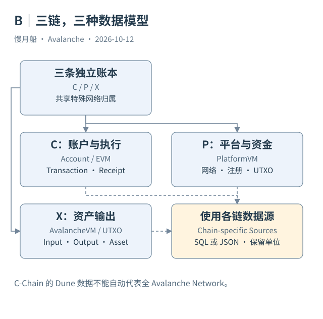

# 01｜同样是 AVAX，为什么还要换一条链？

你在钱包里看到十个 AVAX，想拿出五个参与质押。打开质押页面，却被要求先把钱移到 P-Chain。钱包没有换，币名也没有换，为什么还需要转移？问题出在余额的位置：刚才看到的是 C-Chain 的账户余额，质押操作读取的却是 P-Chain 的资金记录。

## 币名没有告诉你账本在哪里

Avalanche 是区块链网络（Blockchain Network）。主网里有负责不同工作的区块链（Blockchain），每条链维护自己的状态、接受自己的交易。C-Chain 运行智能合约，P-Chain 记录平台操作与验证者信息，X-Chain 处理其资产模型中的输入和输出。三者之间有协议定义的资产转移方式，但余额不会因为钱包由同一把密钥控制就自动合并。

可以把钱包理解成一个能够使用多个账本的工具。界面为了方便，把不同位置的钱放在一起展示；底层规则仍然分别记账。在 C-Chain 成功发送一笔交易，不能直接证明 P-Chain 收到了一笔可质押资金。要完成从 C 到 P 的移动，需要观察源链导出与目标链导入，再核对导入后资金的状态。

五个 AVAX 只是教学金额，实际操作还必须为适用的费用留出空间。本篇不发起任何转移。后文采用已发生的主网记录，说明为什么导出数量、目标链收到的数量以及最终被锁定的质押数量可能不同。把不同阶段的金额机械写成相等，会掩盖费用与其他输入。

## 先问链，再问交易

面对一条“转账成功”的通知，分析师首先需要问：在哪个网络、哪条区块链，哪一种交易？主网（Mainnet）、Fuji 测试网和本地网络中的 AVAX 不处在同一个经济环境。即使交易编号长得相似，也不能放进同一组主网统计。

C-Chain 中常见的交易哈希是以 `0x` 开头的十六进制字符串；P/X 交易常用 CB58 文本编号。形式区别可以帮助识别，但不能替代来源。一个应用完全可以用不同编码展示同一组字节，所以可靠身份应包含网络、区块链和规范化后的交易标识。

余额也要带位置。C-Chain 的余额属于账户状态，P/X 的可用资金与未花费输出有关，已锁定的质押又有自己的条件。在途资金可能已经从源链扣除，却还未进入目标链的普通可用集合。这不是钱包丢钱的充分证据，而是需要查证的中间阶段。

## 数据问题从这里开始

在 Dune 查询 `avalanche_c.transactions`，得到的是 C-Chain 被索引的 EVM 交易。它不自动覆盖 P-Chain 的委托，也不自动覆盖 X-Chain 的资产转移。标题写“全 Avalanche 活跃用户”，查询却只读取这张表，会在第一步就扩大结论。

本篇把同一个问题走三遍：运行时谁做什么，数据里留下什么，再把两者连接起来。到最后，读者应能区分“已经创建记录”“节点正在验证”“链正在出块”和“目标业务完成”。钱包里的十个 AVAX，是进入这张网络地图的起点。

例如同一钱包界面先显示 C 余额，再显示 P 可用资金时，两次显示读取了不同模型。调查应保存各自查询时间，而不是把两张截图的数值变化认作一次链上操作。只有找到具体交易与资金对象，才能把界面提示落实成记录关系。

图中的箭头按标注表示运行步骤或证据关联；图形是教学模型，实际响应另见案例档案。

[编辑此图](../../assets/diagrams/three-models.drawio)。

资料与核对依据：[primary-network](https://build.avax.network/docs/primary-network.md)；[p-rpc](https://build.avax.network/docs/rpcs/p-chain.md)；[dune-overview](https://docs.dune.com/data-catalog/evm/avalanche/overview.md)。协议基准日为 2026-10-12；案例时间以原始记录为准。

[上一章](../00-preface.md) · [本篇目录](../../SUMMARY.md) · [下一章](02-network-and-primary.md)
