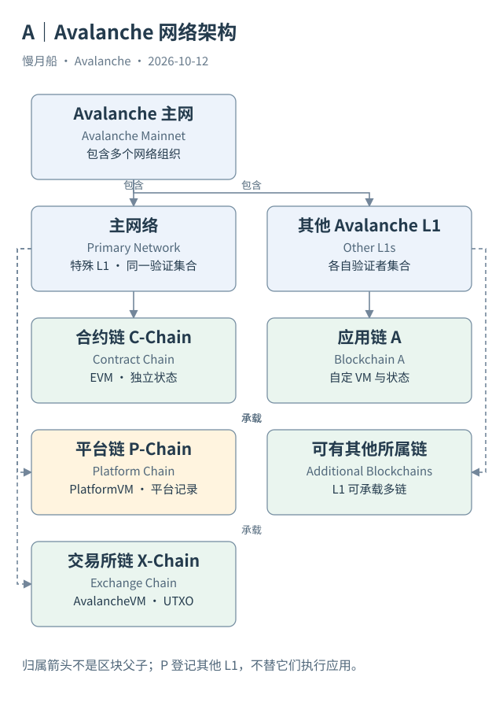

# 02｜Primary Network 是整个 Avalanche 吗？

一个浏览器主页同时列出 C-Chain、Beam 和 Dexalot。它们都属于 Avalanche，但为什么有的共用 AVAX，有的支付自己的代币？回答之前，需要先分清网络边界与链边界。Avalanche Mainnet 包括 Primary Network 以及部署在该网络中的其他 Avalanche L1。

## 三条链组成的特殊网络

Primary Network 是特殊的 Avalanche L1，承载 C、P、X 三条链。它的验证者共同承担三链验证职责，但三条链没有因此成为同一条账本。共同验证者集合（Validator Set）描述谁参与接受决定；不同状态与交易规则描述各自维护什么。这是两个不同维度。

P-Chain 会记录其他网络的创建与验证者相关信息。这个平台职责容易造成一种视觉错觉：把所有 L1 都画在 P-Chain 下面，像普通智能合约。实际运行中，一条 L1 区块链拥有自己的链历史与状态，应用交易不需要作为 P-Chain 合约调用逐笔执行。

一台 AvalancheGo 节点可以处理多个链实例。共享进程、网络连接或存储设施，不会把这些实例的状态合并。读者看到同一个服务地址提供不同 API 路径，应理解为服务可以路由到不同链，而不是所有请求进入同一个执行器。

## 一个 L1 可以承载多条区块链

官方当前定义允许一个 Avalanche L1 验证一条或多条区块链；每条区块链归属于一个 L1。因此，L1 和 Blockchain 不能无条件一一对应。多数应用网络只有一条 EVM 链，使两个名字在日常交流里常被混用；数据库设计仍应保留这层关系。

同一 L1 的多条区块链可以选择不同虚拟机（Virtual Machine，VM）。验证者集合提供网络组织，VM 定义具体状态转换。Primary Network 正好是读者可以直接观察的例子：三链分工不同，却属于同一个特殊 L1。架构图应以包围关系表示归属，不应把 P-Chain 画成另外两条链的父区块。

Etna 之后，采用现代 L1 机制的验证者可以只验证自己的 L1，并同步 P-Chain，以取得相关验证者信息。同步 P-Chain 不等于承担 Primary Network 三链的验证职责。旧式 Subnet 的约束和独立 L1 的约束，需要按历史版本分开判断。

## 网络目录与运行证据

一个目录收录了某条链，只能说明这个来源知道这条链。P-Chain 创建记录能证明对象曾被创建；最近区块能证明某个时间位置有链活动；当前注册信息能说明验证者集合的一部分状态。没有任何一项能够单独概括“运行健康”。

作者既有 Network Dashboard 使用社区上传目录，把条目关联到验证者观测。其字段可帮助找候选网络，但覆盖依赖上传者采集与刷新。它不能凭“链名存在”证明所有链都公开运行，也不能凭缺少验证者行判定链已经死亡。

阅读网络地图时，先确定方框表示网络、区块链还是服务，再确定线表示归属、消息还是证据关联。这样才不会把“互相通信”误读成“共享执行”，也不会把“平台登记”误读成“平台替它提供全部安全性”。

读网络架构还可以检查一个反例：如果某个应用 L1 暂停，Primary Network 的三链记录不会因此自动停止。它们可能存在通信或登记关系，却不是同一个状态机。故障影响范围需要运行证据，不能只根据组织图中的距离推断。

图中的箭头按标注表示运行步骤或证据关联；图形是教学模型，实际响应另见案例档案。

[编辑此图](../../assets/diagrams/network-overview.drawio)。

资料与核对依据：[primary-network](https://build.avax.network/docs/primary-network.md)；[l1s](https://build.avax.network/docs/avalanche-l1s.md)；[acp-77](https://raw.githubusercontent.com/avalanche-foundation/ACPs/main/ACPs/77-reinventing-subnets/README.md)。协议基准日为 2026-10-12；案例时间以原始记录为准。

[上一章](01-one-wallet-many-ledgers.md) · [本篇目录](../../SUMMARY.md) · [下一章](03-identities.md)
