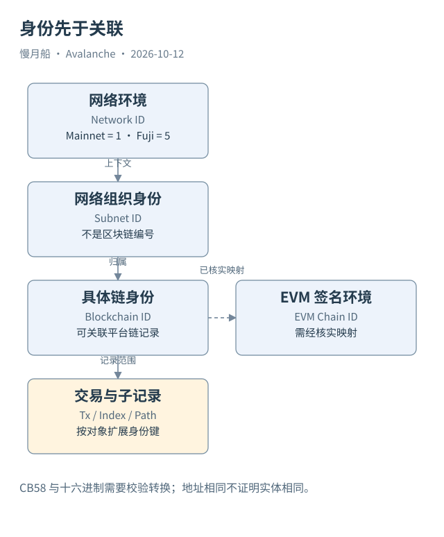

# 03｜三个 Chain ID，究竟哪个能用来关联数据？

钱包配置里的 C-Chain ID 是 `43114`，链浏览器却展示另一串很长的编号。两者都可能被称为 Chain ID。直接把这个数字与 P-Chain 返回的链编号连接，通常会得到空结果，因为它们指向的命名空间不同。

## 编号先有对象，后有表示

网络编号（Network ID）区分 Avalanche Mainnet、Fuji 与其他网络。本轮官方 `info.getNetworkID` 返回主网编号 `1`。区块链编号（Blockchain ID）识别 Avalanche 网络里的具体链；子网编号（Subnet ID）识别网络组织对象。创建链交易通常提供新链的身份来源，Subnet 的创建则是另一项操作。

EVM Chain ID 是 EVM 交易签名环境的一部分，钱包用它配置网络，防止相同签名在不同环境中被直接复用。C-Chain 的主网数字是 `43114`，Fuji 是 `43113`。这些数字不是 P-Chain 的 Blockchain ID，也不是 Subnet ID。分析时应由经过核实的映射表连接它们。

虚拟机编号（VM ID）告诉节点应当使用哪个 VM 实例类型。节点编号（Node ID）识别网络节点身份。验证注册编号（Validation ID）识别 L1 的某次验证注册；同一个节点参与不同网络时，不能把节点身份当成唯一注册主键。

## 相同字节也可能有不同文本

Avalanche 多种编号常以 CB58 展示；合约事件里的 `bytes32` 则常以十六进制展示。可靠规范化需要解码、检查校验字节，并确认二者代表同一种对象。不能仅删除前缀或把字符串转为小写，就声称完成了 CB58 与十六进制转换。

地址也有上下文。C-Chain 使用 EVM 地址；P/X 地址带有网络和链相关的呈现形式，底层控制与多签条件还要查具体输出。两条 EVM 链上出现同一个地址，不自动说明是同一个业务实体，更不能仅凭字符串相同确认跨链资产归属。

本篇附录保存直接获取的三链 Blockchain ID、Beam 的 Subnet 与 Blockchain 映射。它们来自本轮官方 RPC 和 Data API，而非凭记忆填写。映射有来源与时间位置；新增网络时，应添加证据，再使用它参与关联。

## 让关联条件成为可检查的声明

一个稳妥的交易键至少包含 `network_id + blockchain_id + tx_id`。日志还需事件索引，调用轨迹还需路径，UTXO 还需创建交易及输出序号。只保留一列“hash”，会在合并不同链和不同对象时失去辨别能力。

对于时间变化的验证者集合，身份键还不够。某个节点在今天的权重，不能替代消息被验证时 P-Chain 高度对应的权重。历史关联需附上有效区间或高度位置。统一身份的目的不是把所有编号压成一列，而是保留能解释每次连接的语义。

当一次 Join 没有匹配，先检查网络、对象类型和编码，再检查覆盖。空匹配可能来自映射缺失，也可能来自索引没有收录；它不能直接证明链不存在。知道哪个编号回答哪个问题，才能安全地把多链数据放在一起。

复查 Case 06 时，可以先用 Blockchain ID 找到 P-Chain 创建交易，再读取 Genesis 中的数字 Chain ID，最后检查 RPC 返回。三步得到相容结果后，映射才具备可引用依据。链名只帮助检索，不能替代任何一步的身份校验。

图中的箭头按标注表示运行步骤或证据关联；图形是教学模型，实际响应另见案例档案。

[编辑此图](../../assets/diagrams/identifiers.drawio)。

资料与核对依据：[primary-network](https://build.avax.network/docs/primary-network.md)；[p-rpc](https://build.avax.network/docs/rpcs/p-chain.md)；[x-rpc](https://build.avax.network/docs/rpcs/x-chain.md)；[acp-77](https://raw.githubusercontent.com/avalanche-foundation/ACPs/main/ACPs/77-reinventing-subnets/README.md)。协议基准日为 2026-10-12；案例时间以原始记录为准。

[上一章](02-network-and-primary.md) · [本篇目录](../../SUMMARY.md) · [下一章](04-three-models.md)
