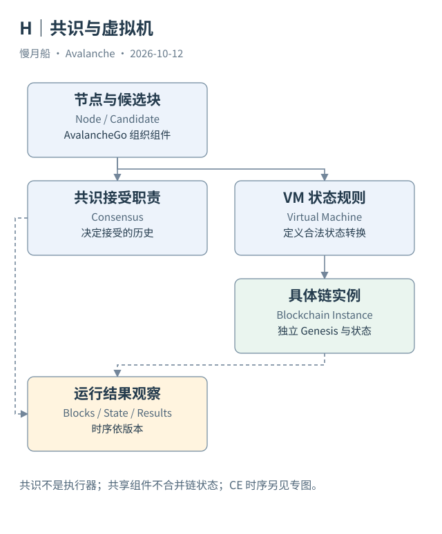
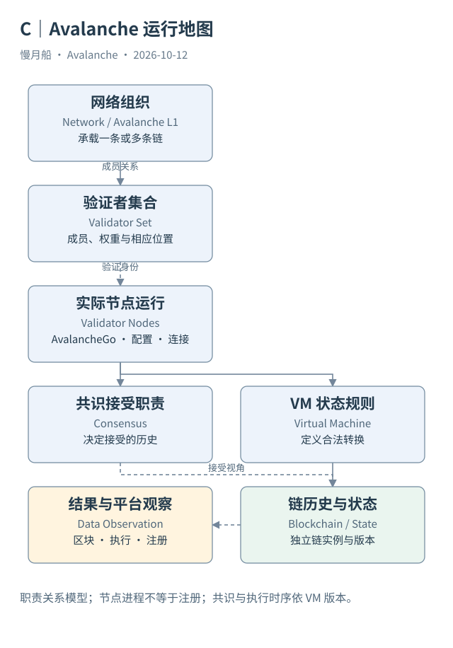

# 05｜谁决定接受，谁决定余额怎样变化？

一笔交易把余额改成了负数，如果许多节点都愿意投票支持它，它就能成为合法交易吗？正常协议不能这样运作。决定接受哪一个候选区块，与定义合法状态转换，是相互配合但不相同的职责。

## 一套规则解释操作

虚拟机（Virtual Machine，VM）定义链上的状态与操作规则。这里的 VM 不必是执行 Solidity 的 EVM。PlatformVM 可以解释创建网络与注册验证者；AvalancheVM 可以解释资产输入和输出；自定义 VM 可以维护完全不同的应用状态。每种链的合法性都需要对应规则来判断。

VM 负责检查输入是否符合规则，并按照规定推进状态。对于传统同步执行模型，节点执行候选区块，检查结果，再参与接受决定。错误签名、重复消费或非法状态转换不能凭共识投票变合法。对于 Continuous Execution，部分检查与完整执行的时序改变，协议仍需要足够的有效性条件来约束候选块。

共识（Consensus）则解决网络中节点可能看到不同候选历史时，如何收敛到一致接受决定。它不是一个“计算余额”的 SQL 引擎。两条链可以使用相关的共识家族，却采用不同状态模型；理解其中一条链的 EVM Logs，并不会让另一条链自动拥有相同事件格式。

## AvalancheGo 把组件组织起来

AvalancheGo 是节点软件，组织网络通信、链实例、共识与 VM 等组件。它不等于某一条链，也不等于一个验证者集合。一台机器可以运行节点，节点可以跟随不同链；成为哪一个集合的验证者，还取决于相应网络登记与管理规则。

VM ID 帮助节点选择执行规则，Blockchain ID 帮助选择具体链实例。使用同一种 VM 的两条链，仍有不同 Genesis、状态、历史与验证者关系。它们可能都接受 EVM 交易，但不会因此共用一个账户余额，也不会共享所有合约。

观察运行时，要分别检查软件版本、链配置、同步位置与验证身份。观察数据时，要分别查看链交易、状态变化、接受位置和平台登记。单个节点返回 RPC 数据，通常只证明该服务能够提供某种链视图，不足以证明它就是有效验证者。

## 数据里能看到什么

区块与交易历史能够提供接受后的账本内容，收据与状态接口能够提供执行结果。网络抽样过程通常不会逐轮写进普通交易表。分析师不能从 C-Chain 交易数量推导每轮参与投票的节点数，也不能把一个 RPC 响应速度当作全网共识延迟。

因此本篇的运行图把“候选与接受”与“状态转换”分为两种职责，并标明在具体版本下如何连接。图中的框是职责，不保证对应两个独立进程。下一章会介绍线性链怎样通过重复抽样形成接受决定；再下一章则解释为什么旧教程对执行顺序的描述已经不足以覆盖当前 C-Chain。

研究者可以用一个问题检查分工是否讲清：相同交易字节送进不同 VM，为什么可能只有一侧合法？因为每种 VM 解释请求与状态的规则不同。共识组件必须配合对应有效性条件，不能将不同链的接受决定互相替代。

图中的箭头按标注表示运行步骤或证据关联；图形是教学模型，实际响应另见案例档案。

[编辑此图](../../assets/diagrams/consensus-vm.drawio)。

完整运行总图把网络归属、验证身份、实际节点、共识与状态转换连接起来。这里展示职责关系，不承诺所有版本使用同一执行时序。

[编辑运行总图](../../assets/diagrams/runtime-map.drawio)。

资料与核对依据：[virtual-machines](https://build.avax.network/docs/primary-network/virtual-machines.md)；[consensus](https://build.avax.network/docs/primary-network/avalanche-consensus.md)；[continuous-execution](https://build.avax.network/docs/nodes/architecture/execution/continuous-execution.md)。协议基准日为 2026-10-12；案例时间以原始记录为准。

[上一章](../part-01/04-three-models.md) · [本篇目录](../../SUMMARY.md) · [下一章](06-snowman.md)
