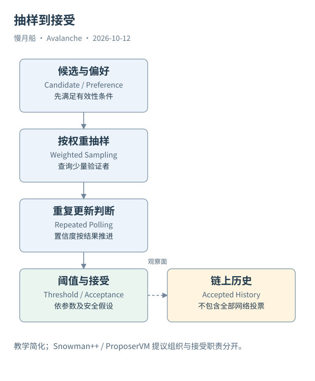

# 06｜抽样投票为什么能形成最终接受？

如果一次只询问少量验证者，节点怎么知道整个网络已经同意？关键是它不会只问一次，也不会把任意几个回复当成最终证明。重复抽样、权重、阈值和持续置信度共同约束决定。

## 从偏好到接受

Avalanche 共识家族以重复抽样为重要思想。节点向抽样得到的验证者询问偏好，收到满足条件的回复后更新自身判断。足够多的连续成功轮次会增强对某个候选的置信度；偏好变化或轮次失败则按算法重置相关计数。这是有参数与假设的协议过程，不是简单多数意见调查。

线性区块链使用 Snowman，把这种思想应用到有父子关系的区块历史。对后续区块的偏好也能支持其祖先，形成传递投票关系。实际 AvalancheGo 实现区分偏好与置信度条件，分析时不能把白皮书中的简化颜色例子当成所有代码版本的完整状态机。

抽样与验证者权重有关。一个 Node ID 出现一次，不代表获得与其他所有节点相同的决策影响。L1 如何定义权重需要核对自己的管理规则；Primary Network 的质押权重则有相应单位与适用条件。把“节点数量”称为“权重分布”，会在数据层替换协议真正使用的对象。

## Snowman++ 改变提议组织

Snowman++ 与 ProposerVM 引入提议者相关的组织方式，改善区块提议过程。它不是新的合约虚拟机，也不应与 Snowman 接受算法或 EVM 执行规则混为一谈。对读者而言，重要的是提议机会、候选合法性、最终接受分别有自己的条件。

过去 X-Chain 使用 DAG 结构，这使历史资料常将它与经典 Avalanche DAG 共识放在一起。Cortina 主网升级在 2023 年 4 月 25 日线性化 X-Chain。研究当代 X-Chain 区块，应按线性链解释；研究升级前历史，则保留 vertex 等旧结构，不能把旧图当成今天三链的统一运行图。

## 最终性也有适用语境

协议的安全结论依赖参数、权重集合和网络条件。最终性（Finality）可以表达正常协议下已接受决定的稳定性，但不应扩写成服务器永不宕机、应用永不失败或任何消息马上送达。共识最终接受不会替目标应用完成另一条链上的业务。

Helicon 之后还要区分 C-Chain 的接受与执行。区块已经被接受进入执行队列，不能仅凭这个阶段就说收据已经可用。执行完成后的交易效果与后续结果承诺，也不是同一个观察时点。这些差异将直接影响索引器取数和用户状态提示。

抽样协议的价值在于用有限的通信逐渐形成稳定判断。普通链上数据研究通常观察决定留下的区块，而不是重放所有投票。能够明确这个边界，就可以解释一笔交易已被接纳，同时坦诚说明没有取得验证者逐轮投票的原始网络证据。

观察一个小型 L1 时，也不要因为验证者集合很小就直接推断具体攻击结果。权重、配置、故障相关性和网络条件都影响安全分析。链上节点清单可以提供输入，不能单独代替完整的共识安全评估。

图中的箭头按标注表示运行步骤或证据关联；图形是教学模型，实际响应另见案例档案。

[编辑此图](../../assets/diagrams/snowman.drawio)。

资料与核对依据：[consensus](https://build.avax.network/docs/primary-network/avalanche-consensus.md)；[cortina-release](https://api.github.com/repos/ava-labs/avalanchego/releases/tags/v1.10.0)；[virtual-machines](https://build.avax.network/docs/primary-network/virtual-machines.md)。协议基准日为 2026-10-12；案例时间以原始记录为准。

[上一章](05-consensus-and-vm.md) · [本篇目录](../../SUMMARY.md) · [下一章](07-helicon.md)
