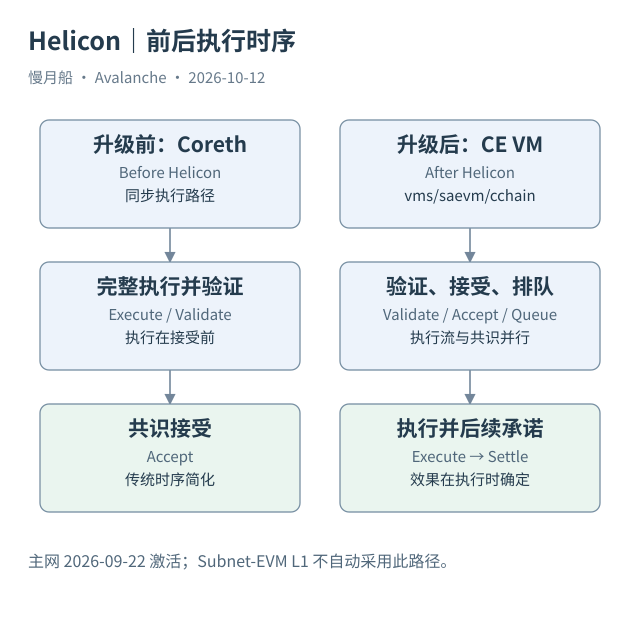

# 07｜Helicon 为什么让接受和执行分开？

一个索引器发现新区块已被接受，却暂时拿不到完整执行结果。它应该立即判定节点故障吗？在 2026 年 9 月 22 日主网 Helicon 激活后的 C-Chain 上，首先需要检查自己是否仍沿用旧式同步执行假设。

## 旧顺序与新队列

Helicon 之前，C-Chain 的历史区块由 Coreth 执行。同步路径把完整执行与共识接受紧密联系：执行工作可能增加接受路径的等待。Helicon 的 ACP-194 引入持续执行（Continuous Execution），把接受后的候选组织为受限制的执行队列，并让执行流与共识工作并行推进。

新区块仍需通过验证，包括对交易支付能力等条件的检查。轻量验证并不执行全部合约，也不保证应用不会 revert。共识接受后，区块进入先进先出的执行队列；执行器按顺序处理，得到状态与收据等结果；后续区块再记录满足协议条件的结果承诺。

官方实现位于 AvalancheGo 的 `vms/saevm`，C-Chain VM 位于 `vms/saevm/cchain`。旧 Coreth 文档仍有历史价值，但不能把它描述成截至本篇基准日唯一现行 C-Chain 引擎。这里的变化涉及执行时序与结果承诺，不意味着 Solidity 应用都换成了一种非 EVM 程序。

## 三个阶段回答三个问题

接受（Accepted）回答候选顺序是否进入已接受历史；执行（Executed）回答具体操作产生了哪些效果；结算承诺（Settled）回答执行结果何时被后续区块记录。已接受不等于目标业务成功，执行时仍可发生业务失败。效果在执行时确定，不能把后续承诺阶段写成所有效果才第一次生效。

数据分析的影响尤其具体。区块头中的 `stateRoot`、`receiptsRoot`、`logsBloom`、`gasUsed` 等字段需要按 ACP-194 解释，不能默认都是当前收录交易的同步结果。链上结果承诺、RPC 兼容展示和 Dune 标准化表，属于不同的数据层。

本篇已经核对协议说明，但尚未对 Helicon 后 Dune 的每一种结果字段进行逐笔 RPC 对账。因此后文的新 SQL 标为静态检查，不能称为已经验证了升级后的索引语义。研究者可以使用原始收据和特定版本适配器缩小这个缺口。

## 适用范围与其他变化

官方文档明确 Continuous Execution 当前运行于 C-Chain，Subnet-EVM L1 仍采用同步执行。Fuji 在 2026 年 7 月 28 日先激活，不能把这个测试网时间写成主网生效日期。自定义网络的激活还需看软件与 Genesis 配置。

Helicon 同时包含 P-Chain 自动续期质押、验证者奖励在线率条件和最短期限等变化。它不是一个只影响“速度”的升级。书稿后面的质押章节按新规则解释，旧样本则按交易发生时版本处理。最重要的观察习惯是：先给记录确定版本，再给字段解释含义。

实际索引器迁移可以先保存一组升级前与升级后的交易及收据，对照版本验证字段，再扩大统计窗口。今天的协议说明已经明确变化，仍不能替代每个下游数仓的适配证明。把协议事实与索引验证分开，能使历史图表更新有据可查。

图中的箭头按标注表示运行步骤或证据关联；图形是教学模型，实际响应另见案例档案。

[编辑此图](../../assets/diagrams/helicon.drawio)。

资料与核对依据：[helicon](https://build.avax.network/docs/primary-network/helicon-upgrade.md)；[continuous-execution](https://build.avax.network/docs/nodes/architecture/execution/continuous-execution.md)；[acp-194](https://raw.githubusercontent.com/avalanche-foundation/ACPs/main/ACPs/194-continuous-execution/README.md)；[release-1.15.0](https://api.github.com/repos/ava-labs/avalanchego/releases/tags/v1.15.0)。协议基准日为 2026-10-12；案例时间以原始记录为准。

[上一章](06-snowman.md) · [本篇目录](../../SUMMARY.md) · [下一章](08-execution-artifacts.md)
