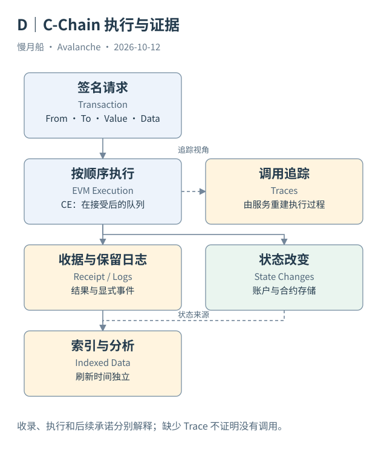

# 08｜区块、收据和状态为什么不总是同时出现？

浏览器显示交易已进入区块，钱包还在等待结果，数据仓库又稍晚才出现一行记录。三者不一致并不自动说明某一方造假。它们观察的是不同阶段，也可能使用不同索引刷新策略。

## 请求与结果不能混用

交易（Transaction）是发起者提交的请求。收据（Receipt）记录执行结果与计费等信息；日志（Logs）是合约主动发出的保留事件；调用轨迹（Traces）是节点或索引服务重建的执行过程。账户与合约存储则组成状态（State）。它们共享交易定位，但不是同一种记录。

一个请求可以调用许多合约，产生多条日志，也可以执行失败。失败请求仍可能被收录并支付费用。`to` 为某个路由器，不代表最终资金只到了路由器；收据成功，也不代表所有业务目标都按用户预期实现。合同式业务判断需要进一步核对日志和状态。

追踪记录并不是用户再次签名的“内部交易”。它描述执行中发生的调用与创建。公开 RPC 可能不开放追踪，或只保留有限历史；缺少轨迹是取证能力边界，不能因此写出“没有内部调用”的确定结论。Dune 的 traces 也要按其来源与成败字段解释。

## 新执行时序要求新的时间标签

Continuous Execution 使共识接受、执行和后续承诺有独立时点。服务可以先知道已接受区块，再取得其收据。RPC 返回的兼容 EVM 区块视图还可能经过节点适配；原始共识结构中的承诺语义，不能未经核对就套进旧 EVM 直觉。

索引器在这些阶段之后还需要抽取、解析与入库。Dune `block_time` 通常表达所属区块时间，不能当成“这行何时进入 Dune”的时间。API 的 `retrieved_at` 则是本次获取时间。把历史区块时间与当天检索时间混在一起，容易把旧结果误当成实时结果。

主网样本中有 Helicon 前的 Dune 执行，也有本轮取得的升级后官方 Data API 响应。本篇保留二者日期，不用旧 SQL 已成功执行来证明新协议字段已完全对齐。跨版本比较要说明指标定义是否受到计费与字段变化影响。

## 以业务问题决定证据

如果只问交易有没有被处理，收据状态和区块定位很有用。如果问某个 ERC-20 是否到账，还要核对相应合约事件与余额。若问跨链业务是否完成，需要目标链证据；源链成功收据只解决源侧执行问题。

状态查询也需指定位置。区块末余额包含该区块多笔交易的共同影响，不一定能隔离某一笔交易。今天的余额还混入后续活动。没有适当历史状态或状态差分时，分析结论应止于已取得的执行记录。

完整的数据地图因而是一组互相校验的分支，而不是一条“交易成功后生成所有数据”的流水线。后续章节会把这些分支对应到 Dune 表，并解释怎样避免把多条日志和多条轨迹连接成虚假的多倍交易量。

数据归档中同时保留 block timestamp 与 retrieval timestamp，可以解释数仓延迟。后者只描述取数时刻，并不是交易执行时间。对外展示一个日期时，需要说明是业务发生日期还是样本采集日期，避免历史执行被误认作新活动。

图中的箭头按标注表示运行步骤或证据关联；图形是教学模型，实际响应另见案例档案。

[编辑此图](../../assets/diagrams/c-execution.drawio)。

资料与核对依据：[c-rpc](https://build.avax.network/docs/rpcs/c-chain.md)；[dune-transactions](https://docs.dune.com/data-catalog/evm/avalanche/raw/transactions.md)；[dune-logs](https://docs.dune.com/data-catalog/evm/avalanche/raw/logs.md)；[dune-traces](https://docs.dune.com/data-catalog/evm/avalanche/raw/traces.md)；[acp-194](https://raw.githubusercontent.com/avalanche-foundation/ACPs/main/ACPs/194-continuous-execution/README.md)。协议基准日为 2026-10-12；案例时间以原始记录为准。

[上一章](07-helicon.md) · [本篇目录](../../SUMMARY.md) · [下一章](../part-03/09-c-transfer.md)
