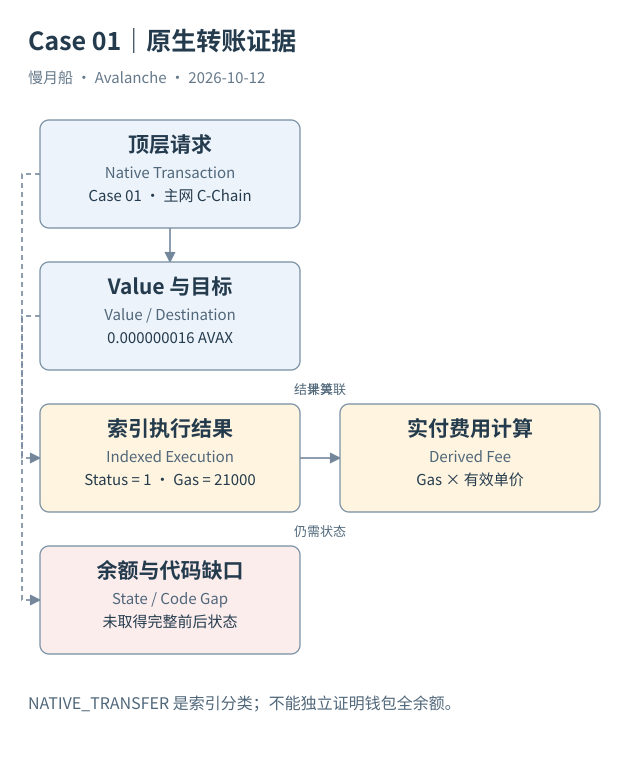

# 09｜一笔普通 AVAX 转账在 C-Chain 留下什么？

收款人看见 AVAX 到账，分析师却需要找到这笔变化对应的请求、结果和时间位置。普通原生币转账提供了最短路径：先找交易，再找执行结果，最后限定能够得出的结论。

## 从顶层请求开始

C-Chain 的原生币是 AVAX，EVM 交易中的 `value` 表示请求转移的原生币数量。原始整数按十八位小数换算为显示数量。发送者 `from`、目标 `to`、Nonce、输入字节与交易哈希组成分析入口。输入为空且目标没有代码时，通常可以按直接原生币转账理解。

但“通常”不应代替证据。目标可能是有代码的账户，空输入仍可能触发合约逻辑。官方 Data API 的 `NATIVE_TRANSFER` 标签可以帮助筛选，它是索引器分类，不是状态差分。本篇 Case 01 保存标签、交易定位和原始详情，同时说明哪些代码与余额查询尚未取得。

这笔主网样本的哈希为 `0x566b431b5c10e7c52022943dce0a4aa724cad760eb18de696665ae869fc852d7`，来自本轮官方 Data API。样本中的 `value` 为 `16000000000`，显示为 `0.000000016 AVAX`。金额很小并不会让它变成测试数据；它是否主网交易由网络与链身份决定。

## 收录与计费分开解释

样本记录给出所属区块、区块时间与成功状态。交易消耗的计费 Gas 和有效单价决定执行费，费用不是 `value` 的一部分。不要用“收款金额减去手续费”解释所有交易：常见直接支付语境中，发送者另付执行费，目标接收请求的原生币数量。

同一交易在 Dune 通常可以通过 `avalanche_c.transactions.hash` 回查，但本篇的新 SQL 尚未运行。SQL 文件只演示按已核实字段筛选，不声称已看到该哈希的 Dune 行。RPC、索引 API 与数仓记录能够交叉检查，前提是都确实取得数据。

分析时应保留原始整数，用精确计算做对账，再转换为方便阅读的小数。展示层使用浮点数可以方便绘图，但不要把经过四舍五入的数量重新当成原始转账金额。按 AVAX 单位显示与按美元估值，更是不同计算。

## 余额结论需要额外材料

一笔成功交易能够说明请求被相应执行路径处理；它不能单独提供钱包全部历史或当时最终余额。区块末余额还包含同块其他交易。没有前后状态查询时，本篇不把样本拓展成完整的钱包对账结果。

这个区别同样适用于用户身份。发送地址是一项链上身份，不能自动变成一个现实用户。归集服务、自动化程序与同一实体多个地址都会改变“活跃用户”的含义。因此示例 SQL 使用“发送地址数”这样的名称。

最简单的转账已经包含网络、链、交易、执行、费用和状态六层信息。后面合约案例会增加调用和事件分支；保持这条主干，才不会因为图上出现更多箭头就把一次签名请求误数成许多用户交易。

按样本索引字段计算，这笔执行费为 `21000 × 6300000000 / 10^18 = 0.0001323 AVAX`。这是显式计算结果，远大于本次请求 value 也并不矛盾。本篇未取得发送者全余额，不能以这两个数恢复钱包资产。

实际响应节选如下；这是索引 API 或 RPC 返回字段的节选，不是构造样本。完整请求与响应见 [c-native-detail](../../research/raw/c-native-detail.json)。

```json
{
  "txHash": "0x566b431b5c10e7c52022943dce0a4aa724cad760eb18de696665ae869fc852d7",
  "blockNumber": "97355822",
  "value": "16000000000",
  "gasUsed": "21000",
  "gasPrice": "6300000000"
}
```

图中的箭头按标注表示运行步骤或证据关联；图形是教学模型，实际响应另见案例档案。



[编辑此图](../../assets/diagrams/c-transfer.drawio)。

[本章可用的 DuneSQL 与边界](../../examples/sql/README.md)。新 SQL 未执行。

[真实案例与字段缺口](../../examples/transactions/README.md) · [实际 API 请求/响应](../../examples/rpc/README.md)。

资料与核对依据：[c-rpc](https://build.avax.network/docs/rpcs/c-chain.md)；[dune-transactions](https://docs.dune.com/data-catalog/evm/avalanche/raw/transactions.md)；[api-evm-transactions](https://build.avax.network/docs/api-reference/data-api/evm-transactions/listLatestTransactions.md)。协议基准日为 2026-10-12；案例时间以原始记录为准。

[上一章](../part-02/08-execution-artifacts.md) · [本篇目录](../../SUMMARY.md) · [下一章](10-tokens-and-logs.md)
