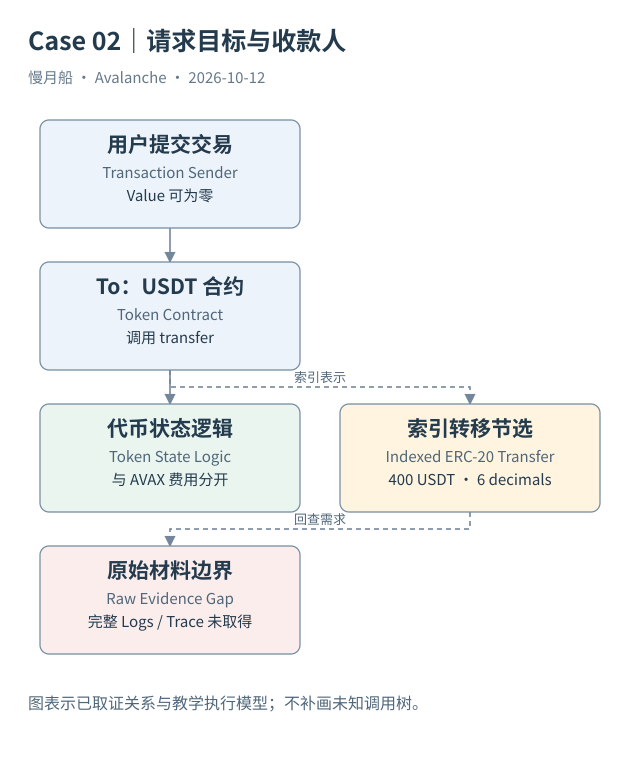

# 10｜转了 USDT，为什么交易的 To 是合约？

钱包说你给朋友转了一笔 USDT，交易详情却显示目标是 TetherToken 合约。两者并不矛盾。顶层目标表示程序在哪里执行，代币收款人则藏在调用参数及执行留下的事件中。

## 原生余额与代币余额

AVAX 余额属于 EVM 账户状态；ERC-20 余额由代币合约按照自己的存储与规则维护。调用 `transfer` 时，用户请求合约修改地址对应的余额。交易 `value` 可以为零，仍然发生有意义的代币转移。手续费则通常仍以 C-Chain 原生 AVAX 支付。

本篇 Case 02 从官方 Data API 取得真实主网交互，哈希为 `0x017c257f6fd9abff097e0740e27422d19e1e0ad7c8973e247827495f847b3242`。顶层目标是 `0x9702230a8ea53601f5cd2dc00fdbc13d4df4a8c7`，输入选择器为 `0xa9059cbb`。索引器将目标标为 USDT，完整结论还要结合该版本接口与保留的转移记录。

函数选择器只有四个字节，能够帮助识别调用，但不能凭选择器单独证明任意合约就是标准 ERC-20。ABI（Application Binary Interface）定义字节如何解释；合约实现决定实际业务。升级代理还需要匹配历史时间位置的接口与实现。

## Logs 与 Traces 回答不同问题

标准 ERC-20 `Transfer` 事件包含发送者、接收者与原始数量。原始日志记录发出地址、Topics、Data 和事件索引；解码表把其中的字节变成参数列。事件发出地址是合约执行上下文，不能当成事件参数中的资金发送者。

调用轨迹可以展示路由器、池、代币之间的执行路径。它不是另一份用户交易，也不是一份万能资金表。`STATICCALL` 可能只是读取余额；失败的调用与失败祖先也会影响哪些变化最终保留。没有取得完整轨迹时，不能补画不存在的调用树。

ERC-721 的转移也能采用同名 `Transfer` 事件，但 Token ID 与可替代数量的含义不同。ERC-1155 又有单笔与批量记录。统计之前需识别标准与参数布局，不能把所有事件第三个整数相加为“代币总金额”。

## 从事件到经济解释

一个 Swap 往往产生多次资产移动。将所有 Transfer 数量视为成交量，会把中间路径重复累计；按代币单位直接求和还会混合不同资产。DEX 的 Curated 数据尝试按模型提取成交段，但模型覆盖与多跳粒度仍需解释。

授权 `approve` 改变可使用额度，不等于资产已经转走。包装 AVAX 的 Deposit、Withdrawal 与标准 Transfer 也有不同语义。分析师要保留事件类型与来源，不把所有代币动作都转换成单一付款概念。

在本篇，真实样本用于检查顶层目标与转移记录之间的关系，SQL 示例用于说明怎样按日志键回查。未取得的原始调用树和余额变化保留为缺口。看懂 USDT 合约地址为什么是 To，才真正开始理解“请求目标”和“业务收款人”的区别。

保存的索引详情给出 logIndex 为零的 USDT 转移，原始数量 `400000000`、decimals 为六，对应四百 USDT。这里取得的是官方索引表示，尚未取得原始日志字节和完整调用树。转账金额可以读出，执行内部路径不能凭空补齐。

实际响应节选如下；这是索引 API 或 RPC 返回字段的节选，不是构造样本。完整请求与响应见 [c-erc20-detail](../../research/raw/c-erc20-detail.json)。

```json
[
  {
    "from": {
      "address": "0x03555bDb03B5c0176dB7bFBA4B6462C680536204"
    },
    "to": {
      "address": "0x76E2951857A3c682B07C6fDF10743F3F442fB221"
    },
    "logIndex": 0,
    "value": "400000000",
    "erc20Token": {
      "ercType": "ERC-20",
      "address": "0x9702230A8Ea53601f5cD2dc00fDBc13d4dF4A8c7",
      "name": "TetherToken",
      "symbol": "USDT",
      "decimals": 6,
      "logoUri": "https://images.ctfassets.net/gcj8jwzm6086/1BBNU6BTJz7A38puMbeyHW/cd805bc934bf8981163c6ce928769273/USDT-logo.svg",
      "price": {
        "value": 0.999317,
        "currencyCode": "usd"
      }
    }
  }
]
```

图中的箭头按标注表示运行步骤或证据关联；图形是教学模型，实际响应另见案例档案。



[编辑此图](../../assets/diagrams/token-logs.drawio)。

[本章可用的 DuneSQL 与边界](../../examples/sql/README.md)。新 SQL 未执行。

[真实案例与字段缺口](../../examples/transactions/README.md) · [实际 API 请求/响应](../../examples/rpc/README.md)。

资料与核对依据：[dune-logs](https://docs.dune.com/data-catalog/evm/avalanche/raw/logs.md)；[dune-traces](https://docs.dune.com/data-catalog/evm/avalanche/raw/traces.md)；[api-evm-transactions](https://build.avax.network/docs/api-reference/data-api/evm-transactions/listLatestTransactions.md)。协议基准日为 2026-10-12；案例时间以原始记录为准。

[上一章](09-c-transfer.md) · [本篇目录](../../SUMMARY.md) · [下一章](11-fees.md)
