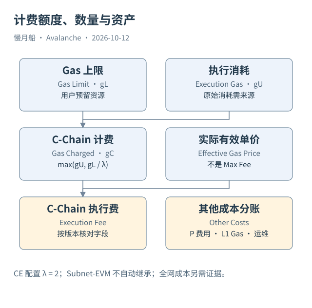

# 11｜Gas Limit 为什么也会影响实际计费？

用户把 Gas Limit 设置得很高，希望避免交易失败。旧经验认为只为真正执行消耗付费，多留额度没有额外成本。Helicon 后的 C-Chain 不宜继续无条件使用这条经验。

## 额度、消耗与计费数量

Gas Limit 是交易允许使用的资源上限，实际执行使用量表示运行消耗，计费 Gas 则表示协议最终收费的数量。ACP-194 定义 `g_C = max(g_U, g_L / λ)`：计费数量至少受到上限与参数 λ 的约束。C-Chain 配置的 λ 为 2，具体整数计算以实现为准。

因此，某笔交易实际只使用很少资源，也可能因为预留的额度较大而承担较高计费数量。本轮官方 Data API 样本中可以观察到 Gas Limit 为 `500000`、展示 `gasUsed` 为 `250000` 的记录。这与最低计费约束相容，但没有独立取得原始执行消耗，不能把相容性写成已经逐条重算证明。

实际费用需要计费数量与实际单价。动态费用交易的 Max Fee 是用户愿意支付的上界，不能直接乘以 Gas Limit 当作实付。接口中的 `gasUsed` 和 `gasPrice` 具体表示什么，应对照收据与适配器版本；不同接口同名字段未必处于同一原始层次。

## C-Chain 不照搬 Ethereum 的费用分配

C-Chain 执行费以 AVAX 计价，其费用处理不能直接照搬 Ethereum 的“基础费销毁、优先费支付提议者”教学图。作者既有 C-Chain 费用查询采用观察到的执行计费数量乘单价，并将统计范围限定为该链的执行费用。

这个范围不包含整个 Avalanche Network 的所有费用与发行变化。P-Chain 交易费、L1 验证者连续费用和独立 L1 原生币手续费，是其他机制。总执行费也不是某用户收款金额。标题若写“全网 AVAX 净销毁”，就需要补齐其他销毁与发行来源，而不能只依赖 C-Chain 交易表。

Subnet-EVM L1 可以配置不同费用接收或奖励机制，使用自己的 Gas Token。一个 L1 的计费规则也不自动继承 C-Chain 的 Continuous Execution。比较链之间手续费时，应先统一资产单位和计费含义，再决定是否需要价格转换。

## 统计需要跨版本说明

本篇提供有时间范围的 DuneSQL，保留 `gas_used`、`gas_price` 和计算口径。其字段经过 Catalog 核对，执行状态为 `STATIC_CHECKED`。Helicon 后这些列与实际收据的逐笔对应尚有缺口，不把 SQL 文件存在当成结果验证通过。

费用的日变化还可能受到交易数量、合约路径、参数和新计费规则影响。仅看均值下降不能证明每个用户都更便宜；仅看总额上升不能证明链更拥堵。比较时需记录升级位置、失败交易是否包含以及样本分布。

安全的数据习惯是保留原始单位与来源字段，然后明确计算层的解释。这样当协议改变时，可以重算指标，而不是在一张已经丢失细节的日报里猜测“费用”究竟是什么。

本篇也保留了 Helicon 前的 Dune 样本，方便读者检查历史口径。不能拿过去某日查询已完成来证明今天最低费用、计费数量和结果时间都未改变。跨升级比较时，先标出分界，再决定是否能沿用同一公式解释数值。

图中的箭头按标注表示运行步骤或证据关联；图形是教学模型，实际响应另见案例档案。

[编辑此图](../../assets/diagrams/fees.drawio)。

资料与核对依据：[acp-194](https://raw.githubusercontent.com/avalanche-foundation/ACPs/main/ACPs/194-continuous-execution/README.md)；[continuous-execution](https://build.avax.network/docs/nodes/architecture/execution/continuous-execution.md)；[helicon](https://build.avax.network/docs/primary-network/helicon-upgrade.md)；[dune-transactions](https://docs.dune.com/data-catalog/evm/avalanche/raw/transactions.md)；[l1-config](https://build.avax.network/docs/avalanche-l1s/evm-configuration/customize-avalanche-l1.md)。协议基准日为 2026-10-12；案例时间以原始记录为准。

[上一章](10-tokens-and-logs.md) · [本篇目录](../../SUMMARY.md) · [下一章](12-dune-raw.md)
