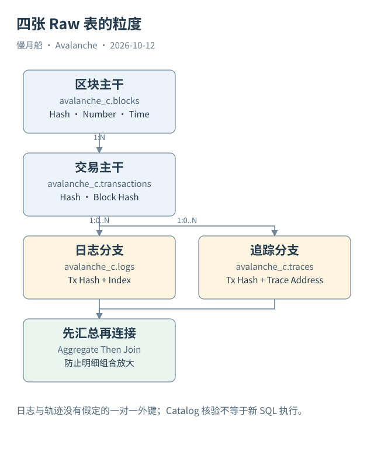

# 12｜四张 Raw 表怎样围绕一笔交易连接？

你已经找到一笔 C-Chain 交易，下一步想看它属于哪个区块、发出了哪些日志、调用了哪些合约。Dune 的 Raw 表可以连接这些观察面，但连接方式必须保留各自粒度。

## 主干与分支

本轮 `searchTables` 实际取得 `avalanche_c.blocks`、`transactions`、`logs`、`traces` 等九个表的字段。区块表的编号与时间列为 `number`、`time`，交易表则为 `block_number`、`block_time`。看起来相近的命名不能靠猜测填入 SQL。

一笔交易通过 `block_hash` 连接区块 `hash`；日志与轨迹通过 `tx_hash` 回到交易 `hash`。高度可以用于一致性检查，哈希提供具体记录身份。日志的 `index` 和轨迹的 `trace_address` 区分同笔交易下的多个分支记录。

一个区块可有多笔交易，一笔交易可没有日志，也可有许多日志。轨迹与日志之间没有可随意假定的一对一外键。将两类明细仅按交易哈希直接相连，会产生组合放大：教学例中三条轨迹与四条日志变成十二行，而交易仍只有一笔。

## 按问题选择粒度

如果问题是交易总数，读取交易表并限定时间与成败口径。如果问题是事件数量，读取日志或相应解码事件表。如果问题是内部调用，读取轨迹并区分根调用和子调用。把这些数量都叫“交易次数”，会让指标彼此无法比较。

想在同一行展示交易的日志数和轨迹数，应先把两个分支分别汇总到交易粒度，再回连交易。计费金额也留在交易级求和，不能在明细组合行里重复累计。无日志交易需要用合适的外连接保留，而不是因连接方式被无意过滤。

Catalog 返回的数据类型同样影响正确性。地址与哈希多为 `varbinary`，轨迹 `value` 为 `uint256`，交易 `value` 为 `decimal(38,0)`。不要把显示的 `0x` 文本和原始字节列按字符串直接比较。日期分区字段也不同：blocks 用 `date`，其他多用 `block_date`。

## 当前目录不等于完整实时覆盖

Catalog 证明表和列被登记，没有运行 SQL 就不能声称所有列都可解析、历史连续完整或数据已刷新到最新区块。作者旧研究曾遇到“目录可见但 SQL 不可解析”的候选表。本篇继承这个经验，明确分开 Schema 核验与实际执行。

已有查询的历史结果可以提供真实行，但其窗口停留在原执行日期。本轮读取结果不触发刷新。正文使用这些样本时明确它们在 Helicon 前发生，不用它们证明升级后的索引器已经完全兼容。

四张表提供了从请求到执行证据的基本路径；它们仍只覆盖 C-Chain 的相应观测。要解释验证者注册或 C→P Import，就要离开这组 EVM 表，进入 PlatformVM 数据。

表卡保存本轮返回的完整字段及可空标记，作为 SQL 审查材料。Catalog 的 nullable 标记是元数据，不是对每条实际返回的保证。数据质量仍需有限样本或明确查询检查，本篇不会把目录标签升级成实际无缺失结论。

最小的交易级查询可以直接保留粒度：

```sql
SELECT block_time, hash, success, gas_used
FROM avalanche_c.transactions
WHERE block_date = DATE '2026-10-12'
ORDER BY block_time, hash
LIMIT 10;
```

此段为 STATIC_CHECKED，未实际执行；LIMIT 不代替分区过滤。完整示例与限制见 SQL 目录。

图中的箭头按标注表示运行步骤或证据关联；图形是教学模型，实际响应另见案例档案。



[编辑此图](../../assets/diagrams/dune-raw.drawio)。

[本章可用的 DuneSQL 与边界](../../examples/sql/README.md)。新 SQL 未执行。

资料与核对依据：[dune-blocks](https://docs.dune.com/data-catalog/evm/avalanche/raw/blocks.md)；[dune-transactions](https://docs.dune.com/data-catalog/evm/avalanche/raw/transactions.md)；[dune-logs](https://docs.dune.com/data-catalog/evm/avalanche/raw/logs.md)；[dune-traces](https://docs.dune.com/data-catalog/evm/avalanche/raw/traces.md)。协议基准日为 2026-10-12；案例时间以原始记录为准。

[上一章](11-fees.md) · [本篇目录](../../SUMMARY.md) · [下一章](../part-04/13-p-chain-role.md)
