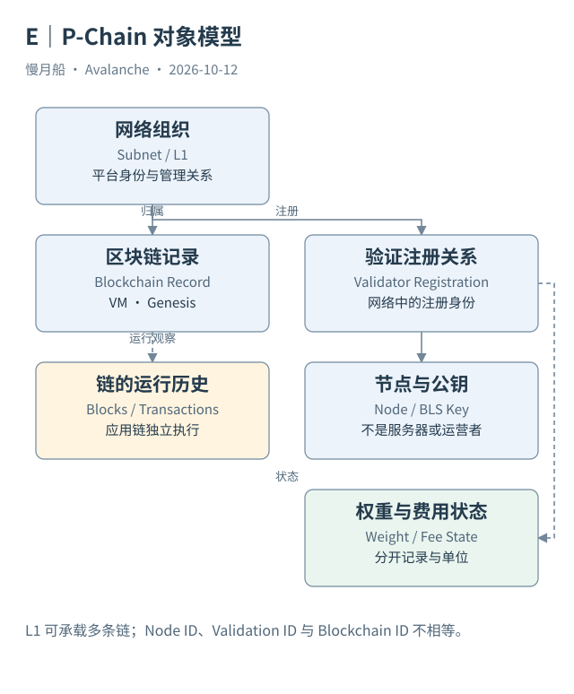

# 13｜P-Chain 为什么不是普通合约链？

如果一个 L1 有自己的智能合约，为什么还需要到 P-Chain 登记？因为应用执行和网络组织是不同工作。P-Chain 保存的是协议能识别的平台对象，使节点知道有哪些网络、哪些链以及相关验证者记录。

## 直接表达平台操作

平台链（Platform Chain，P-Chain）运行 PlatformVM。其交易类型直接表达创建 Subnet、创建 Blockchain、质押、委托以及现代 L1 注册等操作。它不需要把这些动作伪装成某个 EVM 合约的函数调用，因此交易结构也不会自然具有 EVM 的 `to、input、receipt logs` 全套字段。

P-Chain 同样处理资金输入和输出。网络创建费、质押资金和验证者连续费用相关资金，都要符合对应状态规则。平台对象与资金对象共同出现，并不意味着它们属于同一种余额。费用余额不是质押本金，潜在奖励也不是已到账资产。

`CreateSubnetTx` 建立网络组织的控制与身份记录；`CreateChainTx` 指定所属 Subnet、VM 与 Genesis 等信息。前者不自动创建应用链，后者也不自动启动服务器。读者需要把链上对象与链外运行条件分开，才能理解“创建成功”的真正含义。

## 两种验证者机制并存

Primary Network 的验证者通过适用的 AVAX 质押规则参与；传统 Subnet 的验证者曾受到同时验证 Primary Network 等约束。Etna 之后，通过 ACP-77 转换的 L1 可以采用独立管理，P-Chain 登记其节点、公钥、权重与连续费用状态。

现代 L1 的 Validator Manager 发出符合协议的管理消息，P-Chain 检查消息并改变注册状态。P-Chain 的作用是维护协议可用的记录与验证条件，并不代替 L1 决定全部经济规则，也不替它逐笔执行应用交易。

平台状态还支持跨链消息验证所需的验证者集合信息。目标链能够按相应 P-Chain 高度取得签名者公钥和权重，检查来自其他链的消息。普通 L1→L1 消息无需全部经过 P-Chain 作为中心传输通道，因此不能把平台交易量当作全网消息量。

## 在数据里保留交易类型

本轮官方 Data API 的 P-Chain 列表实际返回 `AddPermissionlessDelegatorTx` 和 `RewardValidatorTx` 等记录。它们有区块定位、UTXO 和节点相关字段，与 C-Chain EVM 交易明显不同。具体某类字段缺失时，应先判断类型适用性，而不是一律补零。

读取 P-Chain 可以使用 `platform.getTx`、`getBlockchains`、`getCurrentValidators`、`getL1Validator` 等 RPC，也可用官方索引 API 查看历史。实时状态与事件历史各有作用：今天的注册状态不等于过去完整生命周期，历史交易也不单独证明今天仍然有效。

P-Chain 是把网络组织带入链上可观察空间的关键。理解它之后，就能追问某条 L1 的存在留下了哪一项记录，哪一次转换改变了管理方式，哪些信息仍必须从 L1 自己的运行接口获得。

当 P-Chain 返回一个 txType 而没有 EVM input，不应立即判断数据损坏。它可能完整提供了该平台操作需要的字段，只是与你熟悉的账户链不同。应先按类型查规范，再判断缺失的是协议字段还是分析者希望增加的加工字段。

实际响应节选如下；这是索引 API 或 RPC 返回字段的节选，不是构造样本。完整请求与响应见 [atomic-p-followup](../../research/raw/atomic-p-followup.json)。

```json
{
  "txHash": "EDAKbagtkyMLKspgXnbRbE1aXtvDRW9BgHRJQFGPztxhPtnpi",
  "txType": "AddPermissionlessDelegatorTx",
  "nodeId": "NodeID-8mJL8AgUyaPvtoidS91rNSgohsfW45Y1R",
  "subnetId": "11111111111111111111111111111111LpoYY"
}
```

图中的箭头按标注表示运行步骤或证据关联；图形是教学模型，实际响应另见案例档案。



[编辑此图](../../assets/diagrams/p-data-model.drawio)。

资料与核对依据：[p-rpc](https://build.avax.network/docs/rpcs/p-chain.md)；[p-format](https://build.avax.network/docs/rpcs/p-chain/txn-format.md)；[acp-77](https://raw.githubusercontent.com/avalanche-foundation/ACPs/main/ACPs/77-reinventing-subnets/README.md)；[api-primary-transactions](https://build.avax.network/docs/api-reference/data-api/primary-network-transactions/listLatestPrimaryNetworkTransactions.md)。协议基准日为 2026-10-12；案例时间以原始记录为准。

[上一章](../part-03/12-dune-raw.md) · [本篇目录](../../SUMMARY.md) · [下一章](14-p-objects.md)
