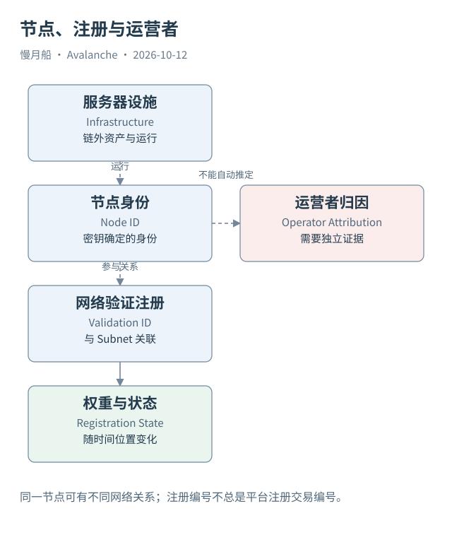

# 14｜服务器、Node 和注册记录怎样分开？

一个项目说自己有五个验证者。它可能指五台服务器、五个 Node ID、五个注册，或者五家公司。只有先把计数对象分开，这个数字才有可比较的含义。

## 物理设施不在账本里自动出现

服务器是运行软件的物理或虚拟设施，Node 是参与网络通信的节点身份。服务器可以迁移，进程可以重启，节点身份可以由相应密钥保持。链上看到 Node ID，不能直接推断机房位置、独立运营者或故障隔离程度。

注册则是协议中的验证关系。现代 L1 记录有 Subnet ID、Node ID、BLS 公钥、权重、Validation ID 和费用状态等信息。相同节点可以与不同网络建立关系；把 Node ID 作为跨网络验证注册表的唯一键，会覆盖或丢失其他网络中的记录。

Validation ID 也不应被无条件解释成提交注册交易的哈希。ACP-77 的初始验证者用 Subnet ID 与索引计算注册身份；后续注册采用协议规定的消息身份规则。本轮 Beam 案例的 P-Chain 注册交易 ID 与 Data API 返回的 validationId 不同，是可以直接核对的实例。

## 数据模型有两条主干

一条主干是网络组织到区块链：Subnet/L1 关联 Blockchain，Blockchain 具有 VM、Genesis 与链历史。另一条是网络组织到验证注册：注册关联节点、公钥、权重、费用状态与管理权限。两条主干通过网络对象相连，不需要假定每条区块链各有完全独立的一组注册。

Validator Manager 的定位至少包含管理链 Blockchain ID 与地址。管理程序可以放在规定的链上，并不总是必须位于被管理 L1 自己的唯一应用链。一个地址字符串脱离所在链，不能唯一确定管理合约。

权重与费用余额还要分开。权重用于共识与签名门槛等协议判断，L1 可以通过自身规则映射抵押或权限。费用余额用于支付 P-Chain 连续费用。权重为 `20000` 不等于有 `20000 AVAX`，费用余额也不等于节点抵押的全部资金。

## 快照需要时间位置

本轮 Data API 取得 Beam 的一页验证者，保存其注册编号与剩余余额。一页最多五项，不能将返回长度当作完整网络验证者数。是否有下一页、当前活跃定义、采集时点与字段单位，都需要保留。

P-Chain RPC 的状态返回可以附带高度，索引 API 可能只给检索时间与注册时间。没有共同高度时，不能声称两种来源构成严格同一时点的状态快照。注册时初始费用余额与后续余额不同，也可能来自时间扣费、充值或索引延迟。

数据库中应记录对象身份、关系、有效位置与来源。实体运营者可以作为独立归因层添加，但没有证据就不填。这样的模型看起来比“五台服务器”复杂一些，却能避免把网络安全性、节点数量和运营者独立性混在一起。

快照里出现同一 Node ID 的多行时，应检查它们是否属于不同网络注册。去重规则必须由对象关系决定。随意按节点删行，会低估成员关系；随意按每行计独立运营者，又会夸大运营独立性。

图中的箭头按标注表示运行步骤或证据关联；图形是教学模型，实际响应另见案例档案。

[编辑此图](../../assets/diagrams/validator-identities.drawio)。

[真实案例与字段缺口](../../examples/transactions/README.md) · [实际 API 请求/响应](../../examples/rpc/README.md)。

资料与核对依据：[acp-77](https://raw.githubusercontent.com/avalanche-foundation/ACPs/main/ACPs/77-reinventing-subnets/README.md)；[p-rpc](https://build.avax.network/docs/rpcs/p-chain.md)；[api-l1-validators](https://build.avax.network/docs/api-reference/data-api/primary-network/listL1Validators.md)；[api-subnet](https://build.avax.network/docs/api-reference/data-api/primary-network/getSubnetById.md)。协议基准日为 2026-10-12；案例时间以原始记录为准。

[上一章](13-p-chain-role.md) · [本篇目录](../../SUMMARY.md) · [下一章](15-primary-staking.md)
