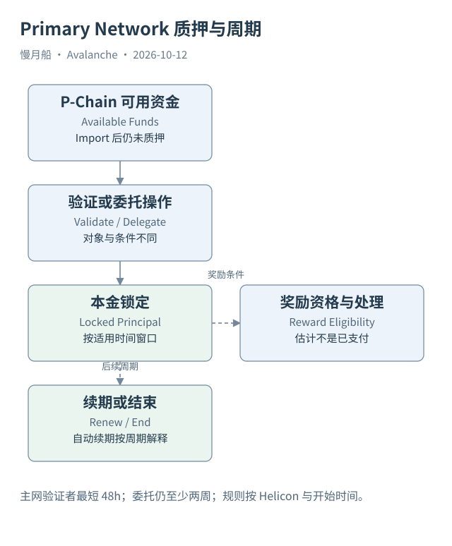

# 15｜质押与委托在 P-Chain 怎样留下记录？

将 AVAX 移到 P-Chain，并不等于它已经参与质押。资金还要进入适用的验证者或委托操作，形成锁定与奖励相关记录。查看可用余额时，这些状态不能混为一项。

## 验证与委托的对象不同

Primary Network 验证者运行节点并满足协议的质押条件；委托者把资金委托给已有验证者，不因此获得自己的 Node ID 验证身份。主网验证者最低质押 `2000 AVAX` 的条件针对该机制，不能推广为每个现代独立 L1 验证者的共同要求。

委托交易需要指定目标节点、金额、适用时间与奖励所有者。请求被接受后，本金在规定期间受到约束，潜在奖励并非即时可用余额。奖励是否实际产生，要看后续协议处理，不能把 API 的 `estimatedReward` 或 `potentialReward` 当成已经支付。

本轮取得的一笔后续委托为 `EDAKbagtkyMLKspgXnbRbE1aXtvDRW9BgHRJQFGPztxhPtnpi`，类型为 `AddPermissionlessDelegatorTx`。它消费了前文 C→P Import 创建的资金输出，同时包含自己的平台字段。跨链资金到达和资金随后被锁定，是两个可以分别核验的动作。

## Helicon 改变了哪些时间条件

主网 Helicon 把 Primary Network 验证者最短质押期限降到四十八小时，委托最短期限仍为两周。委托还必须完全落在验证者适用的质押窗口内。因此一个只验证四十八小时的验证者，并不因为主网最低期限缩短就能够接受两周委托。

新开始的验证适用九成在线率奖励条件；激活前开始的旧验证按旧条件判断。奖励曲线参数还有按时间推进的变化。把今天的网页默认规则追溯到所有历史注册，会错误解释过去是否具备奖励资格。

ACP-236 引入自动续期验证。对应 P-Chain 交易包括 `AddAutoRenewedValidatorTx`、`SetAutoRenewedValidatorConfigTx`、`RewardAutoRenewedValidatorTx`。当前周期结束不一定意味着整个验证关系退出；配置周期为零则在当前周期结束后不再续期。

## 数据分析需要识别周期

当前验证者 API 对自动续期记录提供相关权限与续期配置字段。一个注册的周期时间可以滚动，而交易身份保持不变。仅以 `endTime` 接近当前时间判断“即将退出”，会在新机制下误报；仅以时间变化判断“新增验证者”，也会重复计数。

对质押资金应分别保存本金、锁定状态、奖励估计与已实际支付奖励。对用户应区分钱包资金所有者、奖励地址和目标节点。三者相同需要证据，不宜用一个 address 字段覆盖。

本篇不提供质押操作建议或发起签名，而是解释已有记录。读者能够沿着 Import 输出走到委托输入，就已经连接了资金位置与平台操作；至于奖励最终是否支付，则必须继续取得对应后续记录。

样本中的委托金额应以其 staked 输出和 amountStaked 核对，不用交易全部 input 总额替代。输入还可能覆盖找零与费用。奖励地址也可能不同于输入控制地址，因此资金归属与收益接收都要按字段分别说明。

图中的箭头按标注表示运行步骤或证据关联；图形是教学模型，实际响应另见案例档案。

[编辑此图](../../assets/diagrams/primary-staking.drawio)。

[真实案例与字段缺口](../../examples/transactions/README.md) · [实际 API 请求/响应](../../examples/rpc/README.md)。

资料与核对依据：[helicon](https://build.avax.network/docs/primary-network/helicon-upgrade.md)；[p-format](https://build.avax.network/docs/rpcs/p-chain/txn-format.md)；[p-rpc](https://build.avax.network/docs/rpcs/p-chain.md)；[api-primary-transactions](https://build.avax.network/docs/api-reference/data-api/primary-network-transactions/listLatestPrimaryNetworkTransactions.md)。协议基准日为 2026-10-12；案例时间以原始记录为准。

[上一章](14-p-objects.md) · [本篇目录](../../SUMMARY.md) · [下一章](16-p-transaction-types.md)
