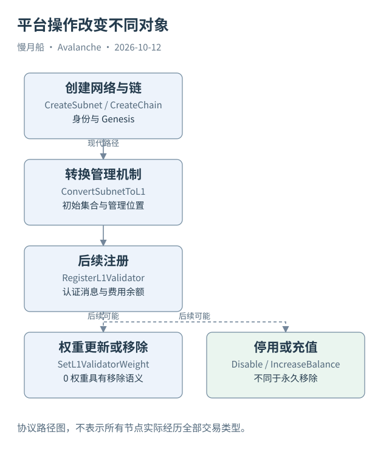

# 16｜七种 L1 相关交易分别改变什么？

一个界面只有“创建”和“删除”两个按钮，底层却可能涉及许多平台交易。要判断执行到哪一步，需要知道每种交易改变了什么对象，而不是把它们都标为同一种部署。

## 从网络记录到链记录

`CreateSubnetTx` 创建 Subnet 身份及其控制条件。`CreateChainTx` 创建所属网络中的 Blockchain 记录，包含 VM 和 Genesis 等。二者在传统与现代路径中都可能出现，但“拥有创建记录”不是“已经建立现代 L1 管理机制”的充分条件。

`ConvertSubnetToL1Tx` 是 Etna/ACP-77 的关键转换操作，指定管理链与管理地址，并登记初始验证者等数据。被转换对象仍沿用原 Subnet ID，所以当前 API 的 subnet 字段不一定代表旧机制。交易名保留历史术语，语义由转换状态决定。

转换成功后，后续注册走 `RegisterL1ValidatorTx`。它承载管理授权消息、BLS 持有证明和费用余额等内容。提交者、资金提供者、节点身份以及授权的管理程序，可能是不同角色，不能只根据交易输入地址概括所有权。

## 权重、停用与充值

`SetL1ValidatorWeightTx` 使用符合规则的管理消息更新权重，并提供防重放的 nonce。将权重设为零具有移除注册的特殊语义，还受协议边界约束。普通权重调整不能直接等价成一笔代币转移，经济规则来自 L1 的管理实现。

`DisableL1ValidatorTx` 由相应停用权限授权，停止活跃状态并处理未使用余额。它不把注册从网络定义的总权重中彻底移除。随后可能通过充值恢复活跃，因此不能把停用一律解释成永久退出或已经完成全部资产解锁。

`IncreaseL1ValidatorBalanceTx` 为注册添加 AVAX 费用余额，任何人都可以按协议提供资金。充值改变费用状态，不自动改变验证者投票权重。费用耗尽后的非活跃注册也可能因此恢复，但实际节点是否在线仍需运行观测。

## 旧类型与新类型保留各自时间

传统 `AddValidatorTx`、`AddDelegatorTx`、`AddSubnetValidatorTx`，以及许可型相关交易，有自己的时期与适用对象。Helicon 又加入自动续期交易。它们不应该全部塞进同一个假设含有 `endTime`、`validationID` 和 EVM logs 的万能结构。

本篇交易类型附录按对象与版本组织，标出平台原生交易和合约管理动作之间的区别。真实注册样本只证明这次注册与某个后续状态，不能补出未取得的权重更新或退出交易。交易规范提供可能路径，链上记录才说明实际走过的路径。

分析师可以把每个动作写成“旧状态、授权来源、交易类型、新状态、观察位置”。这样接口显示 FAILED、停用或已创建时，都能对应到底层对象，而不会由一个产品按钮名替代协议事实。

交易规范同时列出二进制布局与结构字段，JSON 索引视图则可能展开额外关联。将两份材料对照时，应区分规范中的必需输入与索引器事后补充的消费信息。字段同名也不保证位于同一层。

图中的箭头按标注表示运行步骤或证据关联；图形是教学模型，实际响应另见案例档案。

[编辑此图](../../assets/diagrams/p-transaction-types.drawio)。

资料与核对依据：[p-format](https://build.avax.network/docs/rpcs/p-chain/txn-format.md)；[acp-77](https://raw.githubusercontent.com/avalanche-foundation/ACPs/main/ACPs/77-reinventing-subnets/README.md)；[acp-99](https://raw.githubusercontent.com/avalanche-foundation/ACPs/main/ACPs/99-validatorsetmanager-contract/README.md)；[helicon](https://build.avax.network/docs/primary-network/helicon-upgrade.md)。协议基准日为 2026-10-12；案例时间以原始记录为准。

[上一章](15-primary-staking.md) · [本篇目录](../../SUMMARY.md) · [下一章](../part-05/17-x-utxo.md)
