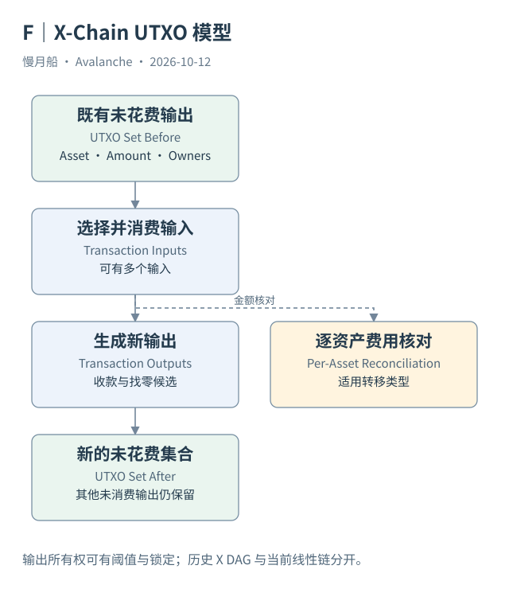

# 17｜X-Chain 的钱为什么由一组输出组成？

在账户模型中，钱包余额像一个随交易更新的数字。X-Chain 上，钱包可用资金却要从未被消费的输出中找出来。理解这种差异，才能解释为什么一次付款需要多个输入。

## 输出是可消费的资金对象

X-Chain 运行 AvalancheVM，使用 UTXO 模型。一笔交易消费已存在的输入对象，生成新的输出。每个输出具有资产身份、数量与所有权条件；后续交易需要满足条件才能消费它。UTXO 集合记录哪些输出当前仍未花费，而交易历史记录它们怎样产生和消失。

如果钱包先收到三笔资金，付款时可以消费其中一个或多个输出。选定输入的总额超过付款与费用需求时，通常产生找零输出（Change Output）。账本没有就地修改原输出余额，而是消费旧输出，再生成收款与找零等新输出。

输出所有权不总是“一列地址”。它可以包含地址集合、阈值和锁定条件。观察到某个地址列在输出中，不等于该地址单独就能花费全部金额。余额计算必须说明所用接口如何处理多签和锁定，否则同一个输出可能被多个地址视角重复计算。

## 资产身份属于交易模型

资产编号（Asset ID）识别资产。Avalanche Native Token 是 AVM 资产机制中的概念，不能与任意 EVM ERC-20 自动等同。创建资产（Create Asset）可以定义相应元数据与初始状态，后续转移按该资产及功能扩展规则处理。

本轮 `avm.getAssetDescription` 直接返回主网 AVAX 的 Asset ID、名称、符号与 denomination `9`。X-Chain 原始数量按九位小数展示，不能使用 C-Chain 原生 EVM 的十八位换算。即使同称 AVAX，也要在接口层明确单位。

可以借助 Bitcoin 的 UTXO 思想理解“消费旧输出、生成新输出”，但不能说两者交易结构完全相同。AVM 具有自己的资产、功能扩展、编码和跨链机制。思想类比只解释局部模型，不替代规范。

## 当前历史是一条线性链

Cortina 之前 X-Chain 使用 DAG 与 vertex 等历史组织结构；升级后被线性化。UTXO 状态模型并没有因为历史组织改变就变成 EVM 账户模型。共识历史结构与资金状态结构应当分别解释。

本篇真实样本来自官方 Data API，给出 `chainFormat: linear`、区块高度、消费输出与生成输出。它不是 Dune EVM transfers 的一条记录。索引器可能补充消费交易与时间，这些便利字段也需要标明来自索引 API。

读一笔 X-Chain 交易时，先按资产分别汇总输入和输出，再检查条件与费用，不把输入地址到输出地址做笛卡尔配对。接下来用真实多输入交易示范：金额守恒关系能说明什么，又有哪些所有权结论仍然不能推出。

一个地址的余额接口若返回资产列表，还要按 Asset ID 分开查看。把多个资产的 raw amount 相加没有统一经济单位。名称与 symbol 可以显示给读者，但可审查的资金对象仍需保留资产身份与 denomination。

实际响应节选如下；这是索引 API 或 RPC 返回字段的节选，不是构造样本。完整请求与响应见 [x-avax-asset](../../research/raw/x-avax-asset.json)。

```json
{
  "assetID": "FvwEAhmxKfeiG8SnEvq42hc6whRyY3EFYAvebMqDNDGCgxN5Z",
  "symbol": "AVAX",
  "denomination": "9"
}
```

图中的箭头按标注表示运行步骤或证据关联；图形是教学模型，实际响应另见案例档案。



[编辑此图](../../assets/diagrams/x-utxo.drawio)。

资料与核对依据：[x-rpc](https://build.avax.network/docs/rpcs/x-chain.md)；[x-format](https://build.avax.network/docs/rpcs/x-chain/txn-format.md)；[cortina-release](https://api.github.com/repos/ava-labs/avalanchego/releases/tags/v1.10.0)；[data-api](https://build.avax.network/docs/api-reference/data-api.md)。协议基准日为 2026-10-12；案例时间以原始记录为准。

[上一章](../part-04/16-p-transaction-types.md) · [本篇目录](../../SUMMARY.md) · [下一章](18-x-real-transfer.md)
