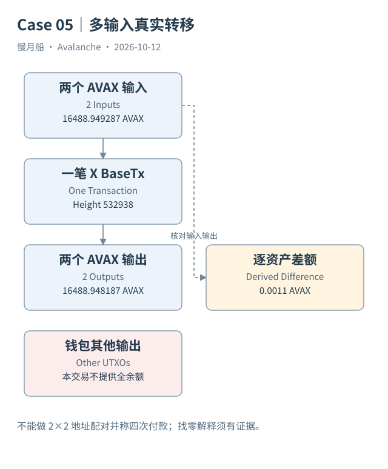

# 18｜两个输入、两个输出，究竟转了几次钱？

Case 05 的 X-Chain 主网交易消费两个 UTXO，又生成两个 UTXO。若把每个输入与每个输出连接，会得到四条“转账”。协议却只接受了一笔交易，经济含义需要回到资产和输出条件解释。

## 先保留真实记录

交易编号是 `cf7EMNn6ionatrWAxYDcDipQSQKD5j6vX2gSDptoDtiiBN1qa`，类型 `BaseTx`，区块高度 `532938`。官方 Data API 给出线性链标记、区块哈希和时间。本篇保留完整响应及从其中节选的输入输出表，没有把文档示例当成已发生交易。

两个输入的 AVAX 原始数量分别为 `10555772946000` 和 `5933176341000`，合计 `16488949287000` 个最小单位。两个输出合计 `16488948187000`。逐资产计算差额为 `1100000` 个最小单位，即 `0.0011 AVAX`。这是由真实响应整数推导出的差额。

本响应未提供独立费用字段，因此这里确认的是输入输出差额；按 BaseTx 规则，它可作为费用解释的候选，尚未完成独立费用对账。不能把同一差额方法无条件套到任意创建资产、铸造或复杂操作。先明确交易类型，再判断是否具备相应的资金守恒关系，才能避免把新发行资产误当成遗漏输入。

## 找零是解释，不是地址名字

一个输出回到与输入相关的控制地址时，可以成为找零候选，但不能仅凭地址重复就确定它是“找零”。多签、归集、自转移或业务拆分都有可能。严格结论应保留输出序号、资产、数量、所有权条件，并说明识别依据。

两输入记录带有各自创建交易和输出序号。它们是不同资金对象，即使所有权地址相同，也不能合并为一个原始 UTXO。交易消费的是对象，不是从某个地址余额中随意减去一个数字。

输入的签名证明与凭证可能可见，但它们不是私钥。可验证的控制条件也不直接等于现实受益所有权。面向数据读者，本篇只讨论协议资金对象，不凭公开地址标签给匿名参与者编造身份。

## 余额还需要集合位置

想知道交易后钱包剩多少钱，需要获得该位置全部未花费输出，而不是只看本交易输出之和。钱包可能保留没有被消费的其他 UTXO。今天的未花费集合又可能已经发生变化；历史消费记录与当前集合应分别存储。

API 可以提供 `utxoId`，原始身份还可由创建交易与输出序号表达。跨链观察要另加来源链与消费链，避免把相同文本片段错误关联到其他链。规范化脚本保留原始身份，并用精确整数处理数量。

这个案例没有增加复杂代码，却已经说明四条地址配对为何不是四次经济转移。分析师应将“协议交易数”“输出对象数”“资产毛流量”分别命名，才能把 UTXO 记录正确带入更高层指标。

本次响应同时给出 amountUnlocked 和 amountCreated，离线校验把它们与输入输出明细各自求和核对。它没有单独返回 amountBurned，因而只确认明细与索引汇总一致，不宣称费用已经通过独立字段验证。

图中的箭头按标注表示运行步骤或证据关联；图形是教学模型，实际响应另见案例档案。

[编辑此图](../../assets/diagrams/x-transfer-case.drawio)。

[真实案例与字段缺口](../../examples/transactions/README.md) · [实际 API 请求/响应](../../examples/rpc/README.md)。

资料与核对依据：[x-format](https://build.avax.network/docs/rpcs/x-chain/txn-format.md)；[x-rpc](https://build.avax.network/docs/rpcs/x-chain.md)；[api-primary-transactions](https://build.avax.network/docs/api-reference/data-api/primary-network-transactions/listLatestPrimaryNetworkTransactions.md)。协议基准日为 2026-10-12；案例时间以原始记录为准。

[上一章](17-x-utxo.md) · [本篇目录](../../SUMMARY.md) · [下一章](19-atomic-transfer.md)
