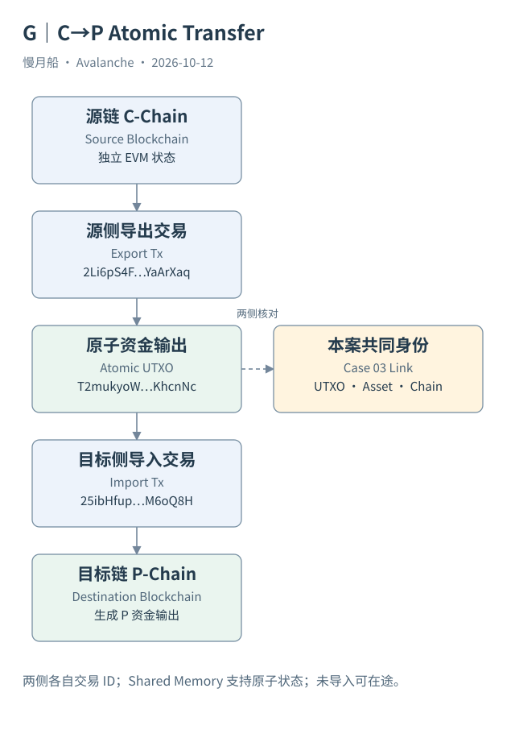

# 19｜C→P 的 Export 和 Import 怎样接上？

资产从 C-Chain 离开后，P-Chain 如何知道应该给谁一份可用资金？Primary Network 的原子转移（Atomic Transfer）通过导出与导入及原子 UTXO 关联两侧状态，不能用一条普通 ERC-20 Transfer 概括。

## 两条链各自处理一侧

Export 在源链按相应模型扣除资金并创建指定目标链可导入的原子输出。节点的共享内存（Shared Memory）机制为链间交换这些原子状态提供支持，它不是一个由中心服务器代管资产的合约。Import 在目标链消费可导入输出，并按目标链规则生成可用资金或余额变化。

导出已经接受但尚未导入时，资金可以处于中间阶段。源侧记录并不自动意味着目标侧可用余额已经增加。两侧是独立交易，具有各自交易 ID、区块位置和费用；它们通过输出身份与链方向关联，而不是通过相同交易哈希关联。

本篇 Case 03 源侧 Export 为 `2Li6pS4FTWqQJFMQGuqudWew5DWinMvGUtZzE1zqvjfYaArXaq`，目标 Import 为 `25ibHfupr19go4Z98MCfafQcuovYUkerVTPRraWYjN1bM6oQ8H`。两份官方响应共同出现 UTXO `T2mukyoWT33c4XqMESsent6Cd2Ti7S11SibUN1hvJ6XKhcnNc`，Asset ID 与数量一致。

## 数量与方向提供交叉检查

导出创建的原子输出为 `100010366235` 个九位小数最小单位，即 `100.010366235 AVAX`。源侧 EVM Input 的索引表示数量是另一项字段，不能未经换算就与 EVM Transaction 的十八位 `value` 相加。源侧扣除、导出输出与目标可用输出要分别核对费用。

目标 Import 的 consumedUtxos 指向源交易和输出序号，并给出来源 C-Chain、消费 P-Chain。输入总额与输出总额之间还要检查 Import 费用。仅凭两笔交易时间相近、金额相近，不足以建立可靠配对；共同输出身份使关联具有更强证据。

官方索引 API 补充 `consumingTxHash` 等字段，方便找后续记录。本篇仍实际获取了目标交易，核对其输入，而不是只把源响应的一列索引标签写成完整目标链验证。索引关联与目标交易本体各自保留来源。

## 后续用途不是导入的一部分

本案导入输出随后被真实委托交易消费。它让开篇“移到 P-Chain 用于平台操作”的场景有了完整资金血缘。但不能推定每一笔 C→P 转移都用于质押，也不能把委托金额全部解释为这一次导入带来的资金，后续操作可能有其他输入。

Atomic Transfer 与普通合约桥不同，也与 AWM 的验证者签名消息不同。后文将分别讨论消息传递和资产桥应用，不在同一张图里把三种机制画成一个箭头。

这条案例链能证明导出输出被目标导入消费，并进一步进入某次平台操作。它仍不是钱包全历史对账。没有取得的其他资金来源与最终奖励，继续保持未证实边界。

导出到导入的时间在本案中相差一秒，但这只是该案例的观测，不是任何情况下的延迟保证。公共服务时间分辨率、取数覆盖与目标处理条件都会影响解释。图中的简洁步骤也没有承诺每个用户都只等待一秒。

图中的箭头按标注表示运行步骤或证据关联；图形是教学模型，实际响应另见案例档案。

[编辑此图](../../assets/diagrams/atomic-transfer.drawio)。

[真实案例与字段缺口](../../examples/transactions/README.md) · [实际 API 请求/响应](../../examples/rpc/README.md)。

资料与核对依据：[atomic-format](https://build.avax.network/docs/rpcs/c-chain/txn-format.md)；[p-format](https://build.avax.network/docs/rpcs/p-chain/txn-format.md)；[c-rpc](https://build.avax.network/docs/rpcs/c-chain.md)；[api-primary-transactions](https://build.avax.network/docs/api-reference/data-api/primary-network-transactions/listLatestPrimaryNetworkTransactions.md)。协议基准日为 2026-10-12；案例时间以原始记录为准。

[上一章](18-x-real-transfer.md) · [本篇目录](../../SUMMARY.md) · [下一章](20-atomic-reconciliation.md)
