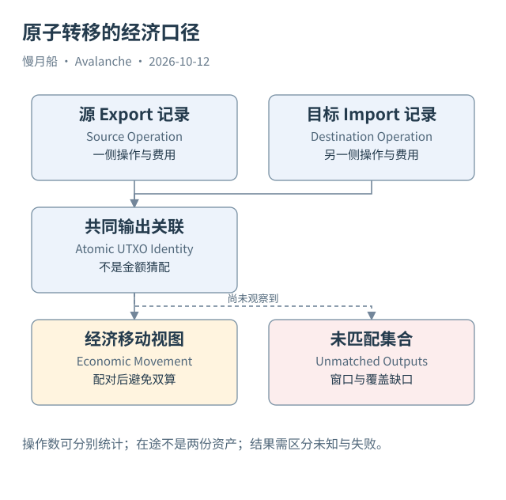

# 20｜导出和导入为什么不能各算一次资金流？

一份跨链报表看到 C-Chain Export 一百 AVAX，又看到 P-Chain Import 一百 AVAX，于是声称网络产生了两百 AVAX 转移量。如果指标本来想描述资产从 C 到 P 移动，这就把同一经济动作的两侧重复算了一次。

## 操作数量与经济移动

Export 和 Import 都是重要协议操作，分别计数并没有错。错误在于将两侧记录数或金额直接命名为“独立资金转移”。指标必须先说明统计对象：源导出数量、目标导入数量、已配对移动数量，或尚未配对的在途金额。

配对应按来源链、目标链、创建交易、输出序号与资产身份建立。一个导出可以生成多个输出，目标操作也可能消费多个输入，因此模型不应机械要求每次经济场景永远只有一笔导出和一笔导入。Case 03 展示一组具体关系，不是所有情况的基数保证。

观察窗口还会切断两侧。源交易在月底发生，目标 Import 在下月出现；按月分别提取会得到看似不平衡的结果。这不自动证明资产遗失，而是需要跨窗口保留未匹配集合，继续追踪消费状态。

## 不把费用和本金混在一起

源侧扣除金额、原子输出金额、目标输出金额可能因两侧费用而不同。对账时保留精确整数与 denomination，按阶段比较。金额相等是辅助一致性条件，不是替代 UTXO 身份的连接键。

导入后的平台操作还可能消费其他资金。本篇后续委托确实消费了 Import 创建的 UTXO；可以据此证明它参与这次操作，但不能据此把整个质押本金归因于这一个输出。资金混合之后，进一步分摊属于需要声明假设的分析推导。

地址控制关系也不能略过。源 C-Chain EVM 地址与目标 P-Chain 地址可能由相同钱包管理，但公开交易字段不能无条件证明现实主体一致。跨链资产关联可以成立，同时现实身份仍未确定。这是两种不同结论。

## 中间状态也应成为数据

在途表可以保存已导出未观察到消费的输出，但标题应写“本来源范围内尚未观察到导入”。索引延迟、未覆盖的地址或分页遗漏，都可能制造暂时缺口。没有目标交易不等于确认没有导入。

Helicon 后公开 C-Chain `avax.getAtomicTxStatus` 不再是可靠现行接口路径，官方建议查询 `avax.getAtomicTx`，待执行后观察 `blockHeight`。旧教程中对状态轮询方法的描述，需要按版本修正。本篇 RPC 示例注明这一变化。

最终报表最好并列给出操作级与经济级统计，说明观察窗口、配对率和未匹配金额。读者由此既能看到链上工作量，也能避免把一次跨账本资产移动误读成网络新创造了两份财富。

在原子移动表中保留 export_tx_id 与 import_tx_id，比生成一个无法追溯的“跨链哈希”更有价值。后续调查可以分别打开两侧来源，并核对费用与输出。统一行只是分析视图，不是新的链上协议对象。

图中的箭头按标注表示运行步骤或证据关联；图形是教学模型，实际响应另见案例档案。

[编辑此图](../../assets/diagrams/atomic-reconcile.drawio)。

资料与核对依据：[atomic-format](https://build.avax.network/docs/rpcs/c-chain/txn-format.md)；[p-format](https://build.avax.network/docs/rpcs/p-chain/txn-format.md)；[helicon](https://build.avax.network/docs/primary-network/helicon-upgrade.md)；[c-rpc](https://build.avax.network/docs/rpcs/c-chain.md)。协议基准日为 2026-10-12；案例时间以原始记录为准。

[上一章](19-atomic-transfer.md) · [本篇目录](../../SUMMARY.md) · [下一章](../part-06/21-etna-and-subnets.md)
