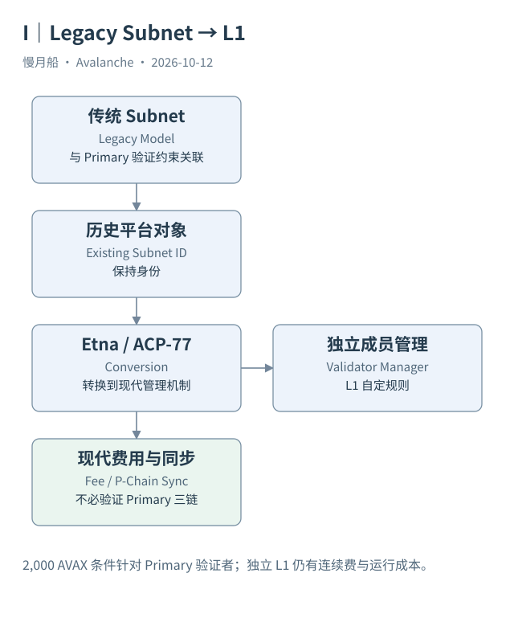

# 21｜Etna 之后，Subnet 的名字为什么还在？

一个项目称自己已经成为 Avalanche L1，API 却仍返回 `subnetId`。这不是自动证明它还停留在旧机制。协议保留了已有网络身份，现代管理方式需要从转换记录与当前状态判断。

## 旧机制的约束

传统 Subnet 由验证者集合共同验证其区块链，相关验证者需要同时满足 Primary Network 验证要求。独立应用因此也受到主网 AVAX 质押与多链运行职责的关联约束。历史部署教程常围绕这个前提组织步骤，阅读时应保留当时背景。

Etna 在 2024 年 12 月 16 日主网激活，ACP-77 引入 Subnet 向现代 L1 的转换机制。转换指定管理链与管理程序，由其通过经过验证的消息参与管理注册和权重。L1 验证者可以不再验证 Primary Network 三链，但仍需同步 P-Chain 取得互操作所需的记录。

原 Subnet ID 继续识别这个网络组织对象，不因转换而换成一组新的身份。创建链的 Blockchain ID 也不是 EVM Chain ID。名称变化与协议转换是两件事：宣传页面改名不足以证明转换，转换交易与相应状态才提供技术证据。

## 独立性有具体条件

现代 L1 可以制定自己的成员规则、原生资产与激励安排，不等于无需验证者，也不等于没有持续成本。安全性依赖其验证者集合、运行能力和管理规则；Primary Network 不替每条 L1 承担全部应用共识。

主网 `2000 AVAX` 最低质押仍与 Primary Network 验证者有关。不能要求每个现代 L1 注册都按同一门槛锁定该数量，也不能反向说 AVAX 完全无关。P-Chain 的连续验证费用仍以 AVAX 余额支持，节点运行与管理服务也有自身成本。

还有一些网络仍可能采用未转换的历史机制。对它们应根据实际类型和交易解释，不能把截至研究日所有名为 Subnet 的网络一律视为现代 L1，也不能把所有标为 L1 的社区目录条目当成已核实的转换。

## Beam 给出可连接的历史

本篇保存 Beam 在 2023 年的 CreateSubnetTx 与 CreateChainTx，以及后来的真实 ConvertSubnetToL1Tx。三类记录共享可核对的网络关联，但发生在不同年份。创建时的控制条件、转换后的管理地址和今天的注册快照，也不该被压成一个永远不变的属性。

这个例子说明网络可以保留身份并演进管理机制。它不会使旧历史消失，也不会证明所有 Genesis 配置一直未变。分析师需要建立版本与事件时间线，把来源中的当前状态和交易发生时状态分别保存。

读者看到 `subnetId` 时，最好的下一问是“该对象是否存在转换证据、目前由谁管理”。这个问题比争论页面使用 Subnet 还是 L1 更接近实际运行，也让数据库能够跨越协议升级保持稳定身份。

传统路径与转换后的注册可以在历史数据中并存。遇到一条旧 AddSubnetValidatorTx，应根据发生时间和网络状态解释，不因为今天目录显示 L1 就把旧记录改名成 RegisterL1ValidatorTx。保留原始类型才能审查演进过程。

图中的箭头按标注表示运行步骤或证据关联；图形是教学模型，实际响应另见案例档案。

[编辑此图](../../assets/diagrams/etna-comparison.drawio)。

资料与核对依据：[acp-77](https://raw.githubusercontent.com/avalanche-foundation/ACPs/main/ACPs/77-reinventing-subnets/README.md)；[etna-release](https://api.github.com/repos/ava-labs/avalanchego/releases/tags/v1.12.0)；[manager-readme](https://raw.githubusercontent.com/ava-labs/icm-contracts/main/contracts/validator-manager/README.md)；[api-subnet](https://build.avax.network/docs/api-reference/data-api/primary-network/getSubnetById.md)。协议基准日为 2026-10-12；案例时间以原始记录为准。

[上一章](../part-05/20-atomic-reconciliation.md) · [本篇目录](../../SUMMARY.md) · [下一章](22-launch-objects.md)
