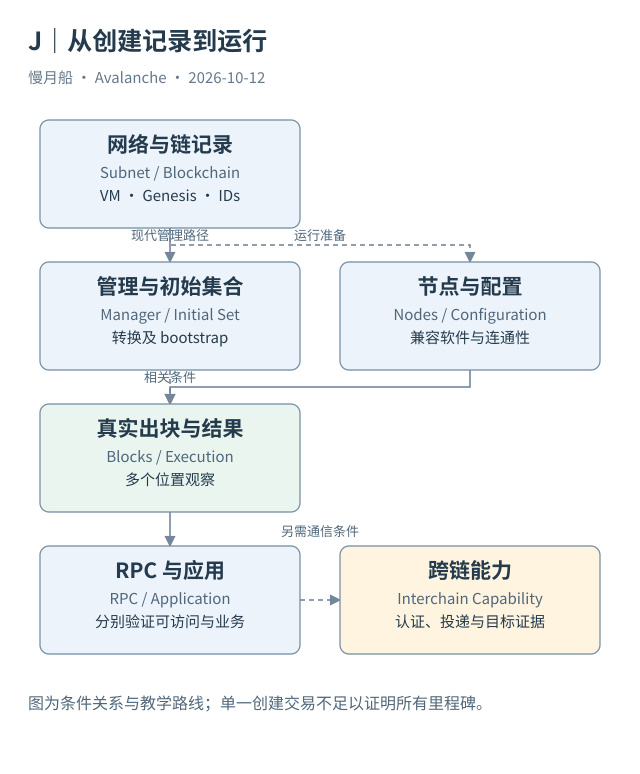

# 22｜创建一条 L1，实际创建了哪些对象？

点击“创建区块链”后看到一笔成功交易，项目是否已经可以向用户开放？创建记录只是工作链条中的一环。它定义某些身份与规则，运行则还需要节点、管理状态和真实区块。

## 定义对象与运行对象

网络记录确定 Subnet 身份及适用控制条件，链记录确定 Blockchain 归属、VM 与 Genesis。Genesis 是初始状态和配置的起点，可以包含 EVM Chain ID、账户分配、费用配置与预编译等。它不是今天所有状态的完整快照。

现代 L1 路径还需要指定 Validator Manager 的位置与授权体系，并通过转换建立初始验证者记录。节点必须运行匹配的软件、VM 与链配置，能够取得 Genesis、建立连接并跟随链状态。链记录存在，不会凭空启动这些进程。

管理合约可能需要代理、初始化与权限配置。链上部署合约字节码和初始化可用管理状态不是同一动作。创建网络记录与创建合约记录，也不应该互相替代；前者属于平台身份，后者属于相应链的应用执行状态。

## 从第一块到可用服务

节点出块说明链已经有运行历史，但还需检查多个时间位置是否持续推进。公开 RPC 可以由验证节点提供，也可以由其他服务节点提供；能读 RPC 不充分证明某台服务器具有有效验证身份。应用是否可用还要看部署、权限与具体业务执行。

开通 RPC 不等于跨链通信已经可用。AWM 支持、签名聚合、消息协议合约和投递服务都有条件。可以把它们放进启动证据矩阵，分别记录完成状态；不要把一笔 CreateChainTx 作为所有后续工作已经成功的万能证据。

同一个 L1 可能有多条区块链，所以 Genesis、VM、区块高度与 RPC 通常落到 Blockchain 层。成员管理落到网络与注册关系层。一个“L1 RPC”产品名称不能抹平这个对象层级。

## 用证据确定里程碑

本篇对 Beam 分别观察网络创建、链创建、转换、注册、区块与收据。它们共同支持一个有限但扎实的结论：这些对象和运行记录在相应时间存在。并非所有管理合约事件、所有节点健康与全部应用状态都已取得。

对一个新的教学项目，也应区分模拟 UI、本地真实网络、Fuji 与 Mainnet。Local 的真实 E2E 能证明本地网络在该环境下走完路径，不能把同一证据改名为 Fuji 运行。只有拿到对应网络身份和交易记录，才能升级结论。

启动一条链可以被产品体验简化，但分析模型应保持展开。把“记录、注册、运行、服务、业务、通信”各自落实到证据，读者才知道创建进度在何处，而不是被一个亮起的绿色按钮说服。

Genesis 公开也不自动意味着所有 RPC 都开放。网络可以配置应用访问与节点服务权限，这些条件不同于链创建记录。研究者只取得公开字段时，应说明视野所及，不能把接口拒绝直接解释成链没有运行。

图中的箭头按标注表示运行步骤或证据关联；图形是教学模型，实际响应另见案例档案。

[编辑此图](../../assets/diagrams/launch-l1.drawio)。

资料与核对依据：[p-format](https://build.avax.network/docs/rpcs/p-chain/txn-format.md)；[manager-readme](https://raw.githubusercontent.com/ava-labs/icm-contracts/main/contracts/validator-manager/README.md)；[l1-config](https://build.avax.network/docs/avalanche-l1s/evm-configuration/customize-avalanche-l1.md)；[api-subnet](https://build.avax.network/docs/api-reference/data-api/primary-network/getSubnetById.md)。协议基准日为 2026-10-12；案例时间以原始记录为准。

[上一章](21-etna-and-subnets.md) · [本篇目录](../../SUMMARY.md) · [下一章](23-genesis-and-gas-token.md)
