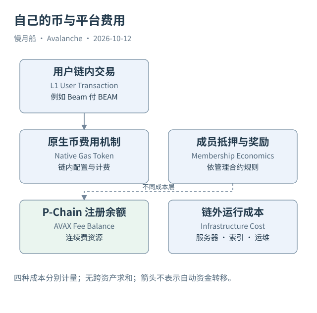

# 23｜自己的 Gas Token 为什么没有消除 AVAX 成本？

某条 Avalanche L1 的用户每次交易支付 BEAM，运营者却还需要在 P-Chain 准备 AVAX。两项支出服务不同机制，使用自己的原生币不会自动取消平台验证相关费用。

## 链内资产由链内规则定义

原生代币（Native Token）是该链基础账户或资产模型中的币，Gas Token 是支付执行费所用资产。EVM L1 通常用自己的原生币付 Gas；Genesis 可以配置初始分配及相关参数。C-Chain 则使用 AVAX，发行一个 C-Chain ERC-20 不会让它自然成为 Gas Token。

Subnet-EVM 提供可配置预编译，包括原生币铸造相关能力（Native Minter）和费用、奖励管理。启用与权限取决于具体配置及升级。存在这些能力，不等于任意用户都可铸币，也不等于所有 L1 都开启同一种费用接收方式。

Reward Manager 等配置可以影响费用如何被处理。分析时应查看该链的 Genesis、升级配置和实际状态，而不是假定每条链都照搬 C-Chain 的费用销毁机制。创建时参数也未必代表今天参数，后续授权更新需要单独取证。

## P-Chain 费用是另一套状态

现代 L1 注册在 P-Chain 维持 AVAX 费用余额，支付连续费用。它与用户的链内 Gas 不同，也与 L1 自己要求的质押、权限或奖励机制不同。运营者可能自行提供这项余额，L1 应用也可能设计补贴，但不能把任何补贴承诺当成成本消失。

此外服务器、存储、网络、索引、RPC 和运维都有现实成本。这些成本未必逐项上链，不能从交易手续费很低直接推出网络运营免费。反过来，P-Chain 的剩余余额也不能独立代表整个网络已经投入的全部资金。

为了比较，应建立分层账：链内用户执行费、L1 成员抵押与激励、P-Chain 连续费、链外服务成本。它们可能以不同资产计价，金额不能未经单位和价格处理直接相加。Tokenomics 需要分析这些流向与条件，而不只是币的名称。

## Beam 的双资产视角

本轮官方链目录把 Beam 主网 EVM Chain ID 标为 `4337`，原生币为 BEAM、十八位小数。其 RPC 的 `eth_chainId` 返回 `0x10f1`，区块与收据提供具体执行定位。P-Chain 网络映射则通过不同的 Subnet 与 Blockchain ID 关联。

同一网络的 L1 验证者索引记录给出 AVAX 费用余额，但权重不能直接转成 BEAM 或 AVAX 本金。管理规则与换算因素需要查对应合约。这个例子证明数据模型中至少有链内原生币与平台费用两个观察面。

一句“这条链用自己的币”只回答用户执行费资产的问题。读者还应继续问谁提供平台费用、谁决定成员权重、奖励在哪里结算、哪些支出根本不在链上。把这些问题分开，才能看懂独立 L1 的真实运行经济。

费用资产还要核对 token decimals。Beam RPC 的计费整数按十八位 BEAM 原生单位解释，P-Chain AVAX 费用余额采用其平台单位。即便两个字段都是数字字符串，也不能在没有资产标签的报表中直接相减。

图中的箭头按标注表示运行步骤或证据关联；图形是教学模型，实际响应另见案例档案。

[编辑此图](../../assets/diagrams/gas-token-costs.drawio)。

资料与核对依据：[l1-config](https://build.avax.network/docs/avalanche-l1s/evm-configuration/customize-avalanche-l1.md)；[l1s](https://build.avax.network/docs/avalanche-l1s.md)；[acp-77](https://raw.githubusercontent.com/avalanche-foundation/ACPs/main/ACPs/77-reinventing-subnets/README.md)；[manager-readme](https://raw.githubusercontent.com/ava-labs/icm-contracts/main/contracts/validator-manager/README.md)。协议基准日为 2026-10-12；案例时间以原始记录为准。

[上一章](22-launch-objects.md) · [本篇目录](../../SUMMARY.md) · [下一章](24-beam-creation.md)
