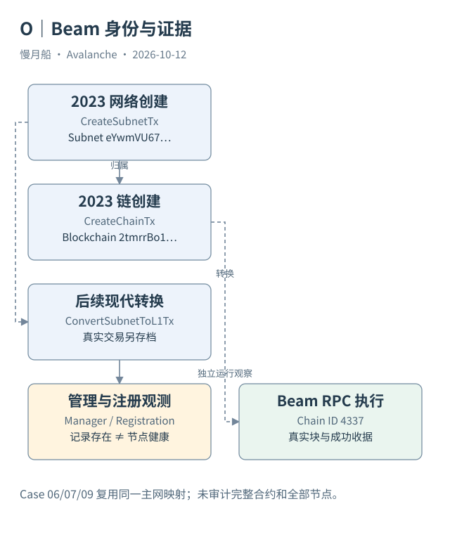

# 24｜怎样证明 Beam 的身份与今天的运行有关？

一个名字叫 Beam 的条目不足以确定网络。P-Chain 甚至可能返回多个同名链。可靠案例需要先确定主网身份，再把历史创建、当前管理与运行数据接起来。

## 先用稳定身份找记录

本轮官方链目录的主网 Beam 条目给出 EVM Chain ID `4337`、Blockchain ID `2tmrrBo1Lgt1mzzvPSFt73kkQKFas5d1AP88tv9cicwoFp8BSn`、Subnet ID `eYwmVU67LmSfZb1RwqCMhBYkFyG8ftxn6jAwqzFmxC9STBWLC`。主网标记与 RPC 地址一起保存，避免误用同名测试网条目。

官方 P-Chain `getBlockchains` 返回相同链与网络关系。Data API 又取得对应 CreateChainTx，给出 `beam` 名称、VM ID 与 Genesis 中的 Chain ID。链目录、平台记录与执行链配置形成三项可以交叉检查的证据。

历史 CreateSubnetTx 与 CreateChainTx 分别位于 P-Chain 高度 `7767891` 和 `7768389`，发生在 2023 年。网络当前详情还给出真实转换交易 `VgR2jZVe3AC8jPPsNcE76KktsRi9J4Jke9kGCk5e8zZBzWTXr`。本篇实际取得交易本体，确认类型为 ConvertSubnetToL1Tx，而非只引用目录中的 L1 标签。

## 历史创建与当前管理

转换记录与当前详情指向管理链及地址 `0x46d5a1b62095ce9497c6cc7ab1bdb8a09d7e3c36`。这个位置描述 Validator Manager 的协议关联，不单独证明当前管理合约全部逻辑、管理员安全或初始化事件。本篇没有取得的合约执行证据仍然列为缺口。

创建时 Genesis 的授权和费用参数不是今天全部配置。当前详情中的控制地址也可能与创建交易不同。这样的差异需要历史操作来解释，不能无证据地判定是 API 错误，更不能把某个时期地址写成永远的唯一管理员。

同样，官方目录的 `status: OK` 是服务来源的状态标记，不是网络健康审计。运行证据需要具体区块与交易，验证者证据需要注册与活跃条件。名称、标签和宣传介绍都只提供辅助检索。

## 取得一个运行时间位置

Beam RPC 的 Chain ID 与目录一致，本轮返回真实区块和收据。区块包含一笔交易，收据给出成功状态与计费信息。它能证明该服务在获取时提供了对应的历史执行视图；连续运行、所有节点一致和长期吞吐仍需要更宽观测。

本篇 Case 06 侧重历史对象，Case 07 侧重注册，Case 09 侧重独立链交易。三个案例复用同一网络映射，减少名字猜测。读者可以由案例索引追到完整 JSON，再看哪些字段属于索引补充，哪些来自 RPC。

建立真实 L1 案例，不需要先收集巨大排行榜。少量相互对应的对象已经能让“网络在哪里登记、链在哪里执行”变得清楚。其他 L1 可以沿用方法，但每个编号、Gas Token 和当前状态都要重新核实。

当前平台注册快照里有注册时间晚于网络创建的节点，这说明创建记录不能描述今天完整成员集合。Case 07 选取一项明确注册，Case 09 选取一个明确执行位置，二者只支持各自问题，不让一个页面标签承担所有当前状态结论。

同名测试网 Beam 的 EVM Chain ID 与 Blockchain ID 另有记录，本篇没有把它混入主网案例。这种明确环境筛选，是公开链目录进入分析之前的必要步骤。

图中的箭头按标注表示运行步骤或证据关联；图形是教学模型，实际响应另见案例档案。

[编辑此图](../../assets/diagrams/beam-evidence.drawio)。

[真实案例与字段缺口](../../examples/transactions/README.md) · [实际 API 请求/响应](../../examples/rpc/README.md)。

资料与核对依据：[api-subnet](https://build.avax.network/docs/api-reference/data-api/primary-network/getSubnetById.md)；[p-rpc](https://build.avax.network/docs/rpcs/p-chain.md)；[l1-config](https://build.avax.network/docs/avalanche-l1s/evm-configuration/customize-avalanche-l1.md)；[acp-77](https://raw.githubusercontent.com/avalanche-foundation/ACPs/main/ACPs/77-reinventing-subnets/README.md)。协议基准日为 2026-10-12；案例时间以原始记录为准。

[上一章](23-genesis-and-gas-token.md) · [本篇目录](../../SUMMARY.md) · [下一章](../part-07/25-validator-manager.md)
