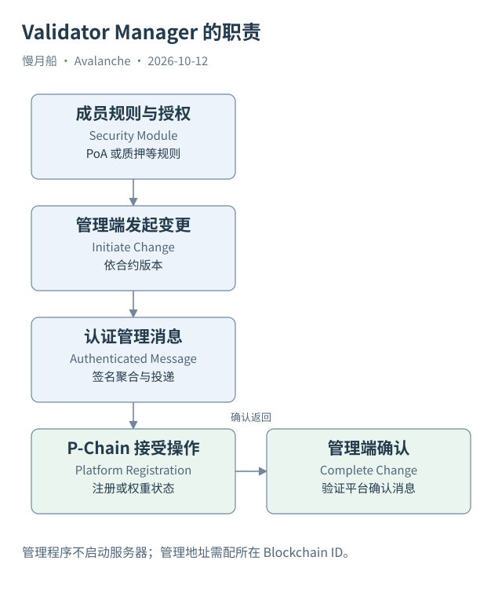

# 25｜Validator Manager 怎样管理真正的节点？

管理合约发出“新增验证者”事件，是否会立即启动一台服务器？不会。Validator Manager 管理的是协议中的成员规则与变更流程，节点进程和网络运行仍需要独立设施。

## 管理逻辑与平台记录配合

ACP-77 允许网络在转换时指定 `(blockchainID, address)` 作为管理位置。该程序按照自己的权限或抵押规则决定注册与权重变更，并发出供 P-Chain 检查的消息。P-Chain 接受符合协议的管理交易后，产生可被管理端确认的状态通知。

ACP-99 定义 Validator Manager Solidity 标准及相关接口，是建立在 ACP-77 上的最佳实践标准。它不是让每条 Custom VM 链都自动具备 Solidity。分析具体网络，仍应确认所采用实现、版本、管理链及安全模块。

官方当前合约体系将 ValidatorManager 与 PoAManager 或 StakingManager 等组件组合。旧版本可能采用不同合约组织方式。不能根据一张最新版类图断言某个历史部署具有全部相同方法、权限和事件。

## 发起、平台落地与完成

添加验证者通常包括管理端发起、产生并取得签名消息、在 P-Chain 提交注册、再向管理端提供平台确认。发起成功只是一个阶段。如果 P-Chain 尚未接受、消息过期或确认未送回，管理端和平台端可能还没有完成整个流程。

管理系统可以限制短时间内权重变动的幅度（churn），也可以规定发起权限、抵押资产和奖励条件。这些链内规则不能从 P-Chain 的一个 weight 字段全部恢复。P-Chain 维护的是协议所需注册，不是每个应用的完整经济账本。

合约管理也不提供服务器的在线保证。节点身份、软件版本、网络连接和同步位置仍需核查。注册可以有效，但节点未运行；节点可以提供 RPC，却不在有效验证集合中。把两者分开，才能判断某项启动工作缺在哪里。

## 看懂“开放”与“许可”

许可型（Permissioned）L1 可以由授权主体发起成员变更；无许可型（Permissionless）管理可以依规则允许符合抵押等条件的参与者加入。这描述成员管理，不能自动推导交易访问权限或 RPC 是否公开。应用访问控制是另一组配置。

管理合约升级、所有权与安全模块设置会改变实际规则。数据研究应按版本保存初始化、权限和变更事件，不能仅看当前 ABI。源代码公开也不等于已验证代理当前实现地址与链上状态。

本篇对 Beam 取得管理位置与 P-Chain 注册，但尚未取得所有管理端事件。案例因此只确认平台可观察部分。理解 Validator Manager 的价值，正是在于看见一条跨对象、跨链的管理路径，并为每个完成阶段寻找相应证据。

管理端权重可以由抵押金额经换算因素计算。整数除法、上限与精度会影响结果，不能把 weight 直接除以代币 decimals 反推锁仓。需要管理合约对应参数，才能把平台权重与经济数量可靠地连接。

图中的箭头按标注表示运行步骤或证据关联；图形是教学模型，实际响应另见案例档案。

[编辑此图](../../assets/diagrams/validator-manager.drawio)。

资料与核对依据：[acp-77](https://raw.githubusercontent.com/avalanche-foundation/ACPs/main/ACPs/77-reinventing-subnets/README.md)；[acp-99](https://raw.githubusercontent.com/avalanche-foundation/ACPs/main/ACPs/99-validatorsetmanager-contract/README.md)；[manager-readme](https://raw.githubusercontent.com/ava-labs/icm-contracts/main/contracts/validator-manager/README.md)；[manager-contracts](https://build.avax.network/docs/avalanche-l1s/validator-manager/contract.md)。协议基准日为 2026-10-12；案例时间以原始记录为准。

[上一章](../part-06/24-beam-creation.md) · [本篇目录](../../SUMMARY.md) · [下一章](26-manager-bootstrap.md)
