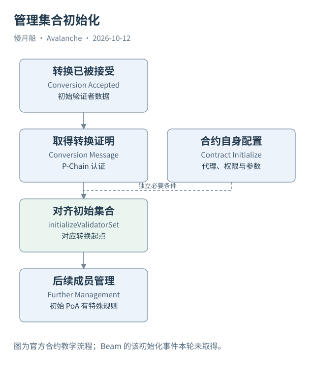

# 26｜转换成功以后，为什么还需要初始化验证者集合？

一笔 ConvertSubnetToL1Tx 已经成功，初始节点也开始出块，管理合约是否可以直接新增验证者？这取决于管理端是否完成必要的初始状态建立。平台记录和合约状态不会因为名字相同就自动同步。

## 两侧需要同一份起点

转换交易确定 Subnet、管理位置和初始验证者等信息。P-Chain 按规则愿意签署相应转换消息，证明平台接受的转换数据。管理合约需要取得适当证明，确认提供给它的初始集合确实对应平台记录，而不是调用者自行编造的列表。

官方合约的 `initializeValidatorSet` 处理这类转换数据与消息，建立管理端初始集合。它与代理或合约自身 `initialize` 配置不是同一个步骤。前者对齐已转换网络，后者配置合约权限与管理参数。遗漏其一都可能留下“地址已经部署但流程无法继续”的状态。

实现细节随管理合约版本而变化，本篇只解释需要核实的对象与证明，不提供签名部署教程。链上操作前应依据选定版本确认精确参数，不能把历史教程函数名复制到任意现行系统。

## 初始验证者有特殊语义

官方当前管理说明将转换初始化的验证者视为初始 PoA 集合，它们不会因为出现在初始数据中自动获得新质押管理的奖励资格。若后续切换到抵押管理，需要走相应流程；初始权重不单独证明已经有代币锁仓。

网络可以先借助初始验证者开始链运行，再完成管理端对齐。这样的启动顺序有具体条件，不能用“RPC 已经有块”证明所有管理步骤已经完成。反过来，管理初始化成功也不能单独保证多个节点稳定出块。

完整启动证据应分别保存转换交易、管理合约配置、初始集合初始化、平台注册与后续链活动。必要时还需消息签名与确认路径材料。无记录的步骤必须写成未证实，而不是用上一阶段的成功代替。

## 一个本地教学项目怎样使用

thaw.fun 这类项目尝试简化发链体验，很适合展示产品状态与底层步骤的差距。但本轮不运行项目、不启动集群、不部署 Fuji，也不修改既有代码。由于主体已有公开主网案例，本篇不把可选本地项目用作关键验证证据。

若以后加入本地案例，应把 UI 模拟、Local E2E、Fuji 写操作和 Mainnet 运行分成独立证据级别。名为 LIVE 的产品状态需要说明判定条件。只读 API 返回空目录，或者页面动画显示进度，都不能冒充 L1 启动成功。

bootstrap 的教学重点是两个状态系统如何建立可信共同起点。读者知道这里为什么有额外一步，就能看懂转换记录、管理状态和真实运行之间的关系，也不会再将“创建成功”理解为后续一切自动可用。

初始集合证明、管理合约部署交易与节点启动日志应该分开归档。三种资料可能共同支持启动结论，但缺少哪一种就应限制对应阶段。仅把日志中的“started”文字复制到报告，不能证明已形成所需签名或初始化了合约集合。

图中的箭头按标注表示运行步骤或证据关联；图形是教学模型，实际响应另见案例档案。

[编辑此图](../../assets/diagrams/manager-bootstrap.drawio)。

资料与核对依据：[manager-readme](https://raw.githubusercontent.com/ava-labs/icm-contracts/main/contracts/validator-manager/README.md)；[acp-99](https://raw.githubusercontent.com/avalanche-foundation/ACPs/main/ACPs/99-validatorsetmanager-contract/README.md)；[acp-77](https://raw.githubusercontent.com/avalanche-foundation/ACPs/main/ACPs/77-reinventing-subnets/README.md)。协议基准日为 2026-10-12；案例时间以原始记录为准。

[上一章](25-validator-manager.md) · [本篇目录](../../SUMMARY.md) · [下一章](27-validator-lifecycle.md)
