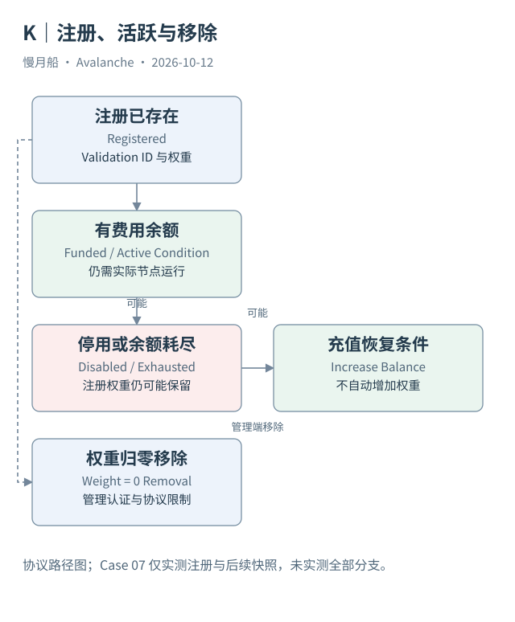

# 27｜停用、费用耗尽和权重归零是同一种退出吗？

一个 L1 验证者暂时停止活跃，平台记录却还保留其权重。为什么不直接删除？因为活跃费用状态和网络定义中的注册权重，是相关但不同的机制。

## 注册没有统一固定结束时间

现代 L1 注册不沿用所有 Primary Network 定期质押的 `endTime` 结构。注册通过初始转换或后续 RegisterL1ValidatorTx 建立，包含权重、公钥、费用余额与相关所有者。管理端依据自身规则决定后续变化。

连续费用余额耗尽时，注册会变为非活跃；DisableL1ValidatorTx 也能按停用授权主动停止活跃并处理剩余资金。这些情况不会自动等价于管理端把网络总权重里的注册永久移除。P-Chain 保留相关信息以支持之后恢复。

IncreaseL1ValidatorBalanceTx 可以补充余额，使符合条件的非活跃注册恢复活跃。谁充值与谁拥有节点不一定相同。充值记录不能证明投票权重增加，也不能证明服务器当时已经重新连接并开始验证。

## 完整移除由权重操作表达

SetL1ValidatorWeightTx 将权重改为零具有移除语义，需要来自对应管理位置的授权消息。它还受到防重放及集合边界等协议条件约束。初始规范防止移除集合最后一个验证者，避免无法形成新注册消息的不可恢复状态，不能把产品“关闭”按钮假定为总能清空集合。

停用后留下的非活跃权重也会影响可用于消息验证的权重关系。不能只看“目前在线的三台节点”就推导它们足以形成每个目标链要求的签名门槛。需要考虑协议取得的集合、权重和具体消息验证位置。

移除注册不自动说明 L1 管理合约中的抵押资产已返还。抵押、奖励与平台余额退款由各自规则处理，可能需要跨链确认与管理端完成步骤。平台最终状态与合约最终状态都应取证。

## 真实样本只覆盖实际路径

Case 07 保存 Beam 某个 RegisterL1ValidatorTx 与之后的验证者快照，两者 Validation ID 与 Node ID 一致。它能证明注册和后续观察关系，但本轮没有该注册的全部权重变化、停用和永久退出记录，不能称为完整生命周期实测。

书稿的生命周期图因此是协议路径图，箭头中的其他分支不是该节点真实发生的历史。案例目录用 VALIDATED 标明部分路径与缺口，而不为了图形完整就编造交易 ID。

一个严谨状态模型至少分开注册存在、管理端阶段、权重、费用活跃条件和实际运行观测。单个“active”布尔值可能适合界面，但不能承担全部研究结论。知道这些状态为何不同，就能解释停用后仍有记录，也能判断哪一步还需要证据。

状态变更通知也有方向：管理端发出的请求说明意图，P-Chain 接受说明平台落地，管理端确认说明其本地状态对齐。对一个变更取到三类材料，才能比单个发起事件更完整地判断流程。未取得的通知保留未知。

图中的箭头按标注表示运行步骤或证据关联；图形是教学模型，实际响应另见案例档案。

[编辑此图](../../assets/diagrams/validator-lifecycle.drawio)。

[真实案例与字段缺口](../../examples/transactions/README.md) · [实际 API 请求/响应](../../examples/rpc/README.md)。

资料与核对依据：[acp-77](https://raw.githubusercontent.com/avalanche-foundation/ACPs/main/ACPs/77-reinventing-subnets/README.md)；[p-rpc](https://build.avax.network/docs/rpcs/p-chain.md)；[manager-readme](https://raw.githubusercontent.com/ava-labs/icm-contracts/main/contracts/validator-manager/README.md)；[api-l1-validators](https://build.avax.network/docs/api-reference/data-api/primary-network/listL1Validators.md)。协议基准日为 2026-10-12；案例时间以原始记录为准。

[上一章](26-manager-bootstrap.md) · [本篇目录](../../SUMMARY.md) · [下一章](28-continuous-fees.md)
