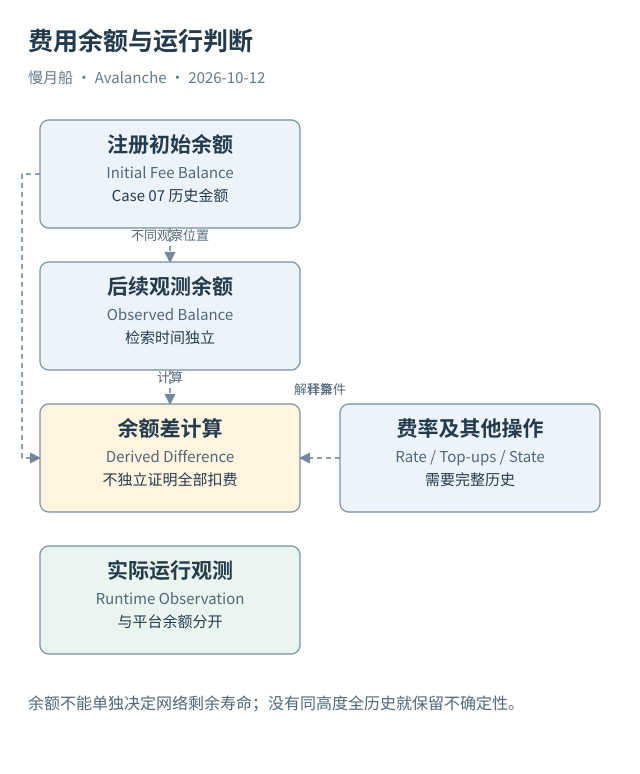

# 28｜剩余费用余额能告诉我们链还会运行多久吗？

一个验证者费用余额还剩一 AVAX，能否推断这条 L1 一定再运行一个月？余额可以说明某个注册的费用资源，但持续时间还取决于费率、充值与其他运行条件。

## 连续费用支持平台服务

ACP-77 通过注册费用余额支付 P-Chain 持续维护相关验证者状态的成本。活跃期间余额按协议费用机制扣减，余额不足会影响活跃状态。费用动态与参数有关，不能把历史营销材料中的近似月费当成所有时期永久固定价格。

余额与一次性 P-Chain 交易费不同。注册交易可能同时包含资金输入、交易销毁与费用余额分配。Data API 的 `amountBurned`、`amountL1ValidatorBalanceBurned` 等字段也需要按类型与来源说明，不能全部合并成某个用户的 Gas。

RPC `platform.getL1Validator` 可返回费用余额、权重与当前高度；官方索引 API 提供相关注册字段。原始数量要核对单位，本篇用精确整数计算，不通过浮点近似对账。字段名称不同不应凭相似性直接替代。

## 两个时点的余额差

Case 07 中，注册历史记录的初始余额为 `1333333333`，随后索引快照为 `1316491093`。差额为 `16842240` 个九位小数最小单位。它与经过时间发生费用扣减相容，但没有完整同高度历史与所有充值记录，本篇不把差额独立证明成全部实际连续费用。

估计剩余时间需要假设未来费率不变、不再充值，且注册继续活跃。即使这些条件成立，估计也只涉及平台费用条件。服务器故障、管理端移除、软件不兼容或网络停滞，都可能使链更早停止实际运行。

多个验证者有各自余额与权重。网络是否还能形成共识或签名，不只看总余额。一个高权重节点费用耗尽，与多个低权重节点余额减少，对运行影响不同。聚合时应保留注册粒度，不能把所有余额堆成一个平均天数。

## 指标应说明观察能力

可以报告“在该高度观测的注册费用余额”“本次来源返回的注册样本”或“在固定费率假设下的估计”。不宜直接报告“全网剩余寿命”。只读观察也无法证明运营者未来是否会充值，不能从余额下降推断主观弃链意图。

P-Chain 余额非零同样不充分证明节点在线；RPC 能读到新块也不能证明每个注册都活跃。将平台状态与链运行数据结合，能提供更完整的诊断，仍需明确时间对齐与覆盖。

持续费用的真正意义是把运行成本的一部分变成可观察状态。它给分析师一个具体入口，却没有替代整个网络健康评估。把余额、权重、费用机制与实际出块分开，才不会将一个精确数字解释成超出证据范围的确定未来。

费用快照可帮助预警，却应在报表中保留观察时间和费率假设。用固定余额阈值的报警只表达阈值被触发，不能直接称链即将死亡。业务系统可以简化提示，研究报告仍应解释其背后的数据条件。

图中的箭头按标注表示运行步骤或证据关联；图形是教学模型，实际响应另见案例档案。

[编辑此图](../../assets/diagrams/continuous-fees.drawio)。

[真实案例与字段缺口](../../examples/transactions/README.md) · [实际 API 请求/响应](../../examples/rpc/README.md)。

资料与核对依据：[acp-77](https://raw.githubusercontent.com/avalanche-foundation/ACPs/main/ACPs/77-reinventing-subnets/README.md)；[p-rpc](https://build.avax.network/docs/rpcs/p-chain.md)；[api-l1-validators](https://build.avax.network/docs/api-reference/data-api/primary-network/listL1Validators.md)。协议基准日为 2026-10-12；案例时间以原始记录为准。

[上一章](27-validator-lifecycle.md) · [本篇目录](../../SUMMARY.md) · [下一章](../part-08/29-warp-trust.md)
