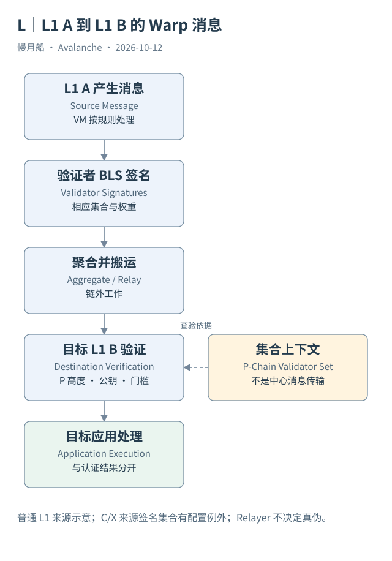

# 29｜不同验证者集合之间，怎样验证消息是真的？

L1 A 声称某笔操作已经发生，L1 B 为什么相信它？如果只相信搬运消息的服务器，这就新增一个中心化真假判断者。Avalanche Warp Messaging（AWM）提供签名与验证原语，使目标按协议检查相应验证者集合的认证。

## 签名绑定具体消息

源侧 VM 按规则产生消息，验证者用 BLS 密钥签署相应内容。聚合器收集签名，将多份签名合成一份聚合签名，同时标记参与签名者。目标验证需要消息内容、公钥集合和权重条件，不能只看一个“签名存在”的字段。

Warp 的无签名消息结构包含 Network ID、Source Blockchain ID 与载荷。发送地址等信息可以在 AddressedCall 这类载荷结构中承载，目标 Blockchain ID 也可由上层协议定义。不要把某个教程展开后的消息字段无条件说成所有底层 Warp 消息的固定顶层格式。

跨网络身份有防重放意义。Fuji 消息不能因同样使用 Avalanche 技术就被当作主网消息。源链身份同样需要规范化编码，EVM Chain ID 不是 Warp 中的 Blockchain ID。消息哈希和 Teleporter 的协议 Message ID 也不是可以任意互换的同一编号。

## P-Chain 提供集合位置

目标按相应 P-Chain 高度取得验证者 BLS 公钥和权重。这个高度与目标块 ProposerVM 等验证上下文关联，不能用“今天的全部节点列表”验证过去某条消息。集合变化后，历史位置仍是正确解释的关键。

签名门槛按权重计算，不按签名条数计算。Subnet-EVM Warp 配置有 quorumNumerator 等参数，默认门槛为 67/100；其他配置须按目标实际规则确认。P-Chain 管理交易有自己的固定门槛，不能把某条应用 L1 的自定参数套进去。

还有 Primary Network 来源的特殊规则：对来自 C/X 的消息，目标 L1 默认可按自身验证者集合处理，除非配置要求 Primary Network 签名者。概念图不能笼统声称所有消息永远由全部源网络节点签名；应注明来源类型和目标配置例外。

## 谁提供了哪一种保证

Relayer 负责搬运与提交，不获得把伪消息变真的权力。它仍影响消息能否及时送达，也可以受上层允许名单与费用条件约束。签名验证解决认证，传输活性与应用成功则需要其他条件。

AWM 不替应用判断任意商业数据是否真实。它证明的是符合协议的签名认证，安全解释依赖相关验证者诚实参与和平台集合记录。应用需要自己规定接受哪些来源、载荷、版本以及状态变化。

本篇取得真实源侧事件，没有取得 Case 08 的聚合签名本体与全部目标路径，因此只确认源侧观测。签名机制来自官方规范；这两类证据分开，读者才不会把理论上可以验证的路径误写成某条消息已经完成。

聚合签名不是若干签名的字符串拼接，而是密码学聚合结果与签名者标识的组合。目标还需要权重集合，才能判断门槛。本篇没有重新实现 BLS，协议解释来自官方规范，案例观测与密码学实现验证分别记录。

Granite 的 ACP-181 进一步把用于验证的 P-Chain 视图按 epoch 固定。目标使用的集合高度可能落后于 P-Chain 最新尖端，消息构造与历史验证不能直接取最新节点列表。这个 epoching 标准由 ProposerVM 等层实现，不是把 P-Chain VM 自身改成另一条 Epoch 链。

图中的箭头按标注表示运行步骤或证据关联；图形是教学模型，实际响应另见案例档案。

[编辑此图](../../assets/diagrams/warp-flow.drawio)。

资料与核对依据：[ACP-181](https://raw.githubusercontent.com/avalanche-foundation/ACPs/main/ACPs/181-p-chain-epoched-views/README.md)；[icm-overview](https://build.avax.network/docs/cross-chain/avalanche-warp-messaging/overview.md)；[icm-deep-dive](https://build.avax.network/docs/cross-chain/avalanche-warp-messaging/deep-dive.md)；[acp-77](https://raw.githubusercontent.com/avalanche-foundation/ACPs/main/ACPs/77-reinventing-subnets/README.md)。协议基准日为 2026-10-12；案例时间以原始记录为准。

[上一章](../part-07/28-continuous-fees.md) · [本篇目录](../../SUMMARY.md) · [下一章](30-teleporter.md)
