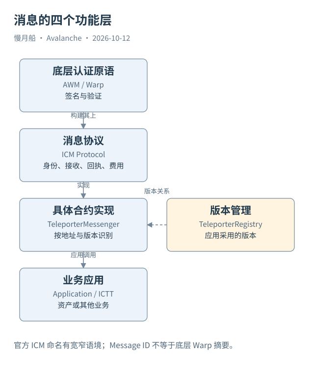

# 30｜AWM、ICM 与 Teleporter 分别是哪一层？

资料里有时把 ICM 解释为底层互操作，有时又称它为 Teleporter。名称随历史材料和文档语境变化，阅读时应先分清功能层，再记录采用的术语。

## 从认证原语到消息协议

AWM 提供消息签名与验证原语，VM 可以据此构建跨链协议。ICM（Interchain Messaging）在当前官方资料中既用于跨 Avalanche L1 消息能力，也用于其上层协议体系。Teleporter 是具体合约协议的重要名称，合约仍使用 TeleporterMessenger 等标识。

本篇采用功能分层：底层 Warp 认证、消息协议、具体合约实现、应用。这样即使教程改名，读者仍可辨认哪些字段属于 Warp，哪些属于 Teleporter 消息，哪些属于应用资产规则。命名说明不改变实际链上合约地址或历史事件名。

TeleporterMessenger 处理发送与接收流程，消息包含目标链、目标应用、载荷、Gas 要求、费用信息与允许的投递者等。它还维护消息识别、重复接收防护和回执相关记录。这些能力不是任何自定义 VM 只要宣称支持 Warp 就自动获得。

## Registry 管理版本入口

TeleporterRegistry 帮助应用管理协议版本与对应 Messenger 地址。一个相同事件名可能来自不同部署或版本，分析应保留合约地址和历史版本。仅按 messageID 在全网无条件连接，可能混合不同协议范围。

消息接收会涉及目标链交易与合约处理。用户在源链发起的是一笔交易，Relayer 在目标链提交的是另一笔交易。它们共享协议消息身份，不共享用户交易哈希。错误地用 tx_hash 连两侧，往往会把正确关联变成空结果。

协议回执与 EVM Receipt 不是同一种对象。前者可被带回源链用于投递确认和奖励逻辑，后者记录某一笔链内交易的执行结果。名字都含 receipt，数据模型仍需分别命名，避免一个“receipt成功”掩盖到底确认了什么。

## 消息不一定携带资产

预言机更新、应用调用、状态通知与代币操作都可能使用跨链消息。空业务载荷也可能用于回执。看到 SendCrossChainMessage，不能自动把事件中的整数叫转账金额；需要查看目标应用如何解释载荷。

本轮 Dune Catalog 实际取得 C-Chain Teleporter send 与 receive 事件表，以及相应 call 表。字段包括 `messageID`、方向相关 Blockchain ID、事件索引与完整消息表示。表名按返回结果保存，没有假造统一全网 ICM 表。

这些表能够说明被索引的 C-Chain 端点活动，不能独立说明所有 L1 消息或完成率。层次划分让我们知道哪里可以写 SQL，哪里需要签名材料，哪里必须取得目标应用状态。下一章将把“发出、接收、执行”变成可分别核查的状态。

一个接收交易可以同时处理消息及协议回执。事件数、窗口不同消息数和业务调用数因此不一定相等。用 Dune 统计时保留合约和方向，再根据协议结构解释，避免把每个 receipt 都当成一笔新增跨链资产转移。

图中的箭头按标注表示运行步骤或证据关联；图形是教学模型，实际响应另见案例档案。

[编辑此图](../../assets/diagrams/icm-layers.drawio)。

资料与核对依据：[icm-overview](https://build.avax.network/docs/cross-chain/avalanche-warp-messaging/overview.md)；[icm-deep-dive](https://build.avax.network/docs/cross-chain/avalanche-warp-messaging/deep-dive.md)；[teleporter-interface](https://raw.githubusercontent.com/ava-labs/icm-contracts/main/contracts/teleporter/ITeleporterMessenger.sol)；[manager-readme](https://raw.githubusercontent.com/ava-labs/icm-contracts/main/contracts/validator-manager/README.md)。协议基准日为 2026-10-12；案例时间以原始记录为准。

[上一章](29-warp-trust.md) · [本篇目录](../../SUMMARY.md) · [下一章](31-message-stages.md)
