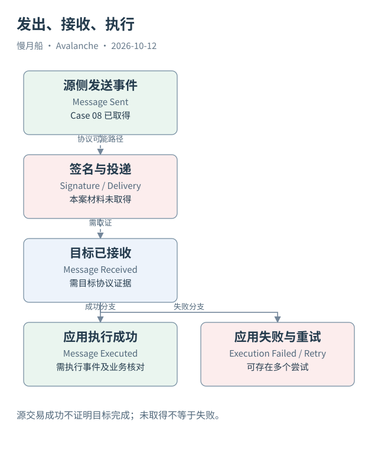

# 31｜发送成功，为什么目标业务仍可能失败？

源链交易已成功发出消息，用户却没有在目标链收到预期资产。这个现象不一定与源收据矛盾。跨链过程有多个独立阶段，每一阶段需要自己的证据。

## 发出之后仍有链外工作

源侧交易执行并保留 SendCrossChainMessage，只证明源协议产生了消息记录。签名请求、聚合和运输通常在链外完成，不一定逐步写入链上。没有这些材料，不能从一个日志推断签名已经足够或 Relayer 已开始提交。

投递者将认证消息提交到目标链，目标验证后，消息协议可能标记已接收。接收成功也不等于目标应用调用成功。Gas 条件、应用状态或合约 revert 都可能影响执行，具体失败与重试规则需按合约版本核对。

官方 Teleporter 接口区分 `ReceiveCrossChainMessage`、`MessageExecuted` 与 `MessageExecutionFailed` 等事件。顶层目标交易可能成功，同时协议记录应用执行失败；只读取收据 status，就会遗漏这个业务层差异。

## 为同一消息保存状态证据

一个合理的分析表可以保存源事件、签名材料是否取得、目标接收事件、应用执行结果和回执状态。每列都要带来源，而不是由“前一列为真”自动推导后一列为真。未观察到的阶段应保留未知，不能全部变成失败。

重试可能产生更多目标交易或事件。一次消息的多个执行尝试，与多个独立消息不是同一计数。完成率要先按协议身份聚合尝试，再定义成功条件。时间窗口也要允许源侧发送与目标侧完成跨越不同日期。

如果问题是代币到账，还要取得资产合约的事件或状态。MessageExecuted 表示协议相关执行成功，不单独证明用户最终余额符合预期。后续路由、费用、兑换或应用内部记账，都可能影响到账含义。

## Case 08 只确认已取得的源侧

本篇真实样本来源于作者已存在的 Dune 查询历史执行：C-Chain 发送事件、合约地址、messageID 与 destinationBlockchainID 已保存。执行窗口在 2026 年 9 月 10 日，本轮读取没有刷新。它不是当天新运行 SQL 的结果。

本轮未取得相应目标接收、执行事件和状态，因此不报告这条消息已完成，也不计算成功率。目标链看不到可能由覆盖或接口限制引起，不等于确定业务失败。案例的限度本身是跨链数据分析的重要教材。

界面可以用简洁状态帮助用户，但研究报告应说明每个状态的判定证据。把 sent、delivered、executed 分开，才能在故障或延迟时定位哪一阶段仍未知，也能避免源链成功提示被误当作资产已经跨链到账。

目标应用之后还可能产生新的消息或执行尝试。若要衡量端到端耗时，需要明确终点是接收、应用调用成功还是最终余额。先写指标定义，再关联各阶段时间，不能在结果中挑最早一个成功事件代替业务完成。

图中的箭头按标注表示运行步骤或证据关联；图形是教学模型，实际响应另见案例档案。

[编辑此图](../../assets/diagrams/message-states.drawio)。

[真实案例与字段缺口](../../examples/transactions/README.md) · [实际 API 请求/响应](../../examples/rpc/README.md)。

资料与核对依据：[teleporter-interface](https://raw.githubusercontent.com/ava-labs/icm-contracts/main/contracts/teleporter/ITeleporterMessenger.sol)；[icm-overview](https://build.avax.network/docs/cross-chain/avalanche-warp-messaging/overview.md)；[icm-deep-dive](https://build.avax.network/docs/cross-chain/avalanche-warp-messaging/deep-dive.md)。协议基准日为 2026-10-12；案例时间以原始记录为准。

[上一章](30-teleporter.md) · [本篇目录](../../SUMMARY.md) · [下一章](32-asset-messaging.md)
