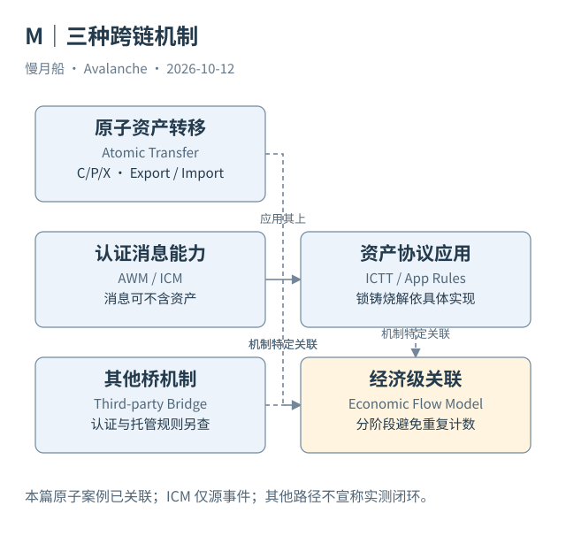

# 32｜原子转移、ICM 资产协议与第三方桥怎么区分？

用户常把“从一条链到另一条链”统称为跨链。分析师必须再问：是哪一套机制在验证、保管和更新资产？相似的界面操作可能留下完全不同的证据。

## Primary Network 的原子资产路径

C/P/X 的 Atomic Transfer 使用各链定义的 Export、Import 与原子输出。源资金按模型导出，目标消费输出并生成目标资金。这条路径在案例中具有明确 UTXO 血缘，不需要将它解析成普通 ERC-20 锁仓合约事件。

但它的适用范围与资产规则仍由协议定义。不能因为 Primary Network 三链支持原子操作，就宣称任意 Avalanche L1 都能无条件通过相同 Shared Memory 路径转移任意资产。其他 VM 与网络之间的互操作需要各自支持。

## ICM 只是应用的消息基础

Interchain Token Transfer（ICTT）等应用利用消息认证与投递，在两侧合约维护资产规则。具体实现可能锁定与铸造、销毁与解锁，或按 home/remote 等关系处理供应。需要确认合约版本、资产映射、数量换算与信任条件。

一条 ICM 消息也可以只更新状态或调用应用，根本不发生代币移动。签名者认证消息，不自动替应用完成资产保管。于是“消息真实”和“资产机制安全”“用户已经到账”是三个不同结论。

原生币与包装代币还有额外语义。某条 L1 的原生币被另一条链表示为 ERC-20，不意味着两侧原始资产 ID 相同。映射关系、供应约束与兑换条件应作为独立证据保存，不能只凭相同符号连接。

## 第三方桥带来另一套规则

第三方桥可能使用多签、外部验证者、轻客户端或其他认证方式。即使目标链是 Avalanche，也不自动变成 AWM 或原子转移。研究应找桥自身合约、事件和确认规则，不能使用网络名称替代机制分类。

对总跨链流量的统计尤其需要避免重复。一个应用可以先包装资产，再发送消息，再生成目标转移。把三类记录全部视作独立经济跨链金额，会再次计算同一操作。统一模型应保存协议阶段，并对经济动作另建关联。

## 让分类支持取证

最少记录机制名称、源目标网络与链、资产身份、操作键、两侧交易和完成证据。Atomic 用 UTXO 关系；Teleporter 类消息用协议 messageID 与合约范围；第三方桥按实际机制定义键。不能设计一个万能 bridgeHash 后要求全部来源配合。

本篇取得一组原子转移闭环与一个 ICM 源事件，但没有验证所有 ICTT 或第三方桥路径。比较图表达功能和证据区别，不伪装成每一种桥都有真实完整样本。分类做得准确，后续统一观察才能保留每条路径的意义。

资产协议的两侧数量可能受 decimals 变换与费用影响。没有核实规则时，金额相同只提供辅助线索。可靠追踪应先识别机制与操作键，再说明数量如何转换，不能以金额吻合替代目标完成证据。

图中的箭头按标注表示运行步骤或证据关联；图形是教学模型，实际响应另见案例档案。

[编辑此图](../../assets/diagrams/cross-chain-mechanisms.drawio)。

资料与核对依据：[atomic-format](https://build.avax.network/docs/rpcs/c-chain/txn-format.md)；[icm-overview](https://build.avax.network/docs/cross-chain/avalanche-warp-messaging/overview.md)；[teleporter-interface](https://raw.githubusercontent.com/ava-labs/icm-contracts/main/contracts/teleporter/ITeleporterMessenger.sol)；[l1s](https://build.avax.network/docs/avalanche-l1s.md)。协议基准日为 2026-10-12；案例时间以原始记录为准。

[上一章](31-message-stages.md) · [本篇目录](../../SUMMARY.md) · [下一章](../part-09/33-data-sources.md)
