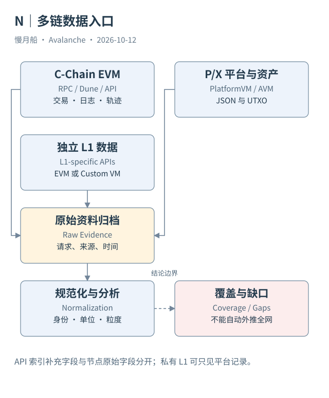

# 33｜为什么 Dune、RPC 和 Data API 都需要保留？

同一笔交易可以从多个服务获得，是否只保留其中最快的一个就足够？如果它们提供不同粒度和加工层次，删掉其他来源可能会同时删掉解释结论的能力。

## 节点接口与索引接口

RPC 面向特定节点或服务的链视图。C-Chain 使用 EVM JSON-RPC，P-Chain 使用 PlatformVM 方法，X-Chain 使用 AvalancheVM 方法。查询路径、方法、参数、网络和时间共同定义请求。一个 RPC Endpoint 不能自动覆盖所有链与所有历史。

官方 Data API 是索引服务，提供更方便的交易、UTXO、资产、注册和关联信息。它可以补充名称、解码和消费关系，便于找到案例。索引字段不一定都是原始共识交易的一部分，读者应知道哪些关系来自服务加工。

本篇每份响应保存请求与检索时间；从中提取的案例另标为节选。这样 API 将来变化时，仍能看到当时究竟取得什么。HTTP 成功也要检查返回是否有 RPC 错误或缺失对象，不能只根据状态码判断验证通过。

## Dune 适合跨记录分析

Dune 提供可用 SQL 连接的 Raw、Decoded 和 Curated 数据，适合时间窗口、排名和指标分析。本轮 C-Chain Raw Schema 经过真实 MCP Catalog 核验；不因此声称 P/X 对象已经存在于某个相同表。

Decoded 把 ABI 信息加到原始事件与调用；Curated 再用模型归类资产移动、交易段等业务数据。加工提高可读性，同时也带来覆盖、版本、单位和去重规则。需要回溯来源，才能知道某条高层行是否与另一个来源重叠。

作者已有 Avalanche Network 与 C-Chain Dashboard 可以作为历史研究索引。社区上传的链目录和验证者快照，不属于全网官方链原始历史。更新时间、采集状态和缺失覆盖都应保留，而不是用漂亮图表隐去。

## 限制是真实观察的一部分

官方公共 RPC 本轮多次返回 429，错误已记录，相关请求不被算成成功案例。另有几条旧文档路径失效、Data API 错误路径返回 400/404，修正后得到的有效响应另存。失败请求证明了访问结果，不证明协议对象不存在。

数据源有免费额度与权限边界。本轮不申请新密钥、不购买套餐、不批量扫描主网历史。Dune 只读账户不执行新 SQL，既有结果只读取已完成执行。读取历史结果不会让其区块时间自动更新到基准日。

选择来源应由问题决定：想理解字段，用规范；想检查交易，取原始或索引响应；想统计已覆盖范围，用 SQL；想确认全网完整性，另需覆盖证据。把四者配合起来，比假定一个工具能够回答所有问题更可靠。

Endpoint 迁移也应记录。例如本篇先尝试旧 Glacier 域名及大写链别名，得到错误；经官方文档核对后使用 data-api.avax.network 与 p-chain 等有效路径。错误样本保留，成功样本另存，不把修正前请求写成成功。

图中的箭头按标注表示运行步骤或证据关联；图形是教学模型，实际响应另见案例档案。

[编辑此图](../../assets/diagrams/data-architecture.drawio)。

资料与核对依据：[data-api](https://build.avax.network/docs/api-reference/data-api.md)；[p-rpc](https://build.avax.network/docs/rpcs/p-chain.md)；[x-rpc](https://build.avax.network/docs/rpcs/x-chain.md)；[c-rpc](https://build.avax.network/docs/rpcs/c-chain.md)；[dune-overview](https://docs.dune.com/data-catalog/evm/avalanche/overview.md)。协议基准日为 2026-10-12；案例时间以原始记录为准。

[上一章](../part-08/32-asset-messaging.md) · [本篇目录](../../SUMMARY.md) · [下一章](34-decoded-curated.md)
