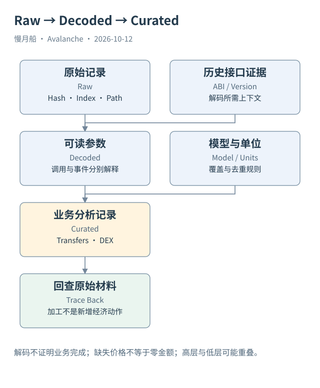

# 34｜解码表和加工表为何仍要回查原始记录？

一张表直接显示 `USDT、from、to、amount`，比 Topics 与 Data 好读得多。但这些友好字段由接口与模型生成，必须知道它们如何从原始记录得到。

## Raw 到 Decoded

原始日志提供合约地址、事件 Topics、Data 和位置。ABI 解释事件签名、索引参数与非索引参数，得到可读列。函数调用解码则解释输入选择器和参数。函数调用被解码不代表成功执行，事件被解码也不代表已经取得最终余额。

本轮 Catalog 取得 `avalanche_c.logs_decoded` 与 `traces_decoded`，也取得专门的 Teleporter 表。通用解码表可提供事件名称和 JSON，专用表则展开协议字段。使用专用表前要确认其合约覆盖、版本与目标字段类型，不能随意猜命名。

代理升级可能改变接口或语义。当前 ABI 不能无条件解释所有历史；动态解码还取决于索引服务的识别范围。未知事件可能只是资料不足，不能直接当成没有业务活动。合约的 names 和 namespace 是检索线索，不是永久身份。

## Decoded 到 Curated

`tokens.transfers` 把多来源资产移动规范化，`dex.trades` 描述模型覆盖的成交段。本轮 Catalog 确认这些表包含 Avalanche C-Chain 范围。查询仍必须筛选 `blockchain = 'avalanche_c'`，防止把其他链活动带入结果。

加工表的金额可以包括 raw amount、标准化 amount 与 USD 估值等不同层次。价格覆盖缺失不应填成零成交；同一代币符号不能替代合约地址。原生 AVAX 与 ERC-20 WAVAX 的表示更需要按来源区分。

一个 Swap 可能有多个成交段与 Transfer 事件。如果把 Curated 成交与原始全部 Transfer 相加，会重复统计同一个业务执行。Raw、Decoded、Curated 是观察层次，不是三种互不相交的经济行为。

## 回查是一条设计好的路径

高层行应保留交易哈希、事件索引或相应路径，再回到原始来源检查。统计口径还需说明是否包括失败、是否仅顶层、是否按成交段或独立交易计数。没有明确粒度的“成交次数”无法与另一张表比较。

Case 02 的官方索引详情提供 ERC-20 转移，原始数量 `400000000`、六位小数，对应 `400 USDT`。它能支撑本次索引观察，尚不能代替完整原始 Logs、Trace 与历史余额。书稿不会因为名字被正确显示，就把所有材料都标为已取得。

分析完成时，应该能够解释结果由哪些源行和哪些模型规则组成。回查能力不是额外装饰，它使你能发现单位误用、重复计数和历史接口错误，也让一张易读表保持可审查的技术含义。

统一表中的 unique_key 是加工模型的身份，不必等于原始日志键。回查时要保留模型采用的交易、索引或路径。若加工行没有足够来源信息，应降低该项结论的可审查等级，而不是猜一个原始事件填入。

在指标附注中列出模型来源和返回的单位，还能帮助读者复算。若同一资产在多个来源出现，先检查血缘重叠，再决定是否需要合并。

图中的箭头按标注表示运行步骤或证据关联；图形是教学模型，实际响应另见案例档案。

[编辑此图](../../assets/diagrams/data-lineage.drawio)。

[本章可用的 DuneSQL 与边界](../../examples/sql/README.md)。新 SQL 未执行。

资料与核对依据：[dune-logs](https://docs.dune.com/data-catalog/evm/avalanche/raw/logs.md)；[dune-traces](https://docs.dune.com/data-catalog/evm/avalanche/raw/traces.md)；[dune-transactions](https://docs.dune.com/data-catalog/evm/avalanche/raw/transactions.md)；[api-evm-transactions](https://build.avax.network/docs/api-reference/data-api/evm-transactions/listLatestTransactions.md)。协议基准日为 2026-10-12；案例时间以原始记录为准。

[上一章](33-data-sources.md) · [本篇目录](../../SUMMARY.md) · [下一章](35-sql-grain.md)
