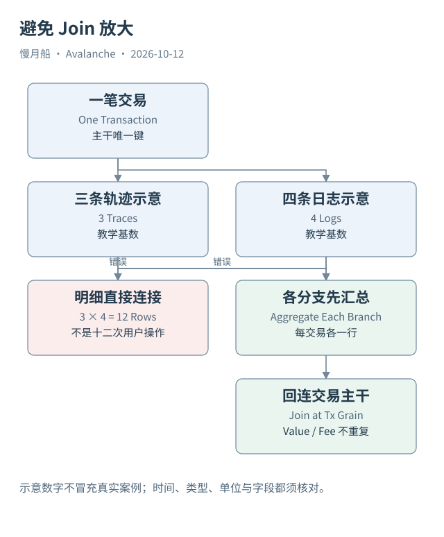

# 35｜一条 SQL 正确，为什么统计仍可能错误？

SQL 可以成功返回数值，标题却可能在描述另一个问题。语法正确只解决程序如何计算，指标正确还需要链范围、时间、粒度、单位与来源覆盖。

## 先定义要计数的对象

统计 C-Chain 每日交易数，应以交易粒度为基础。成功发送地址数则限制成功条件，并计不同发送地址。它不是现实人数，也不包括其他链上的用户。统计区块数时，以区块表为基础；无交易区块不能因为内连接被悄悄排除。

日志数、轨迹数、合约创建地址数和 DEX 成交段数都不是同一个指标。创建合约不等于新增开发者，一次路由多跳不等于多位用户。名称应该让读者准确知道被计数对象，而不是把所有柱形图统一叫“活跃度”。

按交易连接多个明细时，需要先处理一对多。若三条轨迹和四条日志直接相连，组合后十二行会重复交易 value 与费用。示例采用各分支先汇总，再连接主干。教学中的三和四只是说明基数，不冒充本篇实际案例数量。

## 时间与分区同时限制

示例使用明确 UTC 窗口，并同时约束分区字段和时间字段。blocks 的分区是 `date`，transactions/logs/traces 多用 `block_date`，creation_traces 用 `block_month`。字段存在与粒度已由本轮 Catalog 核验。

分区条件有利于查询成本控制，却不能代替语义时间条件。一个月分区内可能包含目标窗口外记录。窗口最后一天如果不完整，也需要单独标出。不同数据源检索时间不同时，不能直接把当天各自最大高度当作严格共同快照。

哈希与地址使用字节类型；原始数量保留精确单位，显示转换另做。Gas 的乘法要避免小整数溢出，浮点显示也要说明精度。跨资产金额没有经济单位一致性，不能直接求和成为总资金量。

## 验证分成两个层次

本篇 SQL 的表名、字段、日期窗口和粒度经过静态审查，状态为 STATIC_CHECKED。Dune 当前账户只读，新 SQL 未提交执行，执行验证标为 BLOCKED_READ_ONLY_ACCOUNT。静态检查不能证明引擎成功解析、字段非空或结果符合预期。

作者已有 Query 的历史 COMPLETED 状态只适用于对应执行。读取它们不会更新结果，也不替本篇新 SQL 验证。执行费用元数据属于历史执行记录，不是本轮新增执行成本。

优秀的 SQL 注释会把问题、范围、单位和不能推出的结论写清楚。这样即使外部执行被阻挡，模板仍能供读者审查；获得权限后再用有限样本验证，而不是把一个未经运行的数字写入书稿。

SQL 里的 LIMIT 只限制返回数量，不保证减少扫描。成本控制首先依赖合适来源、分区与窗口，再选择必要列。对只读账户，本篇不会为了演示成本再发起执行；模板的性能特征只作结构说明，不报告未取得的引擎测量。

图中的箭头按标注表示运行步骤或证据关联；图形是教学模型，实际响应另见案例档案。

[编辑此图](../../assets/diagrams/sql-grain.drawio)。

[本章可用的 DuneSQL 与边界](../../examples/sql/README.md)。新 SQL 未执行。

资料与核对依据：[dune-transactions](https://docs.dune.com/data-catalog/evm/avalanche/raw/transactions.md)；[dune-blocks](https://docs.dune.com/data-catalog/evm/avalanche/raw/blocks.md)；[dune-logs](https://docs.dune.com/data-catalog/evm/avalanche/raw/logs.md)；[dune-traces](https://docs.dune.com/data-catalog/evm/avalanche/raw/traces.md)。协议基准日为 2026-10-12；案例时间以原始记录为准。

[上一章](34-decoded-curated.md) · [本篇目录](../../SUMMARY.md) · [下一章](36-normalize-json.md)
