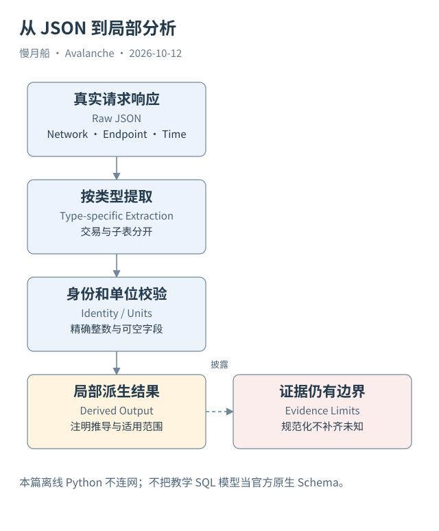

# 36｜怎样把 P/X JSON 接入本地分析？

P/X 数据不是 EVM 表，仍然可以进入分析流程。关键在于先保存真实响应，再建立明确的规范化层，而不是把 JSON 改造成一张看起来像 EVM 的假原始表。

## 原始响应与计算输出分别保存

本篇响应封装记录网络、Endpoint、方法、参数、检索时间及完整返回。API 本身返回的对象保留原结构；节选表和派生金额在另一份文件中生成。读者因此可以分清“服务告诉了什么”和“作者计算了什么”。

Python 示例读取已经落盘的 JSON，不重新连网，也不处理钱包。它把特定案例的输入输出提取出来，按资产汇总整数并做关联一致性检查。程序只演示该样本的模型，不宣称适用于全部 P-Chain 交易类型。

金额使用整数或 Decimal，Asset ID 与 denomination 一起保存。时间保留原 Unix 秒与 UTC 转换；区块高度作为链内位置，不跨链比较数值大小。字段缺失用未知状态或 NULL，不能全部补零，否则“未取得”会变成“已确认没有”。

## 保留一对多结构

一笔交易的 consumedUtxos 和 emittedUtxos 应分别展开子表，通过父交易键关联。所有权地址集合也可另展开，防止多地址输出重复计入金额。Validator 相关交易则按实际结构提取注册信息，不强制所有资金交易都有节点字段。

本地数据库可以把网络组织、区块链、交易、资金输出、注册和消息分成关系表。这里的表名是本书提出的教学模型，不是声称官方 API 原生提供这些 SQL 表。映射规则必须在字段字典中说明。

状态快照还需要 `observed_at` 与可取得的高度。没有共同时点的两份 API 数据，不能被程序自动提升为一致状态。平台余额与节点出块数据也要保留各自来源，才能判断后续关联究竟是严格核对还是时间近似。

## 让程序验证明确的事实

Case 03 的离线校验检查共同 UTXO ID、资产、数量和链方向。Case 05 校验输入输出差额。Case 06 检查 P-Chain Genesis 的 EVM Chain ID 与目录、RPC 一致。它们都是可验证具体命题，不只是重复程序刚写入的值。

校验通过并不补出未知材料。Case 07 的管理端确认、Case 08 的目标执行和 C-Chain 的完整历史余额，仍不因规范化成功而变成已取得。程序结果应与证据索引对齐，不能单独把工程状态升级为 COMPLETE。

最小代码的作用是降低重复劳动和算术错误，让原始链特性继续可见。读者完成本章后，可以把 JSON 变成适用的分析材料，同时清楚知道哪些信息被保留、哪些结论只在选定样本内成立。

本地脚本输出的布尔检查具有具体命题范围。身份一致检查通过，不能推出所有字段正确；输入输出总额一致，也不能推出地址背后是同一实体。验收报告将这些局部通过与全网未验证问题分别列出。

图中的箭头按标注表示运行步骤或证据关联；图形是教学模型，实际响应另见案例档案。

[编辑此图](../../assets/diagrams/json-normalization.drawio)。

[离线提取与关联校验代码](../../examples/python/normalize_cases.py) · [本次计算结果](../../reports/case-checks.json)。

资料与核对依据：[p-rpc](https://build.avax.network/docs/rpcs/p-chain.md)；[x-rpc](https://build.avax.network/docs/rpcs/x-chain.md)；[api-primary-transactions](https://build.avax.network/docs/api-reference/data-api/primary-network-transactions/listLatestPrimaryNetworkTransactions.md)；[api-subnet](https://build.avax.network/docs/api-reference/data-api/primary-network/getSubnetById.md)。协议基准日为 2026-10-12；案例时间以原始记录为准。

[上一章](35-sql-grain.md) · [本篇目录](../../SUMMARY.md) · [下一章](../part-10/37-multi-chain-model.md)
