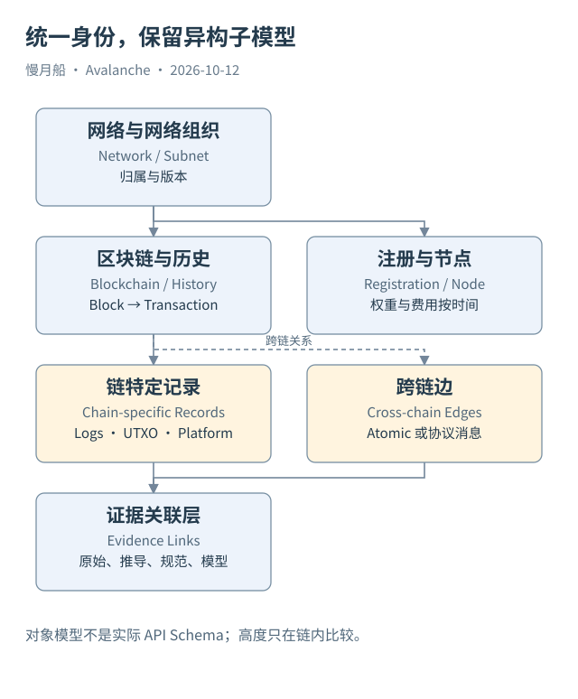

# 37｜一张统一网络地图怎样保留链的差异？

当 C/P/X 和 Beam 都进入同一个分析工程，统一应当发生在哪里？如果把所有交易改成 EVM 格式，统一会破坏事实。更好的做法是统一身份与来源，再保留链特定子模型。

## 网络、链与历史主干

概念主干是 Network → Subnet/L1 → Blockchain → Block → Transaction。箭头表示对象归属与历史定位，不代表每个 API 都按相同层级返回。Primary Network 三链有特殊初始身份，不能强行寻找一个普通创建交易来解释所有 Genesis 对象。

每个 Blockchain 保存 VM、Genesis 和适用版本，EVM Chain ID 作为可空映射。Custom VM 没有 EVM Chain ID 时，不应该伪造一个数字。RPC Endpoint 是服务配置，可以多值与变动，不能作为链的唯一主键。

另一条主干是 Subnet/L1 → Validator Registration → Node/Public Key/Weight/Fee State。它可以跨越多条所属链，不应因某个网络有两条链就复制成两份独立注册。节点与运营者归因另设对象，需要外部证据才能添加关系。

## 两类跨链边保留机制

Atomic 边以原子输出创建和消费关联源目标链，消息边以具体协议身份和合约范围关联发送与处理。桥应用的资产状态作为第三种业务关系加入。统一图可以容纳它们，却不应该抹去机制差异。

时间信息包括交易时间、块位置、注册生效区间和数据检索时间。区块高度只在所属链内有序，不能比较 C 的九千万高度与 P 的两千万高度，推断哪条链晚发生。跨链排序要根据可解释时间或明确因果关系。

所有重要关联保存 `evidence_path` 与层级。直接响应里的关系、由两个样本推导的关系、规范给出的规则、教学图的简化关系分别标记。这样一个读者可以从总图走回具体 JSON，而不必相信作者的口头保证。

## 统一仍然允许未知

没有公开 RPC 的 L1 可以在平台注册层被观察，应用交易层仍为空缺。社区目录缺少一条链，也不能删除官方平台注册。两种来源冲突时保留原值与来源，再研究时间或采集差异，避免擅自挑一个当真。

可见链数量、活跃链数量与受索引链数量分别定义。主网标签也不代表所有服务只包含主网；官方链目录同时返回测试网条目，本篇筛选 `isTestnet=false` 后才确定 Beam 案例。

统一网络认知的价值在于把异构对象放在同一个可追溯框架，而不是制造一张无所不包的大表。分析师越清楚各链差异，越能安全地问跨链问题，也越能说明未覆盖部分为什么限制结论。

统一模型还要允许一条链拥有多个 Endpoint，或同一服务提供多个链路径。这样服务故障可以被记录为来源状态，不需要删除链对象。把访问能力与链身份分离，会使模型更适合长期研究与来源迁移。

图中的箭头按标注表示运行步骤或证据关联；图形是教学模型，实际响应另见案例档案。

[编辑此图](../../assets/diagrams/multi-chain-model.drawio)。

资料与核对依据：[primary-network](https://build.avax.network/docs/primary-network.md)；[l1s](https://build.avax.network/docs/avalanche-l1s.md)；[p-rpc](https://build.avax.network/docs/rpcs/p-chain.md)；[icm-overview](https://build.avax.network/docs/cross-chain/avalanche-warp-messaging/overview.md)；[api-subnet](https://build.avax.network/docs/api-reference/data-api/primary-network/getSubnetById.md)。协议基准日为 2026-10-12；案例时间以原始记录为准。

[上一章](../part-09/36-normalize-json.md) · [本篇目录](../../SUMMARY.md) · [下一章](38-whole-network-balance.md)
