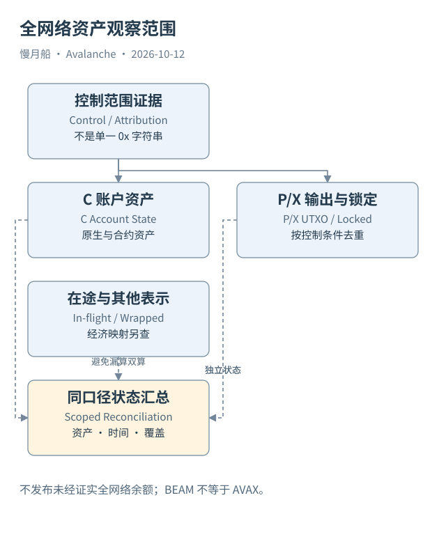

# 38｜一个地址在 Avalanche 全网络有多少 AVAX？

输入一个 `0x` 地址，查询 C-Chain 余额，能否得到这个人在 Avalanche 的全部 AVAX？问题中的“地址”“人”“全部”和“AVAX”都需要先定义，答案才可能有意义。

## 从控制范围开始

一个 EVM 地址只提供某个链的账户观察入口。P/X 使用不同呈现与所有权条件，需要可靠控制关系才能纳入同一主体。多签输出可能由多个地址共同控制，合约地址还可能代表业务系统而非个人。

跨链出现相同 EVM 地址，也不自动证明同一现实实体。EOA 的密钥控制、合约部署与权限逻辑要分别判断。全网络主体余额是归因问题，不能由字符串相等单独解决。无法证明控制关系的资产不应强行算入个人总额。

限定为一组已经确认控制的地址之后，还要分别取得 C 账户余额、P 的可用与锁定资金、X 未花费输出以及在途原子资金。质押本金与潜在奖励不能同时当成可用余额；输出一旦被消费，不再重复算入当前集合。

## 资产表示需要经济映射

原生 AVAX、WAVAX 和桥接版本不是同一个存储对象。原生与包装表示之间有应用规则，桥接资产还有来源与偿付关系。只按 symbol='AVAX' 累加，会混入名称相同但资产身份不同的记录。

在包装资产中，还可能发生抵押资产与持有凭证的重复计算。资产负债视角和钱包持有视角不同，不能用一项简单加总同时回答二者。跨链锁定和远端铸造也可能是同一经济资产的不同表示。

独立 L1 的原生币通常不是 AVAX，即使服务也展示 EVM balance。Beam 的十八位 BEAM 余额不能直接加进主网 AVAX 总额。金额格式相同，只说明接口相似，不说明资产相同。

## 时间一致性限制总额

不同链没有一个通用同步块高度。本地分析需要选择可解释观察时点，记录各来源时间偏差与在途处理。如果源导出已经扣除而目标尚未导入，漏掉在途集合会低估；两侧同时计入又会高估。

余额不是交易毛流量之和。期初状态、手续费、奖励、铸造销毁和其他适用变化都会影响结果。历史 Transfer 数据不一定覆盖所有原生状态变化，也不能在缺少期初余额时推导精确持有量。

因此本篇不输出一个看似精确的“全 Avalanche 余额”。它给出可以执行的研究条件：确认控制范围，逐资产定义经济口径，分别取状态，处理锁定与在途，再披露覆盖和时间差。这个答案可能没有一个醒目的数字，却更接近问题真正要求的事实。

即使目标只是“可立即使用的 AVAX”，也要先排除质押锁定、时间锁和不满足控制阈值的输出。一个经济总资产概念与一个可花费资金概念，采用不同过滤条件。报告应直接写明口径，而不是用“余额”隐去区别。

图中的箭头按标注表示运行步骤或证据关联；图形是教学模型，实际响应另见案例档案。

[编辑此图](../../assets/diagrams/network-balance.drawio)。

资料与核对依据：[c-rpc](https://build.avax.network/docs/rpcs/c-chain.md)；[p-rpc](https://build.avax.network/docs/rpcs/p-chain.md)；[x-rpc](https://build.avax.network/docs/rpcs/x-chain.md)；[atomic-format](https://build.avax.network/docs/rpcs/c-chain/txn-format.md)；[data-api](https://build.avax.network/docs/api-reference/data-api.md)。协议基准日为 2026-10-12；案例时间以原始记录为准。

[上一章](37-multi-chain-model.md) · [本篇目录](../../SUMMARY.md) · [下一章](39-end-to-end.md)
