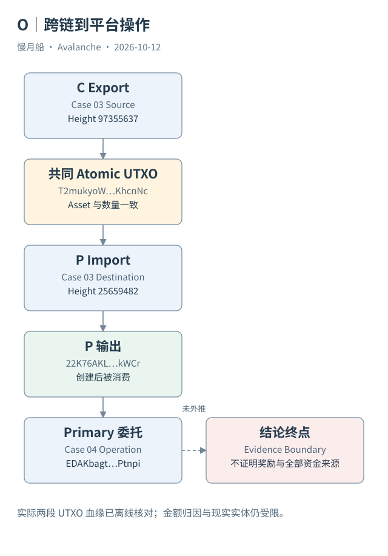

# 39｜怎样从跨链资金走到一笔真实平台操作？

现在把开篇场景连起来：一笔 AVAX 从 C-Chain 导出，在 P-Chain 导入，又被用于委托。无需猜测参与者意图，只用保留记录就可以建立一条明确的资金血缘。

## 三笔交易与两段输出关系

源 Export 位于 C-Chain 高度 `97355637`，时间由官方索引提供。它生成目标 P-Chain 可导入的原子输出。目标 Import 位于 P-Chain 高度 `25659482`，其输入指向同一 UTXO、创建交易、输出序号和 AVAX Asset ID。

Import 又生成一个 P-Chain 输出，ID 为 `22K76AKLGqZG1gftJLgvrV3XdrgwhP9EJF4UVw2vR9HUYxkWCr`。后续委托 `EDAKbagtkyMLKspgXnbRbE1aXtvDRW9BgHRJQFGPztxhPtnpi` 的输入实际消费它。这是第二段资金对象关系，不靠金额相近推测。

三笔交易的类型、网络、链身份与时间都保留在案例文件。高低不同的链内高度不能直接比较，输出消费关系则提供清楚的因果方向。每一段关联都可从两侧响应核对，而不是由插图自动创造。

## 哪些结论已经成立

可以说源侧原子输出被目标 Import 消费；目标产生的某个输出参与了后续真实委托。可以按精确单位核对局部金额和费用，并说明后续操作属于 Primary Network 的委托类型。

不能单独说全部委托本金只来自这笔导入，不能确定两个地址背后的现实主体，也不能证明委托奖励已经支付。后续交易的其他输入、平台锁定与奖励周期都可能扩大问题范围。数据关系准确，并不意味着所有经济叙述都已经被证明。

本篇离线脚本实际检查共同 UTXO、资产、链方向和后续输入关系。通过结果存为校验报告，原始响应与推导保留在不同文件。这样读者既可阅读故事，也可以直接检查关联条件。

## 把方法带到独立 L1

Beam 案例采用另一组关系：CreateSubnetTx → CreateChainTx → ConvertSubnetToL1Tx → 注册及运行记录。链内交易付 BEAM，平台费用状态涉及 AVAX。两条案例线共同说明，统一认知需要保留各自模型，而不是让所有操作都长成一条 EVM Transfer。

ICM 则要求消息身份与目标证据。本篇 Case 08 只有源事件，因此综合图将它的目标阶段标为未取得。即使其他案例已经闭环，也不能借它们的成功替这条消息补齐目标执行。

Runtime Map 告诉我们每步应该发生什么，Data Map 告诉我们实际取得什么；连接两张图时，两者之间的差距需要保留。能够同时讲清已完成路径与证据终点，才算完成一项技术数据研究。

本案后续委托的 amountStaked 远大于单次 Import 输出，这正好提醒读者检查其他输入。共同 UTXO 证明参与，不能独立证明全部资金来源。保留输入集合后，故事能够成立，又不会扩大成没有证据的全额归因。

这段案例的三笔交易不是新写入链上的演示，均为本轮只读取回的已发生主网记录。采集没有控制参与者，也没有替其钱包签名。

图中的箭头按标注表示运行步骤或证据关联；图形是教学模型，实际响应另见案例档案。

[编辑此图](../../assets/diagrams/end-to-end.drawio)。

[真实案例与字段缺口](../../examples/transactions/README.md) · [实际 API 请求/响应](../../examples/rpc/README.md)。

资料与核对依据：[atomic-format](https://build.avax.network/docs/rpcs/c-chain/txn-format.md)；[p-format](https://build.avax.network/docs/rpcs/p-chain/txn-format.md)；[acp-77](https://raw.githubusercontent.com/avalanche-foundation/ACPs/main/ACPs/77-reinventing-subnets/README.md)；[api-primary-transactions](https://build.avax.network/docs/api-reference/data-api/primary-network-transactions/listLatestPrimaryNetworkTransactions.md)。协议基准日为 2026-10-12；案例时间以原始记录为准。

[上一章](38-whole-network-balance.md) · [本篇目录](../../SUMMARY.md) · [下一章](40-observability.md)
