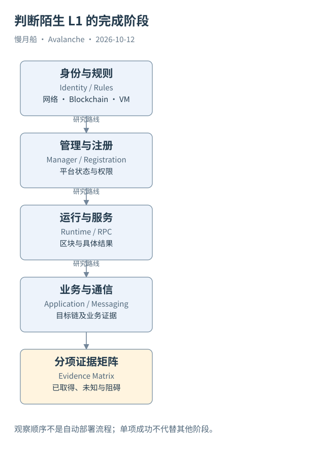

# 40｜打开一个陌生 L1，怎样判断它走到了哪一步？

最后假设你打开一个陌生 Avalanche L1 页面。名字、Logo 和“已上线”标签已经齐全，研究从哪里开始？最有效的顺序是身份、规则、成员、运行，再到业务与通信。

## 先建立运行地图

确认 Mainnet、Fuji 或其他网络，取得 Subnet 与 Blockchain 的稳定身份及映射。查看 P-Chain 相关记录与链的 VM、Genesis；若是 EVM 链，再核对 Chain ID。相同名称或相似 RPC 域名只作为线索，不用它们替代身份。

接着确认是否已经转换成现代 L1，以及管理程序所在链和地址。查看注册、公钥、权重与费用状态，区分平台活跃条件和节点实际在线观测。若页面只给节点数量，说明这是什么来源、什么时间的节点关系。

运行层取得多个位置的区块、具体交易与结果，并记录服务来源。单个区块证明有限时间位置的活动，不证明长期持续健康。公共 RPC 是访问条件，不能自动证明独立运营者数量或所有节点都正确同步。

## 再建立数据地图

EVM 链可以查交易、收据、日志与合适的轨迹服务；Custom VM 需使用对应接口。平台信息查 P-Chain，Primary Network 资产操作还要按 P/X/C 的模型取证。Dune 是否索引该 L1，应实际核对，不能因为索引 C-Chain 就宣称覆盖全部 Avalanche。

每个样本保留方法、参数、时间、网络、链、交易与区块定位。每项计算说明单位和粒度，每张图说明是实际历史还是教学模型。字段缺失先解释来源与类型，不把空值自动当零。

消息通信需要源发送、适用签名认证、目标接收与应用执行。资产到账又需要额外状态。管理注册也可能需要 P-Chain 落地和管理端确认。一个阶段成功不会让其他阶段在数据里自动出现。

## 最后把两张图连接

可以采用分阶段证据矩阵：记录存在、管理建立、注册可观察、出块可观察、RPC 可访问、业务可验证、通信可验证。每项分别注明 COMPLETE、VALIDATED、BLOCKED 或 INCOMPLETE 及原因。等级属于证据结论，不能由项目宣传统一设为通过。

本篇整体以 VALIDATED 交付：书稿、图与有限直接样本完成审查，新 Dune SQL 尚未执行，部分管理端和目标通信证据仍缺失。这个状态让读者知道已得到完整教学路径，也知道哪些实时或历史命题尚未被独立验证。

读完后再遇到“创建了自己的区块链”，你应该能追问创建了什么对象、哪些节点正在维护它、什么状态已经执行、哪些数据可以证明。Avalanche 的多链设计因此不再是一串术语，而是一组能逐项观察、关联与检查的运行关系。

为了长期维护，可以为每个对象保存最近核对位置与来源状态。下一次更新先补变化与缺口，再重新生成指标。这样读者面对协议升级或服务迁移时，不必推翻整张地图，只需更新已经明确分层的事实与关联。

图中的箭头按标注表示运行步骤或证据关联；图形是教学模型，实际响应另见案例档案。

[编辑此图](../../assets/diagrams/observability.drawio)。

资料与核对依据：[l1s](https://build.avax.network/docs/avalanche-l1s.md)；[p-rpc](https://build.avax.network/docs/rpcs/p-chain.md)；[icm-overview](https://build.avax.network/docs/cross-chain/avalanche-warp-messaging/overview.md)；[data-api](https://build.avax.network/docs/api-reference/data-api.md)。协议基准日为 2026-10-12；案例时间以原始记录为准。

[上一章](39-end-to-end.md) · [本篇目录](../../SUMMARY.md) · [下一章](../appendix/glossary.md)
