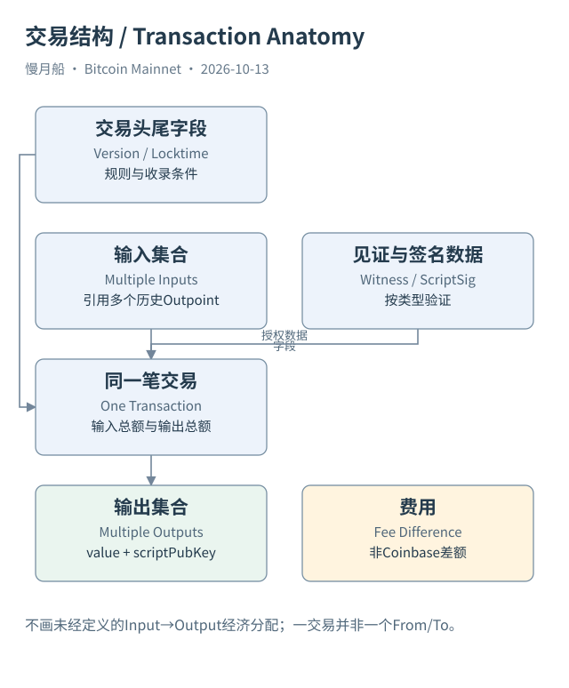
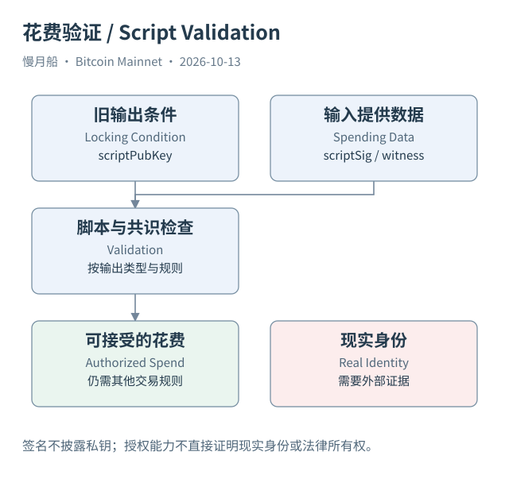
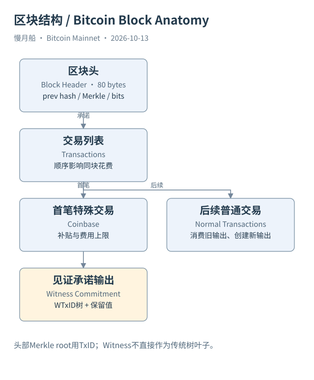
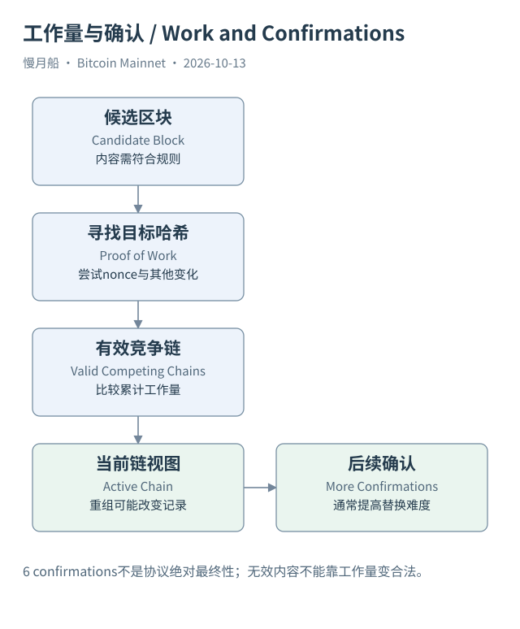
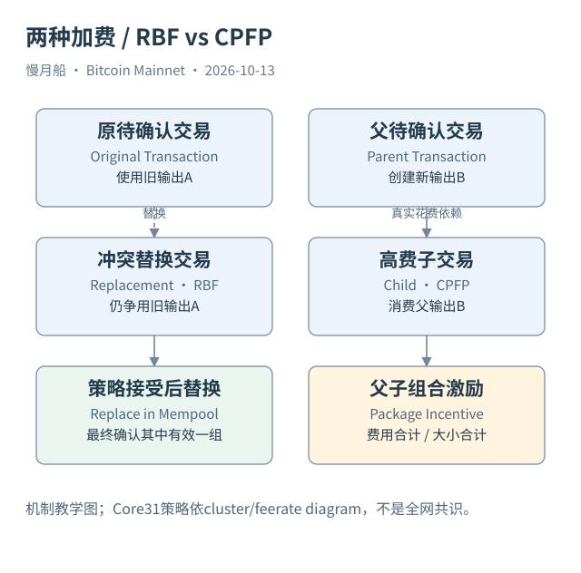
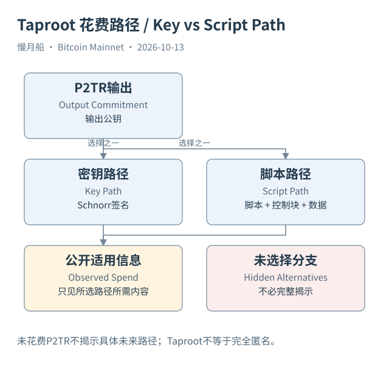
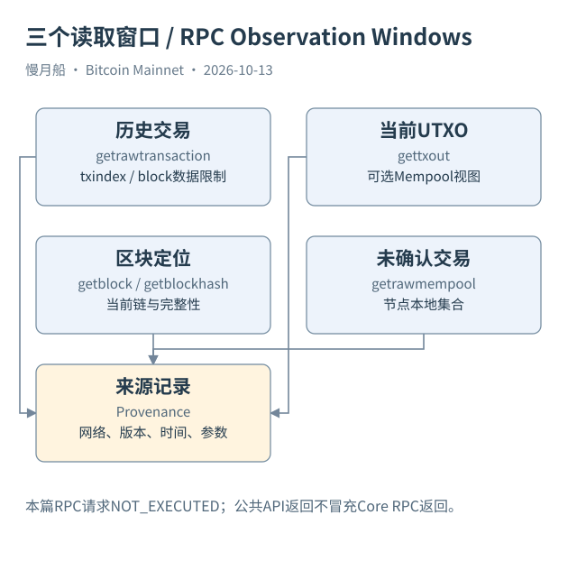
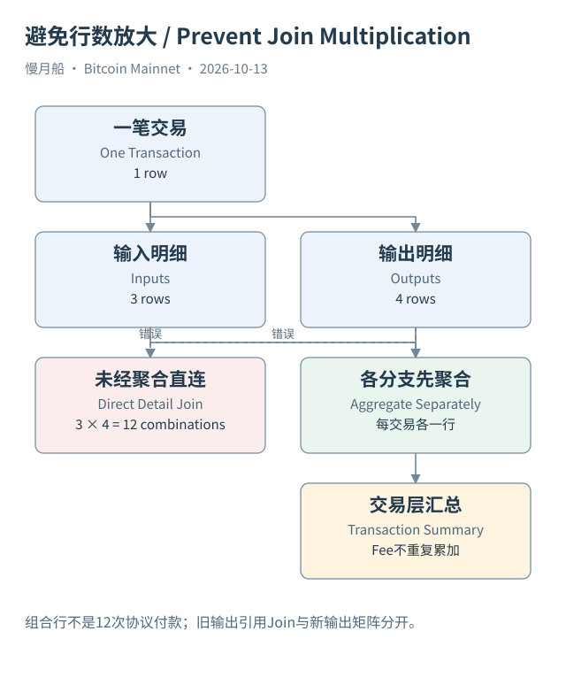
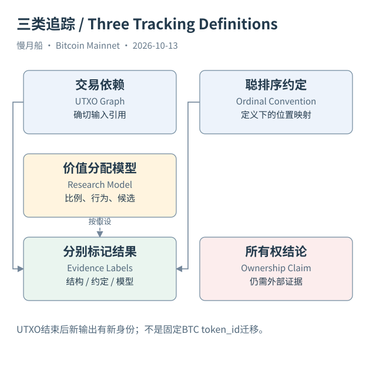

# 《慢月船：链上数据之路》Bitcoin篇

## 前言｜从钱包里的数字，走向可以复查的输出

你可能已经收过BTC，却还不清楚钱包显示的余额来自哪里。这一篇从一次具体转账出发：一笔旧输出怎样被整笔花费，为什么出现找零，费用为什么是金额差额。随后进入脚本、区块和确认，再把这些运行机制接到Bitcoin Core、区块浏览器与Dune的记录中。

前四个Part建立运行地图，第五至第七Part建立数据地图，最后两Part讨论现实归因、价值分配和链外边界。九个Part、三十六章可以顺序阅读；SQL文件与RPC请求放在独立目录，便于有基础的读者复查。每章解决一个问题，图形可以继续编辑。

本书的主线是Transaction→Inputs→Previous Outputs→New Outputs→UTXO Set。一条花费引用可以严格重建，一条经济归属判断可能需要外部证据或附加模型。我们会把原始结构、索引推导、启发式、外部归因与研究模型分别说明。

Alice与Bob的一BTC付款是教学假设。真实案例来自Bitcoin Mainnet公共API，保留原始字节、整数聪和区块位置。作者已有Dune研究只读复用，新增SQL没有执行；本篇没有连接Core节点、启动全链同步或伪造RPC返回。阅读不需要这些服务，但判断验证完整程度时应保留这份范围。

本书不讨论资产价格。读完后，你应能找出旧输出在哪里出生、被哪笔交易花费，以及哪些新输出又等待下一次授权。你也会知道，沿图追到一个新地址，并不自动找到了原始BTC的唯一最终所有者。

# Part 01｜钱包与输出

# 01｜钱包显示的 1 BTC，究竟在哪里？

你打开钱包，看见余额是 1 BTC。朋友发来一个收款地址，你准备转给他 0.3 BTC。很自然的想法是：网络找到你的账户，把余额减去 0.3，再给朋友的账户加上同样的数字。理解 Bitcoin 的第一步，就是暂时放下这个想法。

比特币（Bitcoin）的基础账本没有为每个地址维护一个全局余额栏。它保存交易，以及交易产生的输出（Output）。其中尚未被花费的输出，叫未花费交易输出（Unspent Transaction Output，UTXO）。钱包里的数字，通常是软件找到它能够识别、并具备相应花费能力的一组输出后，加总得到的结果。

假设你的 1 BTC 来自三个旧输出，金额分别是 0.2、0.3 和 0.5 BTC。链上保存的是三条输出记录及其花费条件；钱包把它们联系到自己的密钥和脚本，才显示一个容易阅读的余额。另一个钱包如果只导入其中一个地址或描述符，可能只能看见其中一部分。数字不同，不一定意味着网络账本发生了变化。

钱包（Wallet）首先是一套管理密钥、识别脚本、构造交易和观察状态的软件。私钥（Private Key）用来产生必要的签名，并不是装着比特币的文件。公钥（Public Key）和签名可以参与验证花费权限，但不让观察者直接读出私钥。把钱包复制到另一台设备，可能复制的是使用同一组输出的能力，不会凭空复制第二份 BTC。

地址（Address）则是表达某类收款条件的编码。一个钱包可以管理很多地址，一个地址可以收到很多输出。同一个地址反复收到款项时，旧输出不会自动合并成一条记录。因此，钱包、地址、输出和现实中的人，是四个不同的对象。后文做 SQL 时，这个区别会决定我们究竟是在数地址、数交易，还是讨论用户。

显示余额还要看软件采用的口径。已确认、未确认、可立即花费、观察钱包可见、Coinbase 尚未成熟，这些状态可能分开展示。多签钱包看到某笔输出，也未必能够独自完成花费；时间锁可能让有密钥的人仍需等待。将所有可见输出都称为“现在能转走的钱”，会忽略花费条件。

这并不要求你亲自扫描每一笔历史交易。钱包和节点会维护索引及状态，帮助你识别相关输出。本书要做的是看懂这些数字怎样形成：先找到输出，检查它是否仍未花费，再确认它属于当前讨论的脚本范围，最后决定采用哪一种余额口径。

有一个检验理解的小问题：如果朋友再给同一地址转入 0.1 BTC，链上会修改原来的 1 BTC 输出吗？通常不会。新交易创建一笔新输出，钱包将它加入自己的观察集合。真正发生的，是可识别的输出集合改变了，而不是某个账户余额字段被直接改写。

读到这里，你已经有了后续分析的入口。不要先问“谁的账户剩多少”，先问“哪些未花费输出符合这组花费条件”。当我们把这个问题转成数据查询，钱包界面上的简单数字就有了可以逐条复核的来源。

[编辑此图](assets/diagrams/wallet.drawio)

[编辑模型比较图](assets/diagrams/data-model.drawio)

依据：[wallets](https://developer.bitcoin.org/devguide/wallets.html)；[transactions](https://developer.bitcoin.org/devguide/transactions.html)。研究基准日：2026-10-13。来源获取状态见[来源目录](research/source_catalog.md)。

# 02｜为什么转出 0.3 BTC，要花掉整笔 1 BTC？

现在把上一章的余额简化为一笔 1 BTC 的旧输出。你想付给 Bob 0.3 BTC，钱包却准备花掉整笔 1 BTC。听起来像多付了钱，其实只是 Bitcoin 花费旧输出的基本方式：一个输入引用整笔输出，不能把原输出原地切走一小块，再留下同一个输出继续使用。

交易输入（Input）告诉验证者，这次要花费哪笔历史输出，并提供满足相应条件的数据。交易输出则说明这次新创建哪些金额和花费条件。教学交易只有一个输入，金额来自旧输出的 1 BTC；它产生两个新输出，分别是给 Bob 的 0.3 BTC，以及回到 Alice 控制范围的 0.699 BTC。

还剩 0.001 BTC。它是这笔普通交易的手续费（Fee）：输入总额减去输出总额。交易没有另外创建一个“手续费收款输出”，把钱逐笔转给矿工。矿工在区块的 Coinbase 交易里，可以领取该区块适用的补贴和交易费用。这里的 0.001 BTC 只是方便计算的教学数字，不是推荐费率。

找零（Change）是钱包构造交易时安排给自身控制范围的输出。在这个教学例子中，我们事先知道 Output 1 的用途，所以可以明确标注找零。真实链上没有一个通用的 `is_change` 共识字段。看到一笔单输入、双输出交易，只能先确认结构相同，不能立刻认定较大的输出就是找零。

用整数聪（Satoshi，sat）重算一次：旧输出是 100,000,000 sat，Bob 的输出是 30,000,000 sat，找零是 69,900,000 sat，费用是 100,000 sat。三个去向的金额相加与输入金额一致。1 BTC 等于一亿聪；原始交易金额以整数聪表达，钱包展示的小数并不意味着协议使用浮点数记账。

旧输出花费后，历史记录不会被删除。它仍在创建它的旧交易里，只是不能再次作为当前未花费输出使用。新交易生成的两笔输出有各自的新定位。Bob 将来花费 0.3 BTC 时，引用的是这笔新交易中的相应输出，不是追着 Alice 原来的输出再切下一部分。

钱包可能为找零选择一个新地址。这样一来，外部观察者在新交易中未必看到 Alice 原来的地址。这并不表示资产离开了她的控制范围，也不能仅凭地址改变推断换了所有者。钱包内部知道自己的派生路径和脚本，区块浏览器通常只知道公开交易结构。

本篇的 Case 01 保存了一笔真实 Mainnet 单输入双输出交易，供你比较输入引用、两个新金额和费用。它验证的是这种结构确实存在；案例没有收款目的或钱包内部记录，所以没有把其中一个输出强行写成已证实的找零。教学用途与真实证据范围分开，反而更容易看清协议记录了什么。

如果你把两个输出都计入“对外付款”，就会把 Alice 留给自己的金额也算进去。许多链上交易量指标因此需要特别定义。输出总额能回答交易创建了多少输出价值，却不能单独回答普通用户这次真正支付了多少钱。

[编辑此图](assets/diagrams/payment.drawio)

[编辑真实案例图](assets/diagrams/payment-real.drawio)

依据：[transactions](https://developer.bitcoin.org/devguide/transactions.html)；[tx-reference](https://developer.bitcoin.org/reference/transactions.html)。研究基准日：2026-10-13。来源获取状态见[来源目录](research/source_catalog.md)。

# 03｜怎样准确找到一笔旧输出？

朋友给你发来一串交易哈希，说“这就是那笔 BTC”。你打开浏览器，却发现交易有几十个输出。交易哈希定位的是一整笔交易，还不足以说明具体谈论哪一笔输出。还需要输出在交易中的编号：交易标识加输出索引，合起来叫输出点（Outpoint）。

通常写成 `txid:vout`。交易标识（Transaction ID，TxID）是交易按规定序列化后计算出的哈希标识；输出索引从零开始。`某个txid:0` 与 `同一个txid:1` 是不同的输出，金额和脚本可以完全不同。输入中保存的正是此前交易的标识和此前输出编号，而不是一个抽象的付款人账号。

假设旧交易有三个输出，索引是 0、1、2。你要花费第二个输出，就引用索引 1。输入自己也有在当前交易中的顺序，常写成 `vin` 的索引。当前输入编号与它引用的旧输出编号不必相等：当前 Input 0 完全可以引用旧交易的 Output 17。做表连接时把这两个编号混用，会得到错配或空结果。

读一条输入时，可以按这个顺序检查：它属于哪笔当前交易，是第几个输入，引用哪笔旧交易的第几个输出。最后再从旧输出取得金额和锁定脚本。普通输入的序列化并没有直接带一个完整的“输入金额账户记录”；浏览器展示的前序金额通常来自对历史输出的回查。

因此，浏览器和 Dune 的输入金额是一种很有用的索引增强。它帮助我们算费，却不能让我们误认为所有展示字段都是输入字节中直接写下的内容。保存证据时，本书同时保存旧输出引用和平台给出的前序输出信息，让读者能够继续追查增强字段的来源。

TxID 在网页上通常显示为固定长度的十六进制字符串，SQL 中则可能是字节类型。原始序列化的哈希字节顺序与显示习惯也需要区别。复制浏览器的显示值进行查询时，应按平台已经规范化的格式过滤；不要因为听过“小端序”就机械地把每个哈希反转一次。

严格研究全历史还会遇到早期重复 TxID 的特殊情况。BIP30 及其历史例外说明，不能仅凭现代直觉宣称所有历史交易标识在所有位置绝无重复。一般教学查询可用 Outpoint 表达当前输出身份；跨全部历史建立唯一键时，还应保存区块定位，并审核这些罕见例外。

本篇 Case 07 从早期真实交易出发，记录后来交易的输入引用。这里的每条边都由前序 TxID、输出编号和花费交易的输入编号组成。它没有靠地址相同来猜关系，也没有靠金额刚好相等来匹配输出。金额只是辅助核对，引用字段才是关键证据。

找不到引用时，先检查网络、索引编号、哈希格式和数据覆盖。输入表只筛选了一个日期窗口，可能根本没有包括数年后的花费。查询返回零行，首先说明这个查询范围没有匹配记录，不能直接升级成“这笔输出从未被花费”的全历史结论。

[编辑此图](assets/diagrams/outpoint.drawio)

依据：[tx-reference](https://developer.bitcoin.org/reference/transactions.html)；[bip30](https://github.com/bitcoin/bips/blob/master/bip-0030.mediawiki)。研究基准日：2026-10-13。来源获取状态见[来源目录](research/source_catalog.md)。

# 04｜旧输出被花掉以后，还留下什么？

把上一笔转账想成一次换票：旧票据整张交回，换成几张新票据。这个比喻有助于理解金额分拆，但票据不是带着永久身份的小硬币。链上能够追踪的是输出如何被创建和引用。旧输出在当前 UTXO 集合中退出，历史交易仍然保留，新输出则拥有新的 Outpoint。

一笔输出出生于创建它的交易。对于可以进入未花费集合的输出，在当前有效链上还没有被后续交易花费时，它处于未花费状态。另一笔普通交易用输入引用它并成功成为有效链历史的一部分，节点就把相应旧输出从集合中移除，同时加入符合条件的新输出。

UTXO 集合（UTXO Set）是节点验证花费的重要状态。节点不必为每一个新输入都从创世区块重新搜索全部交易，再问有没有别人花过它。它直接检查相应输出是否在当前状态里，并取得金额、脚本及有关元数据。这一维护过程常与链状态（Chainstate）联系在一起，但链状态不等于钱包自己的余额缓存。

有些输出不会作为正常可花费 UTXO 保存。例如以 `OP_RETURN` 开始、明显不可花费的输出，Bitcoin Core 可以直接识别并不纳入 UTXO 集合。交易历史仍然包含它。因而，统计所有创建输出的行数，不等于统计当前可花费输出数；统计每天输出数减输入数，也需要考虑这些排除和特殊规则。

Coinbase 输出还存在成熟期。即使它已经是链上未花费输出，也不能立刻按普通输出使用。另一类输出可能受时间锁约束。未花费是一个状态判断，可立即花费还需要检查条件。仅把数据库中“没有花费记录”的行全加起来，无法自动得到某钱包此刻能发送的金额。

未确认交易会让视图更加复杂。节点的 Mempool 可能已经有交易准备花掉某笔输出，确认链的 UTXO 集合却尚未按它更新。钱包可以选择扣除这笔待花费金额，避免再次选币。两个软件显示不同状态时，应先问它们采用已确认视图，还是加入了本地交易池视图。

链重组也能改变生命周期的观察结果。一笔曾被收录的花费交易如果离开当前有效链，对应输出可能重新成为未花费。分析近期数据时，应保存区块哈希和观察链头，允许回滚更新；“曾确认过”与“现在位于有效链”不能永久画等号。

本书使用的历史花费边，是公共 Mainnet 索引在取证时提供的记录。它足以解释真实的输出依赖，但没有假装已经在本地全节点上独立验证所有共识规则。对一笔长期确认的案例，我们仍保存高度和区块哈希，以便复查使用的是哪份历史。

读者可以据此区分四样东西：创建输出的历史表、节点当前维护的 UTXO 集合、钱包认识的相关输出，以及平台计算的历史地址余额。它们彼此有关，却有不同范围与维护方式。下一部分进入交易结构时，我们会继续沿着输入引用和新输出这两条线阅读。

[编辑此图](assets/diagrams/utxo.drawio)

依据：[core-coins](https://github.com/bitcoin/bitcoin/blob/v31.0/src/coins.h)；[core-consensus](https://github.com/bitcoin/bitcoin/blob/v31.0/src/consensus/consensus.h)；[blocks](https://developer.bitcoin.org/devguide/block_chain.html)。研究基准日：2026-10-13。来源获取状态见[来源目录](research/source_catalog.md)。

# Part 02｜交易、字节与授权

# 05｜一笔交易为什么可以有很多输入和输出？

你在浏览器中看到一笔交易，左边列了二十个输入，右边列了三十个输出。如果只想寻找一个 From 和一个 To，页面就像突然变复杂了。实际上，交易从来没有承诺只记录一对付款人与收款人。它把一组旧输出的花费请求，与一组新输出的创建安排放在同一个结构里。

版本（Version）规定交易格式及相关规则的解释背景。输入列表包含每个前序输出点、脚本签名字段和序列号；输出列表包含金额与锁定脚本。锁定时间（nLockTime）在满足相应启用条件时限制交易能被收录的最早位置。采用见证格式时，还会为输入保存见证（Witness）数据。

多输入可以是钱包把几笔零钱合起来支付一笔款项，也可以是几个人合作构造一笔交易。多输出可以是批量付款、找零、协议数据，或更复杂安排。我们能够直接数清这些列表的长度，却不能从列表长度自动推断参与的自然人数。钱包行为解释还需要其他证据。

用一个教学结构想象：旧输出 A 是 0.4 BTC，旧输出 B 是 0.6 BTC；交易花费它们，创建 0.3 和 0.699 BTC 两个输出，差额 0.001 BTC 为手续费。图上应画两个输入进入交易，再由交易创建两个输出。它没有提供一条权威线，说明 A 专门流入 Output 0、B 专门流入 Output 1。

输入的金额必须从它引用的旧输出取得。普通交易验证时，节点检查旧输出仍未花费、花费条件被满足，并检查金额与其他规则。仅输入输出总额相等还不够：引用不存在的输出、重复花费或签名条件不满足，都不能靠金额表面平衡变成有效交易。

Coinbase 交易是例外。它的特殊输入不引用正常的旧输出，因此不能把这条输入放进普通前序输出连接，再期待得到一笔历史金额。分析表中的输入数可以包含 Coinbase 特殊输入，统计实际消费的普通 UTXO 数则应排除它。这两种计数差一条，并不一定是数据漏了。

交易也不是一份 EVM 调用树。Bitcoin Script 围绕花费条件执行，不能将各个输出解释成自动调用某个地址的函数。一个输出创建时，接收方一般不用先上线确认接收；未来花费时才需要提供满足条件的数据。被创建与已被未来控制者实际花费，是两类不同事件。

本篇 Case 02 展示多输入单输出的真实结构，Case 09 展示复杂多输入多输出。它们能帮助你识别整合候选和协作交易可能出现的形态，但案例名字已经写明用途未证实。把“看起来像整合”写成“已证明同一个钱包整合”，就跨过了证据范围。

当你把交易展开为表格，每个输入或输出各占一行，交易层的费用和大小不能随行重复累加。二十个输入仍属于同一笔交易。读懂这层一对多关系之后，SQL 中的行数膨胀就不再只是技术细节，而是会改变经济解释的实质错误。

[编辑此图](assets/diagrams/transaction.drawio)

依据：[tx-reference](https://developer.bitcoin.org/reference/transactions.html)；[bip144](https://github.com/bitcoin/bips/blob/master/bip-0144.mediawiki)。研究基准日：2026-10-13。来源获取状态见[来源目录](research/source_catalog.md)。

# 06｜浏览器怎样把一串字节变成交易页面？

你点击浏览器的原始交易，看到一长串十六进制字符。它不是另一笔神秘交易，只是同一份结构按字节表达的结果。浏览器根据格式读取版本、输入、输出和锁定时间，再回查旧输出，才能显示金额、脚本类型等容易理解的内容。

序列化（Serialization）规定各字段怎样依次写入字节流。很多数值使用小端序（Little Endian），也就是低位字节在前。可变长度列表及字节字段需要长度信息；常见长度编码叫 CompactSize，有时被笼统称为 VarInt。其他场合也有不同变长整数编码，不能看到名字相近就按同一种规则解析。

输入中的前序交易哈希、输出编号、scriptSig 长度与内容、sequence，都需要按格式读取。输出金额使用八字节整数，再接脚本长度与脚本内容。脚本并不总是固定长度，也不都能解析成一个普通地址。输出索引来自列表顺序，不需要在原始交易里另存一份全局输出身份表。

带见证的序列化还加入标记、标志和各输入的见证栈。见证属于花费时提供的数据，不是输出金额的新单位。空 scriptSig 与非空 Witness 可以共同出现在有效花费中，所以只检查传统签名脚本为空，不能判断交易没有授权证明。

TxID 按不包含见证的基础序列化计算双 SHA-256，再按显示习惯呈现。见证交易标识（Witness Transaction ID，WTxID）则对包括见证的序列化计算。没有见证的普通交易两者通常相同；见证交易则可以不同。不能拿带见证的全部原始字节计算哈希后，直接把结果命名为 TxID。

这一区别也影响交易可塑性（Malleability）的讨论。SegWit 把见证移出 TxID 的计算范围，解决了适用花费结构中的重要可塑性问题，但不意味着所有交易、所有依赖关系从此完全没有其他变化可能。学习时先明确讨论的是哪种标识、哪些被签名的数据，以及输入类型。

本篇保存了 Case 04 的真实原始交易字节。配套 Python 解码器将基础序列化和见证序列化分开，计算两种标识，再与 API 的 TxID、大小和 Weight 交叉核对。这个小工具做结构核验，不验证 ECDSA 或 Schnorr 签名，也不替代全节点的共识验证。

平台索引是从字节到列的转换，再加上一些历史回查。`prevout.value` 这样的增强字段不是从当前输入独立读出的，地址名称更不是原始交易的一部分。知道转换过程，就能避免把网页上的标签、脚本解释与字节证据混成同一种来源。

普通读者不需要背下每个偏移量，但应能提出三个问题：这个字段直接来自当前交易吗，来自被引用的旧输出吗，还是平台推导或外部标签？这三个问题能帮你在复杂页面上找到真正可靠的证据，也为 Dune 的平铺表与嵌套列阅读打好基础。

[编辑此图](assets/diagrams/segwit.drawio)

依据：[tx-reference](https://developer.bitcoin.org/reference/transactions.html)；[bip141](https://github.com/bitcoin/bips/blob/master/bip-0141.mediawiki)；[bip144](https://github.com/bitcoin/bips/blob/master/bip-0144.mediawiki)。研究基准日：2026-10-13。来源获取状态见[来源目录](research/source_catalog.md)。

# 07｜网络怎样判断谁有权花掉一笔输出？

假设任何人都可以在新交易里写上你的旧输出编号，那为什么别人不能直接把它花掉？因为引用只是告诉节点要检查哪笔输出。旧输出还规定了花费条件，新交易必须提供满足条件的数据，才可能通过验证。

锁定脚本（ScriptPubKey）随输出创建，表达未来花费的限制。花费时，输入的脚本签名（ScriptSig）或见证提供需要的数据。常见条件与公钥和数字签名（Signature）有关，但也可能包含多签、时间约束等安排。因此，比特币并不是先在一个实名数据库中查“谁是主人”，而是按脚本和共识规则检查这次花费是否被授权。

以传统 P2PKH 为例，输出承诺公钥哈希。花费者提供公钥和签名，节点检查公钥哈希是否匹配，再检查签名是否对适用的交易摘要有效。签名证明相应私钥对这次授权数据的控制能力，不会直接公开私钥，也不是一份由协议签发的自然人身份证明。

签名覆盖什么内容，还受签名哈希类型（Sighash Type）和具体花费规则影响。常见默认方式保护交易的重要内容，但不能一概说每个签名总是覆盖每个输入和每个输出的全部字节。讨论合作构造、特殊签名或协议时，需核对使用了哪一种承诺范围。

Bitcoin Script 可以用栈、操作码和条件组合描述花费要求。它与 EVM 都有执行规则，但执行对象、状态能力和使用方式不同。一个脚本不是拥有全局账户存储的普通合约账户，也不会仅因收到输出就自动运行一段收款业务代码。花费验证才是本章关注的动作。

浏览器把地址显示在输出旁边，是帮助用户识别常见脚本模板。遇到 P2PK、裸多签或不可花费数据输出时，未必存在同样方便的单一地址表达。地址字段为空，并不意味着输出无金额、无脚本或记录损坏。脚本的原始字节仍可供我们检查。

本篇 Case 03 保存 P2PKH 花费的前序脚本与 scriptSig。Case 04 则帮助你对比见证花费。我们核验这些数据的结构和引用，但没有把签名字节重新包装为“本地已独立验签通过”。公共索引返回确认记录，与读者自己运行完整验证，是不同层次的工作。

同一组密钥也可能被多个人持有，签名设备可能受机构流程管理。链上授权有效，并不能单独说明签名人获得了法律上的处分权，更不能证明最终经济受益人。因此，私钥控制、链上花费权限、实体身份和所有权归属，需要分别讨论。

当研究者说“这笔输出属于某人”，最好先把话改得更准确：这笔输出锁定到什么条件，哪笔交易提供了什么花费数据，现实身份判断来自哪里。这样写不会削弱技术解释，反而让结论中的每一步都能找到相应证据。

[编辑此图](assets/diagrams/script.drawio)

依据：[transactions](https://developer.bitcoin.org/devguide/transactions.html)；[bip143](https://github.com/bitcoin/bips/blob/master/bip-0143.mediawiki)；[bip340](https://github.com/bitcoin/bips/blob/master/bip-0340.mediawiki)。研究基准日：2026-10-13。来源获取状态见[来源目录](research/source_catalog.md)。

# 08｜为什么地址长得不同，花费方式也不同？

你可能见过以 1、3、bc1q 或 bc1p 开头的 Mainnet 地址。它们看起来像不同格式的账号，其实是在编码不同类别的收款信息。学习地址类型，是为了理解输出承诺了什么、花费时可能公开什么；不是靠几个开头字符就识别钱包主人和交易目的。

P2PK 直接把公钥放入输出脚本，是早期交易中常见的形式。P2PKH 把公钥哈希放入脚本，常用 Base58Check 地址表达。P2SH 则承诺赎回脚本（Redeem Script）的哈希，地址常以 3 开头。创建 P2SH 输出时，外部观察者通常看不到全部内部花费条件，要等实际花费揭示相应脚本。

原生 P2WPKH 是版本零、长度二十字节的见证程序；P2WSH 是版本零、长度三十二字节的程序，承诺见证脚本。两者常采用 Bech32 编码。在嵌套 SegWit 中，外层还可能是 P2SH，因此只看到 3 开头，不能认定它将来必然采用传统非见证方式花费。

P2TR 是版本一、长度三十二字节的 Taproot 见证程序，采用 Bech32m。bc1p 是 Mainnet 上常见的展示形式，但有效识别应解码网络、见证版本、程序长度和校验，不是仅字符串匹配。不同网络可以使用相似结构，查询之前还必须确认是 Bitcoin Mainnet。

裸多签（Bare Multisig）可以在输出脚本中直接表达若干公钥和签名要求。OP_RETURN 则常用于不可花费的数据输出。它们提醒我们：输出的本质是金额和脚本，并非每个输出都必须拥有一个普通用户意义上的收款地址。附录把这些类型并排列出，方便回查。

地址编码、锁定脚本、赎回脚本、见证脚本和实际见证栈不是同一个对象。P2SH 地址表达一份哈希承诺，花费时可能揭示一个多签脚本；P2TR 输出承诺一个输出公钥，实际花费可能走密钥路径，也可能揭示特定脚本路径。创建时看见的信息与花费后看见的信息会改变。

同一种脚本类型也可以用于很多业务。交易所、个人和合作协议都可能使用 Taproot；采用多签并不自动意味着交易所冷钱包。地址类型统计适合描述技术采用情况，不能直接转成用户画像或资产归属。后文的 SQL 08 按输出脚本分类，指标标题会明确统计的是输出行数。

本篇真实样本包含传统、见证与 Taproot 花费，脚本类型取自公共索引的解析结果，必要时再与原始脚本字节比较。类型标签是解析产物，原字节是回查依据。如果平台使用不同名称，应建立明确映射，而不是把名字不一致当成协议发生分叉。

把地址看成收款条件的可读编码后，许多误解自然消失：新地址不必代表新人，旧地址重复使用不会自动合并输出，地址为空也不必代表无价值。接下来讨论时间锁和多签时，我们会继续追问条件如何影响未来花费，而不是只看地址的外观。

[编辑此图](assets/diagrams/address-types.drawio)

依据：[bip16](https://github.com/bitcoin/bips/blob/master/bip-0016.mediawiki)；[bip173](https://github.com/bitcoin/bips/blob/master/bip-0173.mediawiki)；[bip350](https://github.com/bitcoin/bips/blob/master/bip-0350.mediawiki)；[bip341](https://github.com/bitcoin/bips/blob/master/bip-0341.mediawiki)。研究基准日：2026-10-13。来源获取状态见[来源目录](research/source_catalog.md)。

# Part 03｜时间条件、区块与发行

# 09｜有了私钥，为什么仍可能暂时花不了？

一家公司把储备金锁进需要三把钥匙中两把签名的条件里。财务人员拿着其中一把私钥，钱包可以看见输出，却不能独自转走。另一笔输出要求等待一段时间，即使签名完全正确，也可能还没到花费条件允许的位置。余额和权限，从这一刻开始不能只用一个数字表示。

多重签名（Multisig）把授权分散给多个密钥。传统脚本可以明确列出公钥及门槛，也可以把复杂脚本隐藏在哈希承诺后，花费时再揭示。多个密钥不必对应多名自然人；一家公司也可以管理多把钥匙。因此，脚本结构能说明授权条件，却不能单独证明内部审批制度怎样执行。

绝对锁定时间（Absolute Locktime）限制交易在指定高度或时间条件前不能被收录。交易级 nLockTime 是否生效还与输入 sequence 有关，不能只读一个非零字段就认定等待规则已经完整启用。脚本中的 CHECKLOCKTIMEVERIFY，简称 CLTV，允许输出条件要求花费交易满足相应锁定限制。

相对锁定时间（Relative Locktime）则以被花费输出的确认位置为起点。BIP68 对适用版本和 sequence 位定义相对限制，CHECKSEQUENCEVERIFY，简称 CSV，可以把相关要求加入脚本。按区块数等待和按时间单位等待并不是同一口径；时间模式还涉及中位时间和规定的单位粒度。

中位过去时间（Median Time Past，MTP）取有关历史区块时间的中位值，用于适用规则中的时间判断。它不是用户电脑的当前钟表，也不是钱包按下发送键的时间。分析“多久后能花费”时，要明确是高度条件、MTP 条件还是软件预计的现实时间，否则界面里的倒计时会被误写成共识事实。

这些条件解释了为什么某些未花费输出并非立即可用。钱包也许知道自己的密钥，却还需要其他签名、尚未揭示的脚本或等待位置。UTXO 查询通常先回答输出有没有被消费；要回答当前是否能构造有效花费，还必须进一步分析授权与时间条件。

输出描述符（Output Descriptor）提供一种表达和识别脚本的方法，可以把公钥来源、派生范围及脚本模板联系起来。它适合钱包导入和跟踪，却不是新增加到每笔原始交易里的共识字段。Core 返回的推断描述符与钱包自己保留的完整派生信息也可能不同，不应混为同一份身份证据。

Miniscript 帮助以较结构化的方式表达和分析某些脚本策略。它不是让 Bitcoin 自动获得 EVM 式的全局账户状态，也不把所有复杂脚本变成公开的业务合同。对链上研究者，重要的是知道哪些条件当前可见、哪些在花费前只以承诺存在，以及实际执行走了哪条路径。

如果浏览器写“多签钱包”，就继续查看这句话依据的是已揭示脚本还是外部标签。如果只是看见一个 P2SH 地址，完整条件可能仍未知。技术解释应在这里停在可观察范围；公司名字、审批人数和受益人归属，需要另外保存来源。

[编辑此图](assets/diagrams/timelocks.drawio)

依据：[bip65](https://github.com/bitcoin/bips/blob/master/bip-0065.mediawiki)；[bip68](https://github.com/bitcoin/bips/blob/master/bip-0068.mediawiki)；[bip112](https://github.com/bitcoin/bips/blob/master/bip-0112.mediawiki)；[bip113](https://github.com/bitcoin/bips/blob/master/bip-0113.mediawiki)；[bip380](https://github.com/bitcoin/bips/blob/master/bip-0380.mediawiki)。研究基准日：2026-10-13。来源获取状态见[来源目录](research/source_catalog.md)。

# 10｜一笔交易被装进区块时，多了哪些证据？

你已经能看懂一笔交易，但朋友问：它真的进入 Bitcoin 历史了吗？一个孤立的交易字节文件，只说明有人构造了某种结构。要说明它位于当前确认历史，还需要区块定位和相应链视图。区块（Block）把交易列表与一份区块头组织在一起。

区块头（Block Header）包含版本、前一区块哈希、交易 Merkle 根、时间、压缩目标 bits 和 nonce。传统区块头长度是八十字节。前一区块哈希把区块连接起来，Merkle 根承诺该区块的交易标识列表。头部并不直接列出每个地址的余额，也不包含一张全网资金归属表。

区块体保存交易。第一笔是 Coinbase，后面是普通交易；普通交易可能引用此前区块的输出，也可以引用同一区块里更早交易创建的输出。因此，区块内交易顺序不只是网页排版。重建输出生命周期时，需要用交易在块内的位置来表达同块先后关系。

Merkle 树（Merkle Tree）用交易的 TxID 逐层计算承诺。给定相应证明和区块头，可以验证某个标识属于承诺列表，但成员证明不等于独立验证全部交易内容、脚本和链选择。证明工具回答什么问题，必须比“已经完全证明这笔交易”更具体。

SegWit 另外使用见证承诺（Witness Commitment）。见证树采用 WTxID，并结合 Coinbase 输入中的保留值计算承诺，最终放在 Coinbase 的规定输出位置。传统头部中的 TxID Merkle 根与这一见证承诺有关联，但不能说 Witness 原字节直接成了传统 TxID 树的叶子。

区块高度（Block Height）是历史位置；区块哈希识别具体区块。两个竞争区块可以位于同一高度，所以记录交易案例时，本书同时保存高度和哈希。只写“第八十四万个区块”，在实时分叉场景中可能还不足以唯一指明你看到的那一份数据。

本篇保留了高度 840000 的区块资料及其 Coinbase 交易，作为减半和见证承诺的共同案例。浏览器的 transaction_count 是索引字段，可以与区块交易列表核对；只取得前二十五笔交易的样本时，就不能声称已用样本重新汇总整个区块的所有交易费。

区块时间也需要谨慎理解。它是矿工写入头部、并受协议约束的时间值。它不是每笔交易第一次广播的时间，也不等于全球所有节点收到区块的同一秒。交易表继承同一块时间时，许多交易会显示完全相同时间，这不表示它们在同一瞬间被用户发起。

从交易到区块，是从一份花费请求走向一段被组织的确认历史。下一章将解释为什么有合法区块还要考虑竞争链：有效性决定内容是否符合规则，累计工作量和链选择则决定节点目前采用哪条有效历史。

区块浏览器展示的高度是平台在当前链视图中赋予的位置，并非八十字节头部单独带有的一个高度整数。Coinbase中的高度编码与平台索引高度有关，但读取区块头时仍应注意字段来源。

[编辑此图](assets/diagrams/block.drawio)

依据：[block-reference](https://developer.bitcoin.org/reference/block_chain.html)；[bip141](https://github.com/bitcoin/bips/blob/master/bip-0141.mediawiki)；[bip34](https://github.com/bitcoin/bips/blob/master/bip-0034.mediawiki)。研究基准日：2026-10-13。来源获取状态见[来源目录](research/source_catalog.md)。

# 11｜为什么六次确认也不是绝对不可逆？

钱包显示“一次确认”，通常意味着交易已经进入当前链上的一个区块。再出现后续区块，确认数增加。我们习惯把这个数字看成安心程度，却不能把六次确认解释成协议盖下的一枚永久最终性印章。Bitcoin 的安全判断仍需要理解工作量与链选择。

工作量证明（Proof of Work，PoW）要求区块头哈希满足目标（Target）。目标越小，随机尝试成功的机会越低。矿工不断调整 nonce，也可以改变 Coinbase 数据等内容，从而得到不同 Merkle 根和新的区块头，寻找满足约束的结果。不是把某笔付款做得更复杂，就会自动得到更多确认。

难度（Difficulty）是相对目标表达的量。Mainnet 以规定周期调整目标，希望长期平均出块间隔接近十分钟。这是统计目标，不是每个区块恰好十分钟的承诺。偶尔一分钟连出几个块，或较久没有新区块，都不必单凭这一现象认定网络停止工作。

节点检查区块的 PoW，也检查交易和其他共识规则。只有在有效链之间才谈累计工作量（Chainwork）的比较。工作量多不能让超额发行、无效签名或双花规则违规的区块变得合法。所谓最长链在严格讨论中应注意累计工作量，而不是只数区块个数。

两个矿工可能几乎同时找到不同合法区块。部分节点先看到甲，另一部分先看到乙。后续工作量发展可能让节点切换历史，产生链重组（Chain Reorganization，Reorg）。某笔交易离开当前有效链以后，可能回到交易池，也可能因为冲突等原因不再被接受。

确认数越高，通常表示其后累计了更多工作，要替换这段历史的成本和难度提高。但这种提高依赖网络、攻击者资源和具体威胁模型，不能承诺风险严格归零。商户或交易所的确认要求是业务风险决策，不是 Bitcoin 共识硬编码“六次之后不可改变”。

这与采用投票和最终确认机制的其他链不同。本书不借用 Ethereum PoS 的最终性术语来直接定义 Bitcoin 确认。跨链比较时，先列出各网络实际采用的规则，再讨论观察者对历史稳定性的需求，避免只是因为两个界面都写“确认”就认为安全语义相同。

分析数据还需要记录观察位置。一个昨日统计表可能在索引平台回补重组后变化；一个实时告警应知道其交易处于 Mempool、首次收录还是较深确认。保存块哈希、当前链头和确认策略，能让后续复查理解当时为什么接受那条记录。

本篇主要使用长期历史案例来解释结构，没有用当前确认数包装绝对不可逆性。读者看到图上的连续区块时，应理解箭头表示区块前序联系，后续工作量提高历史替换难度；它不是一条从某个数字开始突然变成数学绝对最终性的分界线。

[编辑此图](assets/diagrams/mining.drawio)

依据：[mining](https://developer.bitcoin.org/devguide/mining.html)；[blocks](https://developer.bitcoin.org/devguide/block_chain.html)；[block-reference](https://developer.bitcoin.org/reference/block_chain.html)。研究基准日：2026-10-13。来源获取状态见[来源目录](research/source_catalog.md)。

# 12｜矿工新得到的 BTC，为什么不是普通转账？

每笔普通交易都要引用旧输出，那么最初用于花费的价值又从哪里来？区块第一笔 Coinbase 交易给这个问题提供特殊入口。这里的 Coinbase 是协议术语，与同名交易所不是一回事。它允许矿工按规则领取补贴及费用，而不需要像普通交易一样引用已有 UTXO 提供全部金额。

区块补贴（Block Subsidy）是符合高度规则的新发行金额。交易费则来自普通交易输入总额与输出总额的差额。矿工能领取的上限，是适用补贴加该区块交易费；矿工并非必须把全部上限都领走。Coinbase 输出总额因此应与上限比较，不能一律把它叫“这块新发行的 BTC”。

Mainnet 补贴按每 210000 个区块减半。高度 840000 开始进入 2024 年减半后的 3.125 BTC 补贴阶段。日期是达到该高度的现实时间，规则触发依据则是区块高度。不要按某个日历周年直接推断未来减半已经发生，也不要将每块总奖励误写成固定 3.125 BTC。

Case 06 是高度 840000 的真实 Coinbase。它有特殊输入与多个输出，包括见证承诺相关的不可花费输出。API 给出的输出总额可用整数聪求和，再与该高度补贴比较；差额涉及费用领取。若没有取得完整区块全部普通交易，就不能声称已经独立重算了这块每一笔手续费。

Coinbase 输入中的数据可以包含区块高度及矿工选择的其他内容，但不是一条普通前序输出引用。数据平台可能给它填入特殊值或空值。SQL 连接输入与旧输出前，应先排除 Coinbase；不能把空前序字段解释为数据损坏，再用想象中的转出账户补上。

Coinbase 输出还有一百个区块的成熟期规则。它产生时可以是未花费输出，但不能立刻当作普通可用零钱。精确判断需比较花费所在高度与创建高度；界面显示确认数的习惯与协议高度差可能让口头说法相差一格，最可靠的是检查具体条件和节点验证结果。

常说的二千一百万供应上限，来自补贴序列按整数聪递减形成的约束。它不等于当前全部金额都能流通。未领取奖励、创世块奖励的特殊处理、明显不可花费输出，以及可能丢失的密钥，都会影响各种“可用供应”指标，其中密钥是否丢失往往不能仅凭长期未花费证明。

把多年不动的输出称为休眠，是对观察历史的描述。称它已经丢失，需要额外依据；称它未来永远不可能被花费，更需要检查脚本和规则。发行上限、当前 UTXO 总金额、钱包可花费余额和市场流通估计，不能只用一个总数相互替代。

后文 SQL 10 将把 `mint_reward`、`total_fees` 和 `total_reward` 的平台口径分开，并将 Coinbase 输出作为独立对象观察。学会区分补贴和费用后，你就不会因为区块奖励突然增加，误以为协议违背了减半发行规则。

[编辑此图](assets/diagrams/coinbase.drawio)

依据：[bip34](https://github.com/bitcoin/bips/blob/master/bip-0034.mediawiki)；[core-consensus](https://github.com/bitcoin/bitcoin/blob/v31.0/src/consensus/consensus.h)；[rpc-getblockstats](https://bitcoincore.org/en/doc/31.0.0/rpc/blockchain/getblockstats/)。研究基准日：2026-10-13。来源获取状态见[来源目录](research/source_catalog.md)。

# Part 04｜费用、交易池与SegWit

# 13｜为什么转账金额小，手续费却可能更高？

你付给朋友 0.01 BTC，手续费却比上次转 1 BTC 更高。原因常常不在金额本身，而在这次交易需要占用多少区块资源，以及当时的竞争状况。用很多小输出拼成一次付款，可能比花费一个大输出产生更多输入，交易也可能更大。

普通交易的费用，是输入金额总和减输出金额总和。费用并非一个另行设置的共识 Gas 字段，也不是交易金额固定百分比。钱包通过选币、输出安排与费率估计构造这一差额；验证者根据被引用的旧输出与新输出金额计算它。

SegWit 使用交易重量（Transaction Weight）计量资源：基础大小乘三，再加完整大小，单位是 Weight Unit。等价地，非见证部分获得四倍计量，见证部分按相应规则计量。虚拟大小（Virtual Size，vsize）是重量除以四后向上取整，单位为 vByte，不应直接拿原始完整字节数替代。

费率（Fee Rate）常写为 sat/vB：手续费整数聪除以虚拟大小。假设一笔交易费用 1400 sat、虚拟大小 140 vB，费率是 10 sat/vB。若误把 0.000014 BTC 直接除以 140 再标为 sat/vB，结果将错一亿倍。单位必须跟在数字和计算式旁边。

钱包估计费用时，需要对可能进入新区块的交易竞争作判断。同样大小的交易，在交易池拥挤程度不同的时刻可能采用不同费率。估计也不保证具体收录时间：矿工选择、交易依赖、节点视图和未来新增交易都可能改变结果。

Core 的 `estimatesmartfee` 返回费率时采用 BTC/kvB，并可能返回错误信息或实际估计目标。把它用于钱包展示，需要明确转换到 sat/vB 的规则；一 BTC/kvB 相当于十万 sat/vB。教学请求显式指定估计模式，避免读者把某个历史版本的默认值当作长期不变行为。

本篇 Case 01 的费用为零，说明早期真实交易与今天常见钱包体验不同。Case 04 可以用前序输出整数金额减新输出金额，并用解码得到的虚拟大小计算费率。案例不是当下网络费率推荐，也不能拿历史零费交易证明今天所有节点愿意转发零费交易。

Dune 的金额字段使用 DOUBLE 时，适合在明确近似口径下做统计。若要核对某一笔精确费用，本书优先用 API 的整数聪及原始输出字节。先对每行转换并舍入，通常比先聚合巨大浮点总额再舍入更容易控制误差，但转换仍需与整数来源检查，不能因此宣称天然审计级精确。

当你看见“平均手续费下降”，还应问是 BTC/交易、sat/vB 中位数，还是按 vsize 加权的费率。它们回答不同问题。一个时期交易结构更简单，可以降低每笔费用；即使网络资源单价没有同步下降，钱包体验也可能改变。

还有一个常见混淆：手续费总额更高不代表费率更高。一个很大的整合交易可能总费更多，却每虚拟字节付得较少。比较两笔交易前，先把费用总额与资源单价分别列出来。

[编辑此图](assets/diagrams/fees.drawio)

依据：[bip141](https://github.com/bitcoin/bips/blob/master/bip-0141.mediawiki)；[rpc-estimatesmartfee](https://bitcoincore.org/en/doc/31.0.0/rpc/util/estimatesmartfee/)；[tx-reference](https://developer.bitcoin.org/reference/transactions.html)。研究基准日：2026-10-13。来源获取状态见[来源目录](research/source_catalog.md)。

# 14｜未确认交易究竟存在哪个地方？

你广播交易后，浏览器说正在等待确认。另一个浏览器却暂时搜不到它。这不一定说明交易不存在，也不一定意味着网络出现了一张被篡改的统一待处理表。内存交易池（Mempool）是各节点自己的未确认交易集合，节点看到的内容可以不同。

交易通过点对点网络（Peer-to-peer Network）传播。一个节点收到交易，会检查它是否符合适用的共识约束以及本地接收和转发策略。能进入某节点的 Mempool，不表示已经写入区块；暂时没有被某节点接收，也不能直接证明其他节点或矿工都没有见过它。

共识规则（Consensus Rule）决定区块内容是否有效。标准性和转发策略（Standardness / Relay Policy）控制节点默认愿意接受和传播什么。矿工的选择策略决定候选区块中优先安排哪些交易。这三层有关联，却不是同一套永久不变的限制。

Dust 是一个典型例子。某些很小的可花费输出，在常见费率条件下使用成本不划算，节点策略会按脚本类型和政策费率计算相关阈值。它不是统一写在协议中、适用于所有输出和所有版本的固定最低付款金额。Core 29 又引入特定包条件下的临时 Dust 策略，旧教程不能覆盖全部新行为。

交易也会依赖尚未确认的父交易。子交易引用父交易创建的输出，父交易先需要成为有效历史，子交易才可能按顺序被纳入。同一节点会跟踪这些依赖，用于接受、替换、驱逐及候选区块构造。看单笔费率时，若忽略依赖，会漏掉组合的激励关系。

本轮核对到的 Core 31.0 发布说明介绍了 cluster mempool。默认策略以连通交易簇的数量和虚拟大小约束代替旧的祖先、后代数量与大小限制，并用 chunk 排序等方式处理选择。这里说的是明确软件版本的默认策略，不是所有矿工和全部节点必须同步采用的共识规则。

Mempool 里的交易可能被替换、驱逐、确认或因冲突而消失。节点重启与本地容量也会影响观察。记录一笔未确认交易的案例时，应保存节点来源、取得时间、首次看见口径和替换关系。仅保存 TxID 而没有时间与状态，很难解释日后为何搜不到同样的页面。

本书不伪造实时交易池样本，也不为取得样本自动启动全节点。RPC 教学文件提供 `getrawmempool` 和 `getmempoolentry` 的只读请求及版本化说明，并明确没有实际返回。公共历史区块案例属于已确认数据，不能借用它们冒充曾经完整看到的 Mempool 过程。

对 SQL 分析师，最实用的界线是把确认表与交易池快照分开。Dune 的四张基础表描述索引的确认历史，不应该默认拥有用户广播时间、每个节点的排队过程或每次替换事件。要研究这些问题，需要另外取得有明确节点与时间口径的数据。

[编辑此图](assets/diagrams/lifecycle.drawio)

依据：[p2p](https://developer.bitcoin.org/devguide/p2p_network.html)；[core28](https://bitcoincore.org/en/releases/28.0/)；[core29](https://bitcoincore.org/en/releases/29.0/)；[core31](https://bitcoincore.org/en/releases/31.0/)。研究基准日：2026-10-13。来源获取状态见[来源目录](research/source_catalog.md)。

# 15｜想让交易快一点，为什么有两种加费方式？

一笔交易迟迟没有确认，钱包提供“加速”按钮。它可能重新构造一笔冲突交易，也可能花费原交易的某个输出，创建高费率子交易。这两种方式看起来都在多付费，却作用于不同结构：替换费率（Replace-by-Fee，RBF）与子付父费（Child Pays for Parent，CPFP）。

RBF 的新交易与旧交易争用至少一个相同旧输出。若节点接受替换，旧交易可能从该节点的 Mempool 被移除，新交易成为待确认候选。新交易拥有自己的 TxID，输出金额和安排也可能改变。链上最终只能接受符合规则的一组花费，不能同时确认两笔冲突花费。

BIP125 描述了经典主动标记替换策略，但它不能完整代表本轮观察的所有软件行为。Core 28 默认启用 full RBF，Core 29 移除相关关闭选项。Core 31 又调整替换判断，要求替换后的费率图严格改善。不能仅凭 sequence 未发出旧式标记，就断言今天一笔未确认交易在所有节点都不能被替换。

CPFP 不替换父交易。子交易花费父交易输出，给自己设置较高费用，让父子组合更有吸引力。矿工若想领取子交易费用，必须把父交易也按依赖顺序纳入。因此，需要有权限花费父交易某个输出的人参与；不是任何观察者都能凭空为陌生交易创建有效子交易。

教学例子中，父交易 200 vB、费用 200 sat，子交易 100 vB、费用 2800 sat。合计 3000 sat 除以 300 vB，组合费率是 10 sat/vB。这个计算解释激励直觉，不保证某节点一定接受该包，也不保证下一块一定收录。接收与选择仍受版本和政策限制。

交易包转发（Package Relay）允许节点处理相关交易组合，但支持范围需按版本确认。Core 31 对一父一子包转发有相应改进，也移除了旧 CPFP carveout。不要把“存在包转发”扩大成任意复杂祖先、后代组合都可以无条件通过所有节点。

从确认历史看，RBF 的原交易可能从未进入区块，四张确认表就不会留下完整替换经过。CPFP 的父子若都确认，输入引用关系通常可以在确认历史中重建。但是否为了加速、由谁主动发起，仍可能只是业务推断。结构关系与使用目的需要分开。

浏览器说“已加速”时，研究者应保存替换前后标识或父子依赖、观察来源和时间，再检查最终确认的是哪笔交易。只看最终费用更高，未必足以复原此前等待过程。区块时间也不能直接提供原交易首次广播时间，因此不宜据此计算精确等待秒数。

本篇采用数字明确的教学图讲机制，没有假装执行钱包加速或制造真实未确认冲突。后文 SQL 16 只能统计确认交易费率与块时间，标题不会写成已验证因果意义上的“费率决定确认等待时间”。这个限制来自数据缺少，而不是查询语法不够复杂。

[编辑此图](assets/diagrams/rbf-cpfp.drawio)

依据：[bip125](https://github.com/bitcoin/bips/blob/master/bip-0125.mediawiki)；[core28](https://bitcoincore.org/en/releases/28.0/)；[core29](https://bitcoincore.org/en/releases/29.0/)；[core31](https://bitcoincore.org/en/releases/31.0/)。研究基准日：2026-10-13。来源获取状态见[来源目录](research/source_catalog.md)。

# 16｜见证移到哪里去了，为什么还有两种交易标识？

你查看一笔 SegWit 交易，scriptSig 可能很短甚至为空，见证栈却有签名和公钥。它不是省掉了授权验证，而是把适用花费结构中的证明数据放进另一部分。隔离见证（Segregated Witness，SegWit）让交易字节、标识和区块资源计量之间的关系发生了重要变化。

见证（Witness）按输入组织成数据栈。P2WPKH 通常需要签名和公钥，P2WSH 则涉及见证脚本及其所需数据。输入指向的输出类型决定怎样解释这些数据；不能看见 Witness 非空，就认定它一定是 Taproot 或某个附加资产协议。

基础序列化保留旧格式所需的交易结构，用它计算 TxID。完整见证序列化还包含见证数据，用它计算 WTxID。这样，适用见证数据的变化不会直接进入 TxID 哈希范围。这对依赖前序 TxID 的交易构造尤其重要，但分析时仍应检查全部输入类型和具体签名条件。

交易 Weight 和 vsize 用来表达新的计量。完整交易的 `size` 与 `virtual_size` 常不相同，不能把两个数字都标成“字节”而不解释。Dune 交易表提供 size 与 virtual_size，本轮 Catalog 没有交易级原生 weight 列；要计算 Weight，应从原始字节或另一个可靠来源取得必要结构。

区块头继续承诺 TxID Merkle 根。SegWit 通过 Coinbase 中的见证承诺连接见证树与区块内容。两个承诺解决不同的结构问题，不应该把 Witness 原文直接画在传统 TxID 树叶子中，更不能因为普通头部没有增加一个 witness_root 字段，就误以为见证没有受到区块承诺。

Mainnet 的 SegWit 激活应结合部署与历史高度判断。BIP141 描述规则，不是因为 GitHub 文档存在就自动让所有网络同时应用。本篇使用高度 481824 附近资料解释激活历史，并另取长期确认的见证花费作为字节案例，避免将“处于激活块”与“每笔交易都使用见证”混淆。

Case 04 的解码结果保存基础大小、完整大小、Weight、vsize、TxID 和 WTxID。原始字节与 API 记录互相核对，构成一个读者可以离线复算的小例子。复算哈希是结构校验；它没有证明本地已完整验证脚本、区块 PoW 和整个历史链。

对网络采用率统计，分母也需说明。按花费交易中是否有 Witness 统计，与按新输出是否采用见证脚本统计，是两种指标。一笔交易可以混合不同输入或输出类型。把二者都命名为“SegWit 用户比例”，不仅遗漏混合结构，也把地址或交易误变成了用户。

SegWit 帮助我们看懂一个重要原则：升级会改变观察数据的组织方式，但输入引用旧输出、交易创建新输出的主线仍在。下一部分进入 Taproot 时，我们继续沿这条主线问：输出先承诺了什么，花费后又揭示了什么。

同一区块里的两笔见证交易也可能具有不同的大小折扣，因为输入类型和证明材料不同。采用见证不是给所有交易统一减半，而是让适用字节按重量规则进入计量。

[编辑此图](assets/diagrams/segwit.drawio)

依据：[bip141](https://github.com/bitcoin/bips/blob/master/bip-0141.mediawiki)；[bip143](https://github.com/bitcoin/bips/blob/master/bip-0143.mediawiki)；[bip144](https://github.com/bitcoin/bips/blob/master/bip-0144.mediawiki)。研究基准日：2026-10-13。来源获取状态见[来源目录](research/source_catalog.md)。

# Part 05｜Taproot与两张数据地图

# 17｜一个 Taproot 输出，藏着几种未来可能？

你看见一个 P2TR 输出，却不知道它将来是由一把密钥直接花费，还是需要执行复杂脚本。不是浏览器遗漏了某个必须展示的业务说明，而是输出本来就先承诺一份未来授权结构。花费者选择路径之后，才会公开与该路径有关的数据。

Taproot 的密钥路径花费（Key Path Spend）通过对输出公钥有效的 Schnorr 签名等规则授权。对观察者，它通常不需要展示完整备用脚本树。即便多方事先合作生成密钥和签名，链上形态也不必公开他们的内部协作细节。因此，一个看起来简单的花费，不能直接证明只有一个现实参与者。

脚本路径花费（Script Path Spend）则揭示被选择的脚本、执行所需数据和控制块。验证者用这些材料核对它与输出承诺的关系，再按适用 Tapscript 规则执行。未被选择的其他分支通常不会完整公开，观察者不能从已揭示一个分支推断已经知道所有备用条件。

BIP340 定义 Schnorr 签名的相关规范，BIP341 规定 Taproot 花费及承诺结构，BIP342 解释 Tapscript。三者分工不同。把“采用 Schnorr”写成“所有签名都自动合并”，或把“隐藏未使用分支”写成“交易完全匿名”，都会夸大实际能力。

Taproot 并不改变输入引用旧输出、新交易创建输出的主线。它改变的是一类输出承诺与花费验证的方式，以及不同路径下公开的信息。Mainnet 金额、前序输出引用和确认历史仍是公开可观察数据；地址关联和交易结构仍可能提供研究线索。

本篇 Case 05 在高度 840000 花费一个 Taproot 前序输出，并保存见证栈与原始字节。同一交易另有带 Runestone 标记的输出，可用于连接两种数据层。它不能因为出现附加协议标记，就被重新解释成 Bitcoin Core 维护了一份代币合约状态。

判别实际路径时，应该按 BIP341 处理见证结构及可能存在的 annex，再看剩余栈的形态。仅按见证元素数量写一个简单通用规则，容易遗漏边界。本篇离线工具核验交易字节和标识，不宣称已完整实现 Taproot 路径验签；案例说明也会标明这一验证范围。

对尚未花费的 P2TR 输出，最稳妥的说法是“它使用 Taproot 输出结构，未来路径未揭示”。对已经花费的输出，则进一步讨论实际公开的签名或脚本。这个时间维度非常重要：把今天可见的信息当作输出出生时就全部公开，会误导历史分析。

Taproot 让我们再次看见，链上承诺并不等于完整业务说明。研究者应记录输出类型、实际花费证据和未揭示范围，再决定能否讨论多签、恢复条件或附加协议。没有这些材料时，保持条件性的描述比猜出一个熟悉标签更准确。

已揭示脚本还要按发生高度的规则解释，不能只看一个操作码名字就在所有历史位置套用今天的验证含义。保存实际见证与版本化规范，能让路径判断在后续研究中继续被核对。

[编辑此图](assets/diagrams/taproot.drawio)

依据：[bip340](https://github.com/bitcoin/bips/blob/master/bip-0340.mediawiki)；[bip341](https://github.com/bitcoin/bips/blob/master/bip-0341.mediawiki)；[bip342](https://github.com/bitcoin/bips/blob/master/bip-0342.mediawiki)。研究基准日：2026-10-13。来源获取状态见[来源目录](research/source_catalog.md)。

# 18｜有了 BIP 编号，就已经能在主网使用吗？

你读到一篇新闻，说某个新操作码可以让 Bitcoin 实现更复杂的合约。打开 GitHub，发现它已经有 BIP 编号和详细规范，于是准备把它写成当前主网规则。这一步需要停下来：提案、文档状态、软件实现和网络激活，是四件不同的事情。

Bitcoin 改进提案（Bitcoin Improvement Proposal，BIP）提供公开讨论和规范表达。文档可能是 Draft、Proposed、Complete 或其他状态，但这些词的含义要按对应分类理解。完成规范不等于全网已经接受，更不等于所有旧节点都立刻改变花费验证。

有些 BIP 描述共识变化，有些描述钱包编码、应用接口或节点策略。Bech32 编码和某种主网软分叉不是同一类动作。研究时先问这份提案改变哪一层，再查实现与部署依据，才能知道它是否影响本书正在解读的历史交易。

限制未来花费结构的设想常被放在契约（Covenants）讨论中。CTV、APO、OP_CAT 等名称出现在不同技术讨论里，涉及的操作、签名承诺和部署条件不相同。它们不能因为都被称作“提高脚本表达力”，就被合并成一份已经启用的 Bitcoin 智能合约标准。

本篇核对提案原文，并以 Core v31.0 Mainnet 参数与脚本实现作为当前解释的一个明确基准。对于没有取得充分激活证据的新提案，不把它用于解释案例已经发生的共识执行，也不凭猜测指定未来激活日期。研究目录保留待验证项目，书稿可以准确介绍讨论对象而不冒充运行事实。

软分叉（Soft Fork）部署还涉及节点与矿工如何识别并执行新增约束。具体历史必须依照对应提案的机制、网络和实际位置核对，不能把某次升级经验套用到全部 BIP。测试网出现功能，也不足以证明 Bitcoin Mainnet 已经相同激活。

一个很实用的编辑检查，是把句子里的动词分开：“提出”“实现”“默认转发”“已经激活”分别需要不同证据。新闻说开发者完成实现，只支持实现层判断；节点愿意转发某种交易，涉及策略；有效区块必须满足某条限制，才是在谈适用共识规则。

历史案例也要按发生时的规则解释。不能拿今天某版本的地址标签和策略，反过来宣称十年前的节点已经采用同样规则。版本化资料、区块高度、网络名称和规则来源一起保存，能让读者看见技术演进，而不是把全部年份压成一个模糊的“现在”。

本书的核心不是预测下一次升级，而是读懂已经取得的数据。新提案可帮助你理解设计空间，却不应该压过 UTXO、输入引用和输出花费条件这条主线。遇到没有证据支持的激活判断，明确留下空白，就是技术写作的一部分。

把一个新功能写进教学实验时，最好同时注明实验网络与节点版本。某个本地测试链能够接受，并不会改写已经确认的主网历史；读者因此也能区分实验结果与协议运行事实。

[编辑此图](assets/diagrams/proposal.drawio)

依据：[bip119](https://github.com/bitcoin/bips/blob/master/bip-0119.mediawiki)；[bip118](https://github.com/bitcoin/bips/blob/master/bip-0118.mediawiki)；[bip347](https://github.com/bitcoin/bips/blob/master/bip-0347.mediawiki)；[core-chainparams](https://github.com/bitcoin/bitcoin/blob/v31.0/src/kernel/chainparams.cpp)。研究基准日：2026-10-13。来源获取状态见[来源目录](research/source_catalog.md)。

# 19｜四张表，怎样把 Bitcoin 历史接起来？

你已经知道运行时发生了什么：交易引用旧输出，验证通过后创建新输出。现在换一个问题：如果所有这些记录进入数仓，怎样安排表格，才能让 SQL 分析师把历史重新接起来？Dune 的四张 Bitcoin 基础表为我们提供了清晰入口。

区块表 `bitcoin.blocks` 以区块为粒度，包含高度 height、哈希 hash、时间 time、交易数量及大小等列。交易表 `bitcoin.transactions` 以交易在区块中的记录为粒度，交易标识叫 id，区块位置用 block_height、block_hash 和 index 表达。两张表的时间列和日期分区名称不同，不能凭其他链的命名习惯直接填写。

输入表 `bitcoin.inputs` 把交易输入展开，每条输入有当前交易的 tx_id 和当前输入 index。前序引用则用 spent_tx_id 与 spent_output_number。输出表 `bitcoin.outputs` 每条记录对应一个创建输出，用 tx_id 加 index 表达输出点。输入与输出中的 index 分别属于不同列表。

最关键的连接跨过两笔交易：输入的 spent_tx_id 对应旧输出的 tx_id，spent_output_number 对应旧输出的 index。连接当前交易 id 与输入 tx_id，是找当前交易有哪些输入；连接前序字段与旧输出，则是追问这些输入具体花掉了什么。两种 Join 的问题不同。

交易表也有嵌套的 input、output 数组，可以从一条交易记录展开。DuneSQL 数组位置从一开始，而 Bitcoin 输出索引从零开始。数组第二个元素可能对应 index 等于一的输出，不能因为读取 `output[1]` 就将它命名为 vout 1。最好以元素中的明确索引字段为准。

本轮通过 MCP 实际取得四张表的实时 Catalog，核对字段名、类型、空值声明和分区。文档提供业务说明，Catalog 证明查询层暴露哪些列；二者都不能独立证明全历史没有重复、没有缺失或永远实时更新。需要更进一步的数据质量查询才能检验实际覆盖。

作者既有 Dashboard 218997 的十条研究 Query 也已只读取回。其中九条是正式展示，另一条用于质量核对。旧 QA 在高度 963924 对比了 1860 条交易、4062 条输入和5207 条输出。这个有界样本证明其样本关系一致，不代表全链已经通过同样检查；本轮没有重跑旧 Query。

金额是另一个需要保留来源的地方。平铺输入、输出和交易金额列为 DOUBLE，官方主 Schema 说明采用 BTC。交易页嵌套说明却出现 Satoshi 文案，本篇记录这一冲突，教学优先使用平铺表，精确金额回查整数聪 API 或原始字节，不自行猜一个全局换算规则。

你现在拥有两张地图：运行地图说明旧输出怎样被验证和消费，数据地图说明它们怎样成为列与行。后续 SQL 的任务，就是用前序输出连接把这两张地图接起来，同时保留平台推导、金额精度和观察范围的边界。

表之间并非任意相近字段都能连接。blocks的coinbase列是特殊输入数据，不是Coinbase交易的TxID；要找首笔交易，应核对交易位置或is_coinbase，不按名字相似直接Join。

[编辑此图](assets/diagrams/dune-model.drawio)

依据：[dune-blocks](https://docs.dune.com/data-catalog/bitcoin/blocks)；[dune-transactions](https://docs.dune.com/data-catalog/bitcoin/transactions)；[dune-inputs](https://docs.dune.com/data-catalog/bitcoin/inputs)；[dune-outputs](https://docs.dune.com/data-catalog/bitcoin/outputs)。研究基准日：2026-10-13。来源获取状态见[来源目录](research/source_catalog.md)。

# 20｜为什么一个节点查不到交易，不能证明交易不存在？

你知道一笔很早的交易哈希，向节点调用 `getrawtransaction`，却得到错误。最容易犯的推断是“这笔交易是假的”。其实，一个节点能够验证当前区块链，不意味着它为任意历史交易提供了完整的查询索引。接口失败首先需要解释数据可用性。

Bitcoin Core 节点可能维护 txindex，也可能没有这个索引。调用 `getrawtransaction` 时提供已知 blockhash，可以在该区块数据可用的前提下帮助定位；裁剪节点可能已移除所需旧区块。同步进度、网络选择、参数错误和权限限制也会影响返回，不能把这些服务条件都归为交易不存在。

本篇 RPC 教学采用已取得的 31.0.0 版本文档。`getrawtransaction` 的 verbosity 为零时返回原始序列化，一级提供常见解码结构，二级还可提供费用和 prevout 信息。二级的这些增强字段依赖可用的区块撤销数据，缺少时可能不返回；请求成功也不保证所有预期字段齐全。

`getblockhash` 把高度对应到节点当前有效链中的区块哈希，`getblockheader` 读取头部及有关链信息，`getblock` 可以按 verbosity 返回不同粒度内容。教学里需要先决定是只要头部、交易标识列表还是完整解码交易，避免为了一个字段取得巨大结果或误读返回格式。

`gettxout` 查询当前未花费输出，并可选择是否考虑 Mempool。返回 null 不是“从来没有这笔输出”的唯一解释：它可能已被花费，也可能因为加入交易池视图而被待确认花费排除。历史创建证据与当前未花费状态，应分别向适当来源取得。

`gettxoutsetinfo` 读取 UTXO 集合统计，返回高度和 bestblock 等定位。它不天然提供任何任意地址的完整历史余额。部分模式和历史位置需要索引支持，扫描集合也可能耗时。本书不自动启动昂贵扫描或重新索引；教学文件标明请求用途、预期成本边界与没有实际返回。

`getblockchaininfo` 帮助确认网络、链头、同步和裁剪状态，`getnetworkinfo` 可以核对软件版本；它们应该在解释查询能力之前查看。本文没有连接一个作者授权的本地 Core 节点，因此十二个方法文件是已核对参数的教学请求，执行状态全部明确为未执行。

真正保存 RPC 证据时，需要网络、节点或服务、取得时间、软件版本、方法、参数和原始返回。公共 Esplora API 的解码交易，本书按 API 来源保存，没有把它改名为 Core 的原始 RPC 返回。结构相似，不代表采集路径相同，更不允许编造调用成功记录。

普通读者可以把接口当作不同窗口：一个窗口看历史交易，一个窗口看当前状态，一个窗口看本地未确认交易。窗口没有显示某样东西，先查它的观察范围。这个习惯能避免在链上研究中，把索引限制写成协议事实。

[编辑此图](assets/diagrams/rpc.drawio)

依据：[rpc-getrawtransaction](https://bitcoincore.org/en/doc/31.0.0/rpc/rawtransactions/getrawtransaction/)；[rpc-gettxout](https://bitcoincore.org/en/doc/31.0.0/rpc/blockchain/gettxout/)；[rpc-gettxoutsetinfo](https://bitcoincore.org/en/doc/31.0.0/rpc/blockchain/gettxoutsetinfo/)；[rpc-getblock](https://bitcoincore.org/en/doc/31.0.0/rpc/blockchain/getblock/)。研究基准日：2026-10-13。来源获取状态见[来源目录](research/source_catalog.md)。

# Part 06｜用SQL重建输出状态

# 21｜怎样用 SQL 读完一笔交易，而不漏掉旧输出？

拿到一个真实 TxID 后，最好的第一步不是立即画资金流图，而是先读完交易本身。SQL 01 找交易层记录，SQL 02 展开输入，SQL 03 展开输出，SQL 04 核对费用。每个查询都回答一个清楚问题，能够避免先猜付款方向，再挑选看起来符合猜测的行。

交易表的标识列叫 id，输入和输出表则叫 tx_id，类型是 VARBINARY。教学 SQL 使用明确的十六进制字节常量过滤，不把哈希当普通文本。显示时可以用 `to_hex` 转为可读字符串；显示转换与过滤表达式分开，通常也更容易保留正确类型。

日期分区需要用真实案例所在 UTC 日期。Bitcoin 区块时间不是交易首次广播时间，但可用于对应确认数据分区。固定 TxID、日期和高度能缩小查询范围。本书 SQL 01 至 04 的默认种子是 Case 01：高度 170 的真实交易；它不是当前链头样本，也不是整网统计。

读取输入时，保留当前输入 index、前序 TxID、前序输出编号和金额。若要回查历史输出，旧输出的分区日期可能与当前交易不同。不能为了省扫描把两边都强制到同一天，再把没匹配的输入宣布为异常。正确范围来自实际前序定位，成本与覆盖需要一起说明。

读取输出时，按 index 排序并保留 value、type、script_hex 和 address。地址可能为空，脚本和金额仍可能有效。任何把空地址行直接丢弃的查询，都应在结果说明中承认它没有覆盖全部输出；如果这些输出恰好是协议数据，还会改变你对交易用途的理解。

费用应在普通交易上计算。Case 01 的一个输入来自五十 BTC 旧输出，新输出分别是十 BTC 和四十 BTC，差额为零。这个真实算例验证输入输出关系，不把四十 BTC 的输出自动认定为已由钱包证实的找零。教学图中已知 Alice 控制的假设，与真实样本的未知身份分别保留。

本轮只静态审查新增 SQL，没有执行它们。已有作者 QA 的真实旧结果可以支持平铺金额与引用关系的样本解释，但不能替代 SQL 01 今日执行记录。读者应区分“可以据这些字段编写查询”“语法与口径已审查”和“已经在服务端执行并复核返回”三个层次。

完整查询文件放在 examples/sql，注释注明来源、单位、粒度和观察窗口。正文不复制很长代码，而是告诉你拿到结果后怎样核对：交易行是否唯一，输入输出数量是否匹配，前序编号是否合理，普通费用是否与整数来源一致。返回空行时，再检查分区和索引覆盖。

当这些基础核对完成，交易就从一个哈希变成一组可复查记录。你可以确定它消费哪些旧输出、创建哪些新输出，但还没有自动知道哪笔是业务付款或谁是受益人。后面图谱和归因章节将建立在这份清楚的结构之上。

[编辑此图](assets/diagrams/outpoint.drawio)

依据：[dune-transactions](https://docs.dune.com/data-catalog/bitcoin/transactions)；[dune-inputs](https://docs.dune.com/data-catalog/bitcoin/inputs)；[dune-outputs](https://docs.dune.com/data-catalog/bitcoin/outputs)。研究基准日：2026-10-13。来源获取状态见[来源目录](research/source_catalog.md)。

# 22｜为什么三条输入加四条输出，可能查出十二行？

你想做一张交易明细表，把交易、输入、输出同时 Join 在一起。某笔交易有三条输入、四条输出，结果竟出现十二行。数据库没有发现十二次独立付款，它只是把每条输入与每条输出配对，产生了三乘四个组合。

这里的关键叫数据粒度（Grain）：交易表一行描述一笔交易记录，输入表一行描述一个输入，输出表一行描述一个输出。当前交易与两边都是一对多关系。未经预聚合就接上两个明细分支，数据库并不知道你是否只想看输入总额、输出总额或真实前序引用。

在十二行结果里，同一个输入金额重复四次，同一个输出金额重复三次。若直接求和，输入和输出总额会分别被放大。交易层 fee 也可能重复十二次。随后画出来的流量图，即使配色再清晰，也已经建立在错误金额上，无法靠图形解释补救。

一个稳妥方式，是先各自按交易标识汇总输入与输出，得到每边每笔交易一行，再连接到交易主表。若问题只是输入数量和输出数量，交易表已经有相关列，可以先使用它们并用有界明细核对，不必每次都展开全部历史。

另一个问题是查旧输出。这时输入的 spent_tx_id 与 spent_output_number 对应的是它实际消费的前序输出，不是把当前交易每个输入自由连到每个新输出。前序连接可以产生可证明花费边；输入与当前新输出的所有组合，只是研究者选择的矩阵结构。

有时模型确实需要这个矩阵，例如比例分配资金。此时应先取得正确输入输出集合，显式应用分配规则，并标记模型假设。不能把模型产生的十二个金额单元，命名为协议原生记录的十二次转账。SQL 查询结构本身不会自动赋予经济含义。

作者原 QA 在一个区块样本中分别统计了交易、输入和输出数量，再核对声明值。这种设计先确认每张表在自己粒度上的行数，而不是把所有分支接起来后数行。本轮保存了旧执行一行结果，并保留它的历史观察日期，没有将它推广为全部 Bitcoin 数据永久一致。

还要避免把空值默默变成零。如果前序金额缺失，先统计缺失数量，决定该样本是否能计算费用；直接 COALESCE 为零会把数据缺口写成真实无金额。金额求和前也应确认单位和浮点近似，尤其不要在重复行上转换整数后，误以为整数格式就保证结果正确。

读完一条复杂 SQL，可以用一个小问题检查：输出的一行到底代表什么？如果答案在交易、输入、输出和实体之间摇摆，就需要先重写口径。只有粒度清楚，后面的余额、年龄与资金模型才可能可靠。

[编辑此图](assets/diagrams/joins.drawio)

依据：[dune-transactions](https://docs.dune.com/data-catalog/bitcoin/transactions)；[dune-inputs](https://docs.dune.com/data-catalog/bitcoin/inputs)；[dune-outputs](https://docs.dune.com/data-catalog/bitcoin/outputs)。研究基准日：2026-10-13。来源获取状态见[来源目录](research/source_catalog.md)。

# 23｜怎样计算某地址在指定高度的余额？

你想知道一个地址在高度 H 的余额。直接把它收到过的输出全部相加，会得到历史接收总额；它可能已经花掉其中大部分。只看最近一天转入减转出，也无法得到完整余额，因为窗口开始之前可能已经有很多未花费输出。

地址范围内的确认余额，可以从在截止位置以前创建的相关输出开始，再排除截至同一位置已经被花费的输出。连接仍然使用前序 TxID 与输出编号。SQL 06 查询一个有界输出集合的未花费候选，SQL 07 给出指定高度的完整地址余额查询，并把所需历史覆盖与成本审核写进文件。

“在高度 H”通常表示处理完该区块后的状态。同块内先创建、后消费的输出，到了块末已经不在未花费集合中。如果想问区块中某笔交易执行后状态，就还要考虑块内顺序，不能只用高度过滤。截点定义不同，余额可以合理地不同。

计算所有地址完整历史余额需要覆盖该地址此前全部相关创建记录，以及截止前所有花费记录。只筛选一个月输出，会遗漏更早出生的 UTXO；只筛选一个月输入，会漏掉它们在此前的花费。为了控制成本，本书的候选查询限定一个日期，完整余额查询则明确需要此前全部相关历史。它没有执行，不能拿候选结果代替完整余额。

地址识别本身也有边界。常见脚本能映射为地址，一些输出却没有单一普通地址。OP_RETURN 等明确不可花费输出应另行处理；Coinbase 成熟性、时间锁和多签能力也影响立即可用金额。确认地址相关未花费金额，不一定等于钱包界面的 spendable balance。

Mempool 还可能包含待花费。四张确认表计算的块末余额，通常没有自动减去某节点交易池里的交易。若把节点 `gettxout` 的 include_mempool 打开，结果可能不同。不要拿不同观察视图的差异直接认定余额数据错误，应先对齐截点、网络和未确认口径。

本篇保存 Case 01 的两个真实输出和后续花费边。它们可以用来解释“创建记录仍在、未花费状态已改变”。地址查询另选有明确P2PKH地址的Case 03，以高度481824为截止位置；它不是宣称早期输出今天仍有相同余额，也不根据旧地址活动去识别普通私人用户。

金额单位也需要谨慎。Dune DOUBLE 的 BTC 先逐输出舍入转换为聪，只是带假设的近似重建，应核对整数 API；在大范围累计时仍可能有精度或覆盖问题。精确金额、正确范围和完整花费覆盖缺一不可，不是换个数字类型就完成了审计。

最终结果最好附上一句明确说明：统计的是哪些脚本或地址、哪条链、哪份快照、哪个截止高度、是否考虑未确认交易，以及已知覆盖范围。一个有这些限定的余额数字，远比没有观察条件的“此地址拥有多少 BTC”更容易复查。

[编辑此图](assets/diagrams/balance.drawio)

依据：[dune-inputs](https://docs.dune.com/data-catalog/bitcoin/inputs)；[dune-outputs](https://docs.dune.com/data-catalog/bitcoin/outputs)；[rpc-gettxout](https://bitcoincore.org/en/doc/31.0.0/rpc/blockchain/gettxout/)。研究基准日：2026-10-13。来源获取状态见[来源目录](research/source_catalog.md)。

# 24｜一个输出很久没动，究竟说明什么？

一笔输出出生十年后才被花费，你可能说“十年老币醒了”。这个说法有直观吸引力，但技术上先要明确：我们观察到的是同一个输出在这段确认历史中没有被消费，直到后来交易引用它。它不直接证明同一个人持有十年，也不告诉我们期间有没有链外所有权变化。

输出年龄（UTXO Age）可以按区块高度差或区块时间差计算。前者衡量经过多少个确认位置，后者用头部时间形成近似时间间隔。两者不是固定十分钟相乘的绝对等价物；区块时间也不是精确创建现实时间。指标名称应说明采用高度还是天数。

已花费输出的年龄可以由创建和花费两端计算；尚未花费输出的年龄则相对观察截点计算。它们对应不同样本：只统计已花费记录，会忽略仍在等待的长寿输出。比较“平均持有年龄”时，先看分母包含谁，避免把花费选择造成的样本差异解释成全部持有人的行为。

币天销毁（Coin Days Destroyed，CDD）把花费金额与年龄相乘，再按定义汇总。假设一笔一 BTC 输出经过一百天被花费，在该口径下贡献一百 BTC-days。它不是销毁了一百 BTC，也不是 Coinbase 供应减少；名字中的销毁说的是累计币天这个推导指标被消费。

一次自我整合也可能产生很高 CDD。钱包把长时间未动的输出合并到新输出，旧输出年龄结束，新输出年龄重新开始，即使经济控制者没有改变。交易所内部整理也有类似问题。因此，高 CDD 不能单独证明大量持有人卖出，也不能直接作为市场价格方向证据。

SQL 11 和 12 使用明确日期窗口及前序输出范围连接计算年龄和币天。教学种子窗口覆盖2010年十一月的一段真实后续花费，结果应叫该窗口样本。若只取得近期输出而缺少古老前序记录，恰恰会低估长龄输入，这种缺口不能用零年龄填补。

Coinbase 成熟性与年龄也不同。一个 Coinbase 输出可能已达到最低成熟高度，却仍很年轻；一个普通输出可能很老，但脚本条件未必可满足。年龄描述时间位置，未花费描述状态，可花费描述条件。三者相关，却不能相互替代。

休眠 UTXO（Dormant UTXO）需要研究者指定阈值，例如超过某个高度差未花费。阈值是指标定义，不是 Bitcoin 协议内置的“丢失币标签”。除非已有明确不可花费脚本证据，否则长期没有花费并不能证明私钥已丢失，未来仍可能发生有效花费。

用这些指标时，最好在图注中写出创建时间来源、花费时间来源、样本范围和单位。它们能帮助我们描述输出生命周期与网络行为，但经济动机需要另外研究。把数据推导与行为解释分开，才能保留这些指标真正有用的部分。

[编辑此图](assets/diagrams/age.drawio)

依据：[dune-inputs](https://docs.dune.com/data-catalog/bitcoin/inputs)；[dune-outputs](https://docs.dune.com/data-catalog/bitcoin/outputs)；[rpc-getblockheader](https://bitcoincore.org/en/doc/31.0.0/rpc/blockchain/getblockheader/)。研究基准日：2026-10-13。来源获取状态见[来源目录](research/source_catalog.md)。

# Part 07｜指标、图谱与钱包行为

# 25｜数了很多输出，为什么仍不知道有多少用户？

你看到一天产生了一百万个输出，便想说有一百万次付款。再数出几十万个活跃地址，又想说有几十万名用户。这些数字确实来自链上，但它们的计数对象还没有变成业务对象。输出、地址、交易、钱包和现实用户之间，没有协议提供的固定一对一换算。

交易数可以按确认交易行统计，也可以排除 Coinbase 后统计普通交易。输出数描述创建记录，输入数描述当前交易引用数量。一个批量付款交易可能有许多输出，一个人也可能在一天里做多次整合。标题写成“网络结构活动”，比未经验证的“真实付款人数”更接近数据本身。

地址数量还受钱包派生和重复使用影响。新找零地址可能让一个钱包产生很多新地址；交易所则可能用一套地址和内部账本服务许多用户。输出地址为空的脚本也可能被漏掉。统计时应先说明地址识别覆盖，而不是把 distinct address 当作自然人数的精确代理。

输出价值总额尤其容易被误用。钱包自转、整合和找零会在历史中不断创建新输出，同一控制范围内的价值可能被重复搬运。把所有 output.value 求和，得到的是按定义的输出创建价值，并非去除找零后的经济支付额，也不是交易所真实成交量。

区块利用率可以用 Weight 与四百万 WU 上限比较，但它不同于原始字节使用率。见证折扣改变二者关系，Coinbase 和其他内容也属于区块资源。平台 blocks 表提供 weight、size 和 stripped_size，应选择与指标定义一致的列，不能为了曲线平滑在三种大小间随意替换。

脚本采用率也有多种分母。SQL 08 按创建输出类型统计数量及金额；另一个指标可以按已花费输入类型统计。它们描述新输出选择与实际花费活动，观察时间不同。将 P2TR 输出占比称为 Taproot 用户占比，需要额外解释，不能直接从脚本标签跳到人数。

平均费率、总费用和每笔费用同样各有意义。SQL 09 汇总普通交易费并与区块 total_fees 对照，SQL 16 按日期描述确认交易的费率分布。它们没有用户首次广播时间，因此无法独立测量每笔交易等了多少秒，更不提供费率影响等待时间的因果证据。

作者旧 Dashboard 的每日输出创建与消费图，适合帮助读者观察结构变化。但图里的创建数减消费数，不应直接命名为精确当前 UTXO 集合增长，因为还需处理不可花费输出及历史特殊项。旧结果使用 DOUBLE 汇总金额，也不能被转称为整数聪级供应证明。

一个可复现指标，至少要写清网络、确认范围、日期、粒度、单位和排除条件。读者才能知道数字变大究竟代表什么。技术科普不必把每个数字都包装成商业故事；让统计对象保持准确，就是帮助普通人读懂链上数据。

[编辑此图](assets/diagrams/metrics.drawio)

依据：[dune-blocks](https://docs.dune.com/data-catalog/bitcoin/blocks)；[dune-transactions](https://docs.dune.com/data-catalog/bitcoin/transactions)；[dune-outputs](https://docs.dune.com/data-catalog/bitcoin/outputs)。研究基准日：2026-10-13。来源获取状态见[来源目录](research/source_catalog.md)。

# 26｜一张资金图里，哪些箭头可以严格重建？

你从一个 TxID 开始，找到它产生的输出，再找到花费这些输出的后来交易。这样可以不断延伸出一张图。图很直观，但每条箭头代表什么必须先说清楚：创建输出的关系和输入引用旧输出的关系，可以按交易结构重建；用户之间的商业付款关系，则需要进一步解释。

交易图谱（Transaction Graph）可以使用交易节点和输出节点。交易指向它创建的每个输出，输出指向后来花费它的交易，边上保留花费交易的输入编号。一个输出在同一有效确认视图中，不能同时被两个普通交易成功消费；Mempool 里暂时存在冲突候选则是另一种状态。

这张图不必以地址作为节点。把地址画成“人”，再把每条创建边画成“给他转账”，会在图形最初一步就加入未经证实的身份与用途。先画交易与输出，读者能够清楚看见已取得的数据；另加的地址标签和归因层可以随后单独说明。

Case 07 从高度 170 的真实交易出发，读取每个输出的后续花费信息，并沿一个实际已花费输出继续三层。每条边保存完整前序 TxID、vout、花费 TxID 与 vin。后来交易若同时有其他输入，图的这条链只说明其中一条依赖，不假装显示了该交易全部价值来源。

SQL 13 以有界窗口构造两层下游关系。它会找出种子输出被哪些交易引用，再观察这些交易输出的后续花费。窗口结束后没有结果，只说明在已覆盖范围内没有找到相应边。图应标明截点和停止条件，不能将画面边界当成实际资金最终停留位置。

图谱扩展很容易变大。一笔交易几十个输出，下一代又各有复杂花费，重复展开会产生很多分支。研究者需要限制深度、候选数和日期，记录哪些边被保留。去重应围绕交易及输出身份，不能只按地址相同合并，否则会把不同金额和生命周期压成一个节点。

输入进入交易后，所有普通输入共同满足金额守恒，新输出并不附有由共识指定的输入来源比例。因此，图上应画多个输入进入交易，再由交易创建新输出。若要从 Input A 直接向 Output B 标注资金份额，那就已经进入分配模型，应注明方法和假设。

本篇的离线核验程序检查保存的花费边是否对应后来交易实际 vin，并与原输出金额和脚本核对。这是本地证据一致性检查，结果不来自 Dune 新执行，也不等于独立共识验证。报告会把这几种验证清楚分开，避免“图已经连通”被夸大成全部研究完成。

一张严格的交易图谱已经很有价值：它让读者看见输出怎样出生、被消费、又产生新的结构。它能回答“哪个交易依赖哪笔输出”，但要继续回答“谁的钱去了哪里”，还要检查找零、协作输入、实体标签和模型选择。

[编辑此图](assets/diagrams/spend-graph.drawio)

依据：[tx-reference](https://developer.bitcoin.org/reference/transactions.html)；[dune-inputs](https://docs.dune.com/data-catalog/bitcoin/inputs)；[dune-outputs](https://docs.dune.com/data-catalog/bitcoin/outputs)。研究基准日：2026-10-13。来源获取状态见[来源目录](research/source_catalog.md)。

# 27｜两个输出，哪一个才是付款，哪一个是找零？

看到一笔单输入双输出交易，很多人习惯挑较小金额作为付款，较大金额作为找零。这个规则有时符合钱包行为，却不是协议保证。付款可以很大，找零可以很小；交易也可能同时付给两个人，根本没有找零。判断之前，先确认你手里有没有钱包或业务证据。

找零识别（Change Identification）通常属于启发式推测（Heuristic）。研究者根据金额形态、新地址、脚本类型、地址复用、后续花费和钱包软件习惯，形成一个或多个候选。每条规则都有适用范围，也可能与其他规则冲突；不能把“命中了几条”直接当成已证明。

例如，一个输出金额是整数字样，另一个有很多小数，后者可能像找零。但交易所批量付款、用户手工指定金额或某些协议安排都可能破坏直觉。原始金额是整数聪，所谓整齐只是显示单位和业务习惯的结果，不能靠小数位数寻找协议内置用途。

脚本类型相同也不是决定性证据。付款双方可能使用同类钱包；钱包找零可能切换到新类型。某个输出此前没出现过，既可能是新找零地址，也可能是收款人为了隐私提供的新地址。地址变化帮助产生线索，同时也扩大不确定性。

后续花费可以提供更多上下文，但不能让猜测自动变成事实。一个输出后来与某些已知钱包输出共同花费，可能支持控制范围的候选关系；协作交易又可能使共同输入规则失效。模型之间相互支持时，需检查是否只是同一个未经验证假设被重复使用。

教学交易中，我们事先设定 Alice 控制 0.699 BTC 输出，所以图可以明确标注找零。Case 01 的真实十 BTC 与四十 BTC 输出则保留用途未验证。结构相似不授权我们把教学里的人物和用途直接搬到真实哈希上，这也是贯穿本书的重要编辑习惯。

SQL 15 只筛选单输入双输出中金额等结构条件，输出字段叫 change_candidate，并标记 HEURISTIC。它没有把候选从总输出金额扣除后，再把剩余数字宣传为准确经济支付量。若实际业务需要估算，应同时报告原始总额、规则版本和候选不确定范围。

误判找零还会污染聚类。一旦把收款人的输出错误加入付款方控制范围，后续所有交易都可能被继续合并，错误扩大到许多地址。图谱看起来越来越完整，并不意味着归因越来越可靠；需要追踪每一条合并规则的来源和可能反例。

当你必须给结论时，可以写“按某条钱包行为规则，输出一是找零候选；未取得钱包内部记录”。这样的表达有明确用途和边界。确认一个输出被花费需要引用证据，认定它是找零则需要另一层研究，两者不能共享同一个确定性标签。

[编辑此图](assets/diagrams/change.drawio)

依据：[transactions](https://developer.bitcoin.org/devguide/transactions.html)；[clustering](https://conferences.sigcomm.org/imc/2013/papers/imc182-meiklejohnA.pdf)。研究基准日：2026-10-13。来源获取状态见[来源目录](research/source_catalog.md)。

# 28｜为什么共同花费的输入，未必属于同一个人？

一笔交易把十个地址的输出一起花费，研究者便把十个地址归到同一个钱包。这是常见的共同输入所有权启发式：普通钱包构造付款时，经常一起选择自己能够控制的输出。但这个经验前提不是 Bitcoin 共识规则，多方合作构造交易可以直接打破它。

CoinJoin 让多名参与者把输入和输出放在同一笔交易中，分别提供所需授权。链上可以看见所有前序引用与新输出，却未必能确定每个输入的经济价值对应哪个参与者输出。节点验证的是交易及授权条件，不需要知道这是一场多少人的隐私协作。

PayJoin 也提醒我们，外观像普通付款的交易可能包含收款方输入。一旦共同输入启发式忽略这一可能，就会把付款人与收款人合并为同一个实体。不是只有特别明显、等额输出很多的交易才需要警惕，协作方式可以具有不同形态。

反过来，看到多个相同金额输出，也不能一律断言 CoinJoin。批量发放、业务结算或人为构造都可能形成类似模式。本篇 Case 09 有 176 个输入和十一项输出，我们把它标为复杂多输入交易，不把缺乏协议或业务证据的样本硬命名为已确认 CoinJoin。

UTXO 整合（Consolidation）通常指钱包把多个输出汇成较少新输出。SQL 14 用多输入、少输出条件寻找结构候选。它不能证明所有旧输出此前都属于同一个自然人，也不能说明用户正在出售资产。主动整理、自转和多方合作，可能产生相似的表面数据。

剥离链（Peel Chain）描述一串交易中持续保留一个较大候选输出，并产生较小输出的行为形态。它可能与钱包付款有关，但找零规则是其推断前提。若最初猜错哪个输出继续受原主体控制，后续“剥离”解释也会随之失去基础。

地址复用会让一些观察更直接：同一脚本对应的历史输出可以归入明确的脚本范围。但脚本相同不自动说明最终受益人相同，尤其机构地址和托管业务可能服务多名客户。控制层聚类与客户层身份归属仍应分开。

隐私在这里不是“交易无法追踪”。输入引用仍是公开确定的结构；不确定的是部分参与者对应、用途和归属。分析师应保留多个候选解释，并记录采用规则、反例和置信等级。不能把一个未校准的分数当成现实身份正确概率，更不能仅因图形连通就识别普通私人用户。

对读者而言，最重要的是知道何时停止合并。先确认输出与输入的引用，再判断交易是否可能协作，最后才考虑钱包范围推测。这样使用启发式，它仍能提供研究线索；把它提升为确定身份规则，才会造成看似精确而实际脆弱的结论。

[编辑此图](assets/diagrams/coinjoin.drawio)

依据：[coinjoin](https://bitcointalk.org/index.php?topic=279249.0)；[clustering](https://conferences.sigcomm.org/imc/2013/papers/imc182-meiklejohnA.pdf)；[bip78](https://github.com/bitcoin/bips/blob/master/bip-0078.mediawiki)。研究基准日：2026-10-13。来源获取状态见[来源目录](research/source_catalog.md)。

# Part 08｜实体归因与资金血缘

# 29｜链上为什么没有一份权威交易所地址名单？

你看见浏览器在某地址旁标了交易所名称，就把所有转入称为用户充值，所有转出称为用户提现。这种解释可能符合部分业务，却已经跨过几层证据：地址标签从何而来，该地址是否仍由机构控制，当前交易是内部整理还是客户付款，最终受益人又是谁？

Bitcoin 协议记录脚本与花费，不维护真实机构名单。实体归因（Entity Attribution）可以来自交易所公开披露、研究者交互、第三方标签或其他资料。它属于外部证据层，可靠程度取决于来源、时间和验证方式。浏览器展示一个名称，不等于协议在输出里写下机构身份。

本篇 Case 08 采用 Bitfinex 官方发布的钱包列表。文件将地址 `1Kr6QSydW9bFQG1mXiPNNu6WpJGmUa9i1g` 标为 BTC hot wallet；本轮保存了文件内容和固定版本链接，并取得该地址参与的确认交易。链上核对地址对应前序输出，热钱包与机构名称则引用官方自我披露，不伪装成独立密钥控制证明。

热钱包（Hot Wallet）、冷钱包（Cold Wallet）描述机构使用和密钥管理安排。仅凭交易频率高低或脚本类型，不能严格证明设备是否联网。官方披露提供直接业务线索，仍需要注意文件版本和时效；它也没有自动列出机构全部充值地址或内部账本客户。

充值地址（Deposit Address）可能对应某名客户在平台的入账标识，但链上没有平台内部客户号。归集到热钱包后，平台通常用内部账本区分客户余额。链上后续从热钱包付款，不能直接指定是原来某名充值者的钱，也不能把每个输出的最终受益人写成该交易所。

机构内部转移也可能被误计为流出。热钱包向冷钱包整理储备，链上结构可能像普通付款；若两个地址标签都可靠，可以作为内部转移候选处理。若只知道一端，最好保留未知，不为了画出完整进出图而把缺少标签的地址都当外部用户。

储备证明（Proof of Reserves）进一步涉及资产与负债口径。公开地址余额可以支持一定范围的链上资产观察，却不单独证明平台全部负债、资产无抵押或随时偿付能力。本书只用公开钱包披露演示归因来源，不进行机构财务安全评估，也不把储备数字作为投资建议。

给每个标签保存来源 URL、发布或取得日期、适用网络、地址范围和置信说明，可以让归因随证据更新。标签过期时，不应让历史名称继续支配今天全部交易解释；标签不存在时，也不能从某个浏览器没显示就断言该地址没有机构关系。

最终可以写“此交易花费了官方披露热钱包地址对应的输出”。这句话同时保留了链上结构和外部标签的分工。继续说“某客户提现成功”则需要平台或业务证据。本书在这里停在已核实层次，让读者知道还有哪些问题没有答案。

[编辑此图](assets/diagrams/entity.drawio)

依据：[bitfinex-wallets](https://github.com/bitfinexcom/pub/blob/83d06bdb5f5a2ce05d5ba2db5a426dd44c9f5128/wallets.txt)；[clustering](https://conferences.sigcomm.org/imc/2013/papers/imc182-meiklejohnA.pdf)。研究基准日：2026-10-13。来源获取状态见[来源目录](research/source_catalog.md)。

# 30｜可以追踪输出，为什么不能直接追踪一枚永久编号的 BTC？

沿着一笔旧输出的花费图，你可以找到它被哪笔交易消费。但那笔交易可能有多个输入和多个输出。接下来要问“原来的钱具体进入了哪一个新输出”，就遇到一个新问题：协议没有给普通同质价值附上一张输入到新输出的逐聪经济分配表。

确定的依赖关系，是旧输出被当前输入引用、当前交易创建若干新输出。它说明当前交易使用了哪些历史价值来源。新输出的金额和条件也可核对。但多输入总额汇入同一交易之后，金额守恒本身不能决定输入 A 的哪一部分必须对应输出 B。

把 UTXO 叫作可追踪票据很有帮助，前提是记住票据花费后结束。新票据有新 Outpoint。它们不是把原票据身份原封不动移动到另一个地址，也不是 Bitcoin 共识为每一聪记录永久 token_id。因此，依赖图谱与唯一经济血缘之间存在明确界线。

第二类方法使用顺序约定。Ordinal Theory 按规定的聪序号和交易顺序追踪位置，可以形成 UTXO 内 offset 等索引。在采用该约定时，研究者能够确定相应位置映射；但这是额外索引规范，不是普通共识交易原生附有不可变 NFT 身份。

第三类方法是研究模型，例如按输入价值比例分配到输出，或结合找零与钱包聚类估计资金去向。模型提供一种可重复的解释方式，适合回答限定研究问题。它的结果正确执行，不表示其假设就是现实参与者的会计安排，更不表示获得了法律所有权证明。

三类方法可以并排比较，却不能混用标签。依赖边标为链上结构证据，Ordinal 位置标为约定结果，比例资金份额标为模型估计。若图上用同一种实线和“已证明”标识覆盖三者，普通读者会误以为协议给出了模型选择的全部答案。

Case 07 的三层追踪只验证花费引用。某一层交易加入其他旧输出时，原种子价值与后来全部新输出有关，但我们没有指定唯一归属。综合案例会进一步显示，地址变化、交易所账本和链外活动可以让“今天在哪里”的经济问题比交易依赖问题更难。

也要区别相同金额与相同价值来源。两个输出金额相同，不证明它们是同一枚 BTC 的延续；某输出完全花费后出现同金额新输出，也不能仅凭数值认定身份不变。字段引用是依赖证据，金额相等最多帮助核对或形成候选。

本书希望你能够准确选择问题。如果问某输出被谁花费，使用前序引用；如果问某套聪排序规范怎样解释它，记录规范与版本；如果问原价值的候选去向，写出模型和不确定性。这样，追踪能力与证据限制才能同时呈现。

[编辑此图](assets/diagrams/lineage.drawio)

依据：[tx-reference](https://developer.bitcoin.org/reference/transactions.html)；[ord-overview](https://docs.ordinals.com/overview.html)；[dune-inputs](https://docs.dune.com/data-catalog/bitcoin/inputs)。研究基准日：2026-10-13。来源获取状态见[来源目录](research/source_catalog.md)。

# 31｜按比例分配价值，怎样把假设写进计算？

让输入 A 为 0.4 BTC，输入 B 为 0.6 BTC。交易创建 0.3 BTC 和 0.699 BTC 两个输出，费用为 0.001 BTC。你知道 A 被花费了，但不知道经济上哪一笔新输出继承它。一个最简单的研究选择，是假设所有输入价值按比例混合，再向输出和费用分配。

在这个比例分配（Proportional Allocation）模型里，A 占输入总额的百分之四十。于是模型给 Output 0 分配 0.12 BTC 的 A 来源份额，给 Output 1 分配 0.2796 BTC，再给费用分配 0.0004 BTC。这三个数字相加为 0.4 BTC，保留了模型金额守恒。

费用必须有去向定义。如果只对新输出按原输入总额比例计算，却遗漏费用，传播到下一层的总份额就会少一部分而没有解释。另一种模型可以先扣除费用再重新归一，但它采用不同假设，结果也不同。本书明确使用把费用作为单独终点的方式，不暗中切换。

配套 Python 使用有理数 Fraction 和整数聪进行教学计算，避免浮点舍入在这个小例子里造成金额不守恒。结果可以包含分数聪，因为它表达模型期望份额，不是协议创建了半聪输出。展示时如果四舍五入，需要保留原精确分数及舍入误差。

这个模型不会自动知道找零。它对付款输出与找零候选都按同样比例分配，也不会判断哪个输入属于哪个人。若加入找零规则或钱包聚类，便成为另一种条件模型，应说明额外信息来源；不能先把找零当事实，再宣称模型独立证明了钱包归属。

路径权重（Path Weight）可以沿多层传播，但并非现实资金所有权概率。只有明确给出随机过程或抽样解释、并说明校准依据时，才可以讨论概率含义。把 0.4 的比例写成“百分之四十概率属于某人”，是把价值份额与身份概率混为一谈。

合并与分支还要防止重复计数。两条路径重新汇入同一输出时，应按模型规则汇总来源份额并检查总额边界，不能把整笔输出金额在每条路径各算一次。图谱截断后，需要另记未追踪分支和已流入费用的份额，避免剩余部分被误称为最终全部资金。

本篇保存了教学输入、模型公式、分数结果和离线守恒检查，并注明 RESEARCH_MODEL。真实交易图谱没有被强制套入这套分配。模型能帮助读者比较假设如何影响答案，但我们不把其中一个答案选出来包装成协议原生真相。

一个可靠模型报告应同时给出结构证据、分配方法、费用处理、截点和敏感性讨论。读者才知道结论究竟来自哪些数据、哪些选择。数学算得准确，只完成了计算这一层；经济解释的有效性仍取决于假设是否适合问题。

可以把另一种分配方法作为敏感性对照，但必须从头重算所有层。不要在第一层用比例、第二层突然改成顺序，再把混合结果说成一个统一模型；每次规则选择都会改变路径解释。

[编辑此图](assets/diagrams/probability.drawio)

依据：[tx-reference](https://developer.bitcoin.org/reference/transactions.html)；[dune-inputs](https://docs.dune.com/data-catalog/bitcoin/inputs)。研究基准日：2026-10-13。来源获取状态见[来源目录](research/source_catalog.md)。

# 32｜为什么同一份交易字节，还能被解释成铭文？

你看到一笔交易产生普通 BTC 输出，另一个网站却把它展示成一件铭文资产。两个网站并不一定在读不同区块，它们可能是在同一份 Bitcoin 原始记录之上，采用不同解释规则。理解这一层，能帮助你区分基础协议对象与附加协议资产。

Ordinal Theory 为聪建立编号和顺序追踪约定。按这一约定，可以记录某个聪在某 UTXO 的位置 offset，并在交易消费输出后继续解释位置。Bitcoin 节点仍按整数金额和脚本验证交易，并不要求为了验证普通区块而维护完整的 Ordinal 编号资产数据库。

铭文（Inscription）把内容和有关字段组织成特定 envelope，常在 Taproot 脚本路径花费的 Witness 中揭示。提交与揭示（Commit / Reveal）的安排让原始交易包含可以被索引器识别的数据。看见 Taproot 输出本身，通常不能直接知道它未来是否会揭示铭文内容。

索引器（Indexer）需要按相应规范解析 envelope、关联交易与聪位置，并处理规范中的边界情况。网站显示的 inscription_id、内容类型和持有位置来自这一解释层。它们可以非常有用，却不是 Bitcoin 共识直接维护的 NFT 合约状态字段。

BRC-20 进一步用铭文中的 JSON 表达 deploy、mint、transfer 等操作。相关索引器按有效性、顺序和余额规则维护资产解释。JSON 中出现一个 transfer 字段，并不单独证明它已经形成有效转移；需要核对规范版本及此前状态，不能只做字符串搜索就统计资产余额。

这些规则也会演进。不同索引器若采用不同版本或边界处理，可能对同一原始数据得到不同资产解释。研究应记录名称、版本、覆盖高度和规则来源，而不是把某网站当前余额写成跨所有实现唯一的 Bitcoin 原生余额。

本篇真实附加协议案例采用 Runestone 标记，放在下一章；没有取得完整铭文资产状态快照，就不编造一个已验证铭文 token_id 或 BRC-20 余额。这里使用协议结构图帮助解释数据分层，具体资产实例仍要求独立索引证据。

Dune 四张基础表可以提供交易字节、输出脚本和输入见证等底层材料。本轮没有核实一个标准的 Ordinals、BRC-20 或 Runes 资产状态表，因此教学不虚构 `bitcoin.token_balances` 之类表名。读者需要第三方解释层时，应另外核对数据源及其规则。

这并不意味着附加资产“不真实”，而是证据问题不同。基础层可以验证交易结构和花费，附加层解释内容与资产规则，外部业务层还可能解释价值和受益人。将三层分别写清，你才能知道浏览器的不同展示究竟在哪一步产生。

铭文内容还有显示风险：索引器可能提供图像、脚本或外部链接，阅读这些内容不等于执行其中指令。保存支持问题的原始字段即可，不需要因为数据里写了某种要求就改变分析任务。

[编辑此图](assets/diagrams/overlay.drawio)

依据：[ord-overview](https://docs.ordinals.com/overview.html)；[inscriptions](https://docs.ordinals.com/inscriptions.html)；[brc20](https://l1f.discourse.group/t/brc-20-introduction-to-brc-20/72)。研究基准日：2026-10-13。来源获取状态见[来源目录](research/source_catalog.md)。

# Part 09｜附加协议与综合追踪

# 33｜OP_RETURN 里有数据，就一定是有效代币转移吗？

一笔交易的输出脚本以 OP_RETURN 开始，后面跟着一些字节。Bitcoin 节点知道这是不能正常花费的数据输出，但不因此自动理解一种新资产。Runes 在这种底层记录上定义了自己的消息和资产规则，研究者需要继续解析，才能讨论它表达什么。

Runestone 使用以 OP_RETURN 和 OP_13 开始的特定脚本结构。后续载荷按规范收集并解码为整数消息，再解释字段与指令。仅搜索十六进制开头 `6a5d`，可以找标记候选，却不能证明消息完整、字段有效或资产分配已经成功。

蚀刻（Etching）建立 Rune 的有关定义，铸造（Minting）按已存在条款创建相应资产量，Edict 指定资产分配安排。Rune ID 与资产数量、显示精度等对象，需要按这套协议理解。它们不能与 BTC 金额或 Output index 随意混用，也不能把每个整数都当作聪。

无效消息可能形成 Cenotaph。规范对未知偶数标签、截断字段、越界指令等情况有处理，并可能让相应 Rune 资产被销毁。这里的销毁是附加资产解释，不意味着 Bitcoin 的 BTC 输出金额因此自动消失。普通 BTC 共识交易仍需满足自身规则。

Runes 将资产分配与 UTXO 联系起来，但它的资产余额不是该输出的 BTC value。一个输出可以携带用于花费费用和基础价值的 BTC，同时被索引规则解释为持有某种 Rune 数量。分析时要分别保存资产身份、单位、分配规则与 BTC 金额，不能直接相加。

本篇 Case 10 与 Taproot 案例使用同一笔高度 840000 的真实交易。原始输出确有 `6a5d` 标记；我们保存脚本和交易数据，并标记为 Runestone 候选。没有运行完整 ord 资产索引，没有核实全部前序 Rune 状态，所以不把某资产名称、铸造成功或后续余额写成已验证事实。

这个案例也提醒读者，附加协议活动与费用可以同时发生。交易支付的整数聪费用可从普通输入输出差额核对，资产消息则另按规范解释。看到高费交易，不能直接断言用户获得同等经济价值的资产；费用是区块资源安排，不是代币价格。

如果使用第三方 Rune 索引器，报告应列出实现版本、协议来源、快照高度和缺口。四张 Dune 基础表能提供原始入口，不能仅凭表名就假设它们已经维护所有资产状态。本书不给不存在的标准表起名字，也不把脚本字符串识别包装成完整协议执行。

从铭文到 Runes，读者已经看到同一条原则：基础交易记录可以承载数据，不同协议为这些数据增加含义。Bitcoin 共识、附加规范、索引实现与商业标签各自回答不同问题。准确分层，才能让新概念帮助理解数据，而不是覆盖原本清楚的 UTXO 主线。

交易脚本的BTC value与Runestone载荷里的资产amount属于不同量纲。把二者分别列在表中，能让读者马上发现某个“余额”到底是在统计聪，还是某种附加资产的最小单位。

[编辑此图](assets/diagrams/overlay.drawio)

依据：[runes](https://docs.ordinals.com/runes/specification.html)；[dune-outputs](https://docs.dune.com/data-catalog/bitcoin/outputs)。研究基准日：2026-10-13。来源获取状态见[来源目录](research/source_catalog.md)。

# 34｜一笔真实 BTC 支付，为什么链上可能没有对应交易？

朋友说刚刚通过 Lightning 支付了一杯咖啡，你却在 Mainnet 浏览器找不到一笔相应金额的交易。这不必说明朋友没有付款。闪电网络（Lightning Network）让参与者在通道安排和链外状态之间更新支付关系，许多支付不会每次都生成一笔新的主网交易。

支付通道（Payment Channel）通过资金交易（Funding Transaction）与主网 UTXO 联系起来。参与者按协议维护可以用于结算的状态和承诺安排，在链外交换更新。关闭通道时，链上可能出现合作关闭或单方关闭等交易，具体形式与协议版本和实际路径有关。

哈希时间锁合约（HTLC）等机制帮助多跳路由中有条件地转移支付。读者不需要在这里学习完整消息协议，但应知道路径上参与者处理的链外状态，不是四张 Mainnet 确认表中的普通交易行。不能把通道资金输出的总金额当成每次咖啡付款金额。

主网可以观察某些资金和关闭结构，有时还可结合公开通道公告帮助识别。但仅凭这些交易，通常无法复原通道期间所有支付次数、金额、路径和参与者。一个通道存续多年，中间发生的经济活动并不都写在它最终关闭的输出列表里。

通道余额也不同于钱包普通 UTXO 余额。链外状态决定参与者对资金安排的结算权利，链上输出是有关结算条件的基础对象。更新一次链外余额，不等于创建一笔新的已确认 UTXO。若指标只使用 Mainnet 交易数，就应承认没有覆盖全部 Lightning 支付活动。

托管平台内部划转也可能没有一笔即时主网交易。用户在平台中收到 BTC 余额，可能是内部账本增加，平台仍用共同钱包管理链上资产。这里的经济请求权与某个特定输出的链上控制不是一对一关系，所以无法只用 Mainnet 图谱给每个客户分配独占输出。

包装 BTC（Wrapped BTC）、桥接 BTC 和侧链资产则还有各自托管、锁定或桥接规则。一个其他网络上的代币名称带 BTC，不等于它就是 Mainnet 的某笔原生输出。研究者需要说明底层储备、发行解释和跨系统映射证据，不能仅靠名字把两张账本当成同一份数据。

本篇没有运行 Lightning 节点，也没有获取通道私有状态。图中的链外部分表达可见性边界，不虚构一笔已取得的咖啡付款。BOLT 资料提供协议解释，真实 Mainnet 样本提供链上结构，两种来源不能相互补成不存在的采集记录。

读者因此可以重新理解“所有交易公开”这句话：确认的 Bitcoin 主网交易结构公开，不代表所有涉及 BTC 的经济活动都逐笔出现在主网。分析范围说清楚后，链上数据仍然很有用，只是它不能独自承担全部商业世界的记录工作。

[编辑此图](assets/diagrams/lightning.drawio)

依据：[lightning](https://github.com/lightning/bolts/blob/master/02-peer-protocol.md)；[lightning-routing](https://github.com/lightning/bolts/blob/master/04-onion-routing.md)。研究基准日：2026-10-13。来源获取状态见[来源目录](research/source_catalog.md)。

# 35｜从一笔早期交易出发，今天还能说它在哪里吗？

我们终于回到开头的问题：钱包里的 BTC 到底在哪里？现在把时间拉长，从 Case 01 的真实早期交易开始追踪。它创建十 BTC 与四十 BTC 两个输出。取得后续花费以后，你能够继续把旧输出连接到后来交易，却会发现“在哪里”其实包含几种不同问题。

如果问某个原始输出现在是否仍未花费，查它的生命周期就可以回答有界证据问题。它一旦被花费，这个输出已经结束，不能再把它的 Outpoint 当作今天仍然存在的一笔余额。历史创建记录保留，不表示旧输出身份继续存活在每个后代中。

如果问哪些后来交易依赖它，交易图谱能够逐层展开。Case 07 的本地证据保存三条连续花费边，分别核对后续 vin 引用。这里有明确停止深度，不声称已经追到当前链头，更不将三层样本最末输出标作原始 BTC 的唯一最终位置。

加入其他输入后，问题就变了。后来交易同时消费多笔旧输出，并创建多个新输出。链上记录金额守恒，却没有指定原种子经济价值在每个输出中的份额。图谱可以继续延伸，分配解释却需要 Ordinal 约定或研究模型。延伸更多节点不会自动消除这个差别。

如果采用比例模型，可以传播一组候选价值份额，并单独记录费用和未展开分支。换成顺序模型，可能得到另一组位置结果。两者都可以重复计算，但必须说明选择的定义；不能看到其中一条路线就说“找到了同一枚具有固定身份的 BTC”。

钱包找零让地址变化不必等于所有权变化，CoinJoin 和 PayJoin 让共同输入不必等于共同主人，交易所内部账本让一份链上钱包服务许多客户。公开标签只能补充特定机构关联，还不能直接复原每名客户的历史收益归属。

资金进入 Lightning 通道或其他托管、包装系统后，Mainnet 又缺少部分链外活动。你也许能观察资金和结算交易，却不能只从主网输出反推出全部中间付款。应把这里标作观察边界，并说明若要继续研究，需要哪类额外数据。

因此，一个诚实的综合报告可以有四行不同结论：已验证输出创建；已验证后续花费依赖；按某模型得到候选后代份额；最终现实受益人未确认。它们的确定性不同，但都能帮助读者理解问题，不必为了得到一个单一地址答案而隐藏中间缺口。

这也是 Bitcoin 与账户余额资产研究的重要差别。UTXO 给出强而明确的前序引用，账户余额则有另一套状态变化结构；二者不能只因为都能画箭头就照搬模型。理解每条链原生怎样记账，再选择追踪定义，才是《慢月船》连接运行地图与数据地图的方法。

[编辑此图](assets/diagrams/spend-graph.drawio)

依据：[tx-reference](https://developer.bitcoin.org/reference/transactions.html)；[ord-overview](https://docs.ordinals.com/overview.html)；[dune-inputs](https://docs.dune.com/data-catalog/bitcoin/inputs)。研究基准日：2026-10-13。来源获取状态见[来源目录](research/source_catalog.md)。

# 36｜遇到陌生交易，怎样写出一份可复查的结论？

现在给你一个陌生 TxID，你已经不需要先猜一个 From 和 To。先确认网络和状态，再取得交易、输入、输出与区块定位。接着检查旧输出引用、金额和脚本，最后决定是否有足够证据讨论用途、控制范围或经济资金分配。这条路线能让结论逐步建立，而不是先有故事再找图。

第一层保存直接结构：完整 TxID、区块高度和哈希、输入前序 Outpoint、输出索引、金额与脚本。API 的 prevout 金额来自历史回查，应注明索引增强。原始交易字节能复算标识和输出整数金额；本地没有执行的验签或 PoW 检查，不写成已经通过。

第二层保存推导：费用、费率、输出年龄、截止余额和图谱范围。每个数字说明单位、截点、覆盖与公式。DOUBLE 转聪的舍入要保留精度风险，交易层费用不在明细 Join 后重复累加，Coinbase 不进入普通输入金额公式。

第三层记录启发式：找零候选、整合候选和钱包聚类。为规则保存版本与反例，遇到协作交易可能性停止盲目合并。模型置信分数需要解释，不能因为数字有两位小数就当成经过校准的真实概率。

第四层记录外部归因：标签来自官方披露、第三方平台还是研究过程，取得日期是什么，有没有固定版本。交易涉及公开热钱包地址，可以据此说明外部关联；客户身份、法律所有权和最终受益人仍可能未知。链上不存在一张天然完成这些问题的机构名单。

第五层记录研究模型：如何将输入来源份额分配到输出与费用，采用比例还是顺序约定，怎样处理分支与截断。图中模型边必须与可验证花费边使用不同说明。计算守恒只证明模型按规则执行，不证明选择的规则就是现实业务安排。

本篇文件工程也沿这条路线交付。正文回答问题，图形保留可编辑节点，SQL 说明表与粒度，RPC 标明版本和未执行状态，JSON 保存取得资料，研究目录列出来源与缺口。验证脚本检查引用、编号、字节、金额和花费边，让读者可以继续复查。

外部工具失败时，报告服务限制而不编造链上结论。Dune 新 SQL 受只读范围限制没有运行，旧结果也不改成今日执行。没有完整资产索引就不宣布 Rune 余额已验证，没有授权节点就不伪造 Core 返回。写作可以完成，验证边界仍需要明确留下。

最终你应能够说清：这笔交易花掉哪些旧输出，创建哪些新输出，授权条件是什么，确认位置在哪里，以及哪些推断需要更多证据。做到这些，已经掌握 Bitcoin 数据分析的可靠基础。看得见的交易路径与仍未知的现实归属，可以同时被准确表达。

[编辑此图](assets/diagrams/evidence.drawio)

依据：[esplora](https://github.com/Blockstream/esplora/blob/master/API.md)；[dune-inputs](https://docs.dune.com/data-catalog/bitcoin/inputs)；[rpc-getrawtransaction](https://bitcoincore.org/en/doc/31.0.0/rpc/rawtransactions/getrawtransaction/)。研究基准日：2026-10-13。来源获取状态见[来源目录](research/source_catalog.md)。

[附录目录](SUMMARY.md#附录) · [最终验收](reports/final-acceptance.md)
