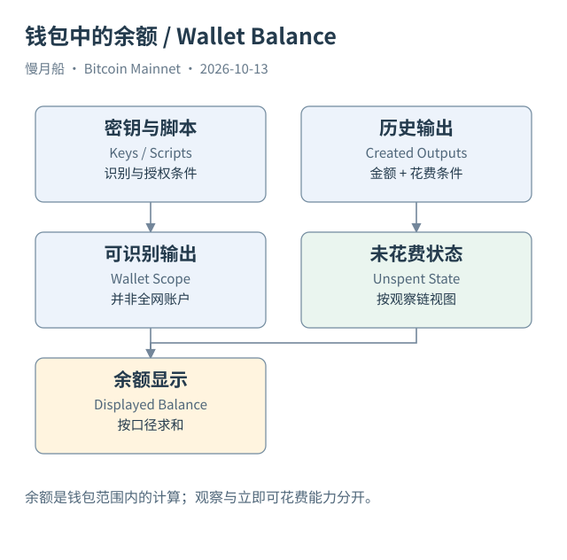
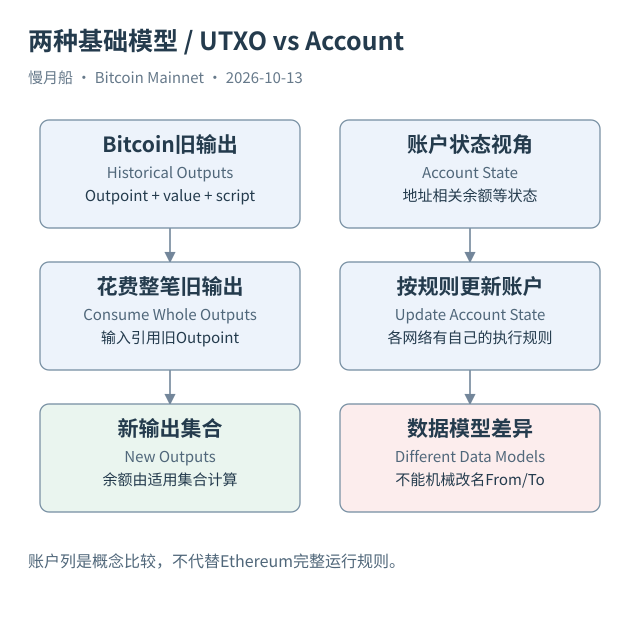

# 01｜钱包显示的 1 BTC，究竟在哪里？

你打开钱包，看见余额是 1 BTC。朋友发来一个收款地址，你准备转给他 0.3 BTC。很自然的想法是：网络找到你的账户，把余额减去 0.3，再给朋友的账户加上同样的数字。理解 Bitcoin 的第一步，就是暂时放下这个想法。

比特币（Bitcoin）的基础账本没有为每个地址维护一个全局余额栏。它保存交易，以及交易产生的输出（Output）。其中尚未被花费的输出，叫未花费交易输出（Unspent Transaction Output，UTXO）。钱包里的数字，通常是软件找到它能够识别、并具备相应花费能力的一组输出后，加总得到的结果。

假设你的 1 BTC 来自三个旧输出，金额分别是 0.2、0.3 和 0.5 BTC。链上保存的是三条输出记录及其花费条件；钱包把它们联系到自己的密钥和脚本，才显示一个容易阅读的余额。另一个钱包如果只导入其中一个地址或描述符，可能只能看见其中一部分。数字不同，不一定意味着网络账本发生了变化。

钱包（Wallet）首先是一套管理密钥、识别脚本、构造交易和观察状态的软件。私钥（Private Key）用来产生必要的签名，并不是装着比特币的文件。公钥（Public Key）和签名可以参与验证花费权限，但不让观察者直接读出私钥。把钱包复制到另一台设备，可能复制的是使用同一组输出的能力，不会凭空复制第二份 BTC。

地址（Address）则是表达某类收款条件的编码。一个钱包可以管理很多地址，一个地址可以收到很多输出。同一个地址反复收到款项时，旧输出不会自动合并成一条记录。因此，钱包、地址、输出和现实中的人，是四个不同的对象。后文做 SQL 时，这个区别会决定我们究竟是在数地址、数交易，还是讨论用户。

显示余额还要看软件采用的口径。已确认、未确认、可立即花费、观察钱包可见、Coinbase 尚未成熟，这些状态可能分开展示。多签钱包看到某笔输出，也未必能够独自完成花费；时间锁可能让有密钥的人仍需等待。将所有可见输出都称为“现在能转走的钱”，会忽略花费条件。

这并不要求你亲自扫描每一笔历史交易。钱包和节点会维护索引及状态，帮助你识别相关输出。本书要做的是看懂这些数字怎样形成：先找到输出，检查它是否仍未花费，再确认它属于当前讨论的脚本范围，最后决定采用哪一种余额口径。

有一个检验理解的小问题：如果朋友再给同一地址转入 0.1 BTC，链上会修改原来的 1 BTC 输出吗？通常不会。新交易创建一笔新输出，钱包将它加入自己的观察集合。真正发生的，是可识别的输出集合改变了，而不是某个账户余额字段被直接改写。

读到这里，你已经有了后续分析的入口。不要先问“谁的账户剩多少”，先问“哪些未花费输出符合这组花费条件”。当我们把这个问题转成数据查询，钱包界面上的简单数字就有了可以逐条复核的来源。

[编辑此图](../../assets/diagrams/wallet.drawio)

[编辑模型比较图](../../assets/diagrams/data-model.drawio)

依据：[wallets](https://developer.bitcoin.org/devguide/wallets.html)；[transactions](https://developer.bitcoin.org/devguide/transactions.html)。研究基准日：2026-10-13。来源获取状态见[来源目录](../../research/source_catalog.md)。

[目录](../../SUMMARY.md) · [下一章](../part-01/02-one-payment.md)

[上一章](../00-preface.md)
