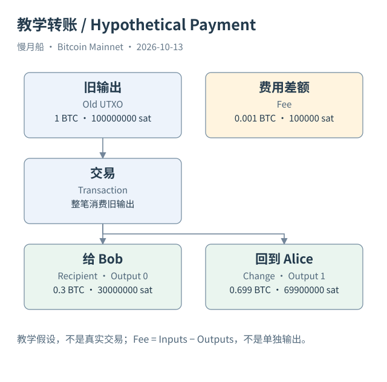
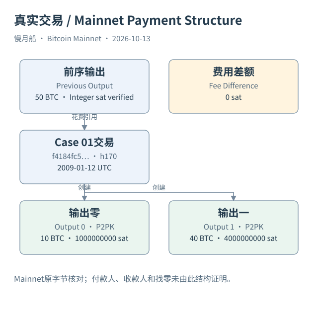

# 02｜为什么转出 0.3 BTC，要花掉整笔 1 BTC？

现在把上一章的余额简化为一笔 1 BTC 的旧输出。你想付给 Bob 0.3 BTC，钱包却准备花掉整笔 1 BTC。听起来像多付了钱，其实只是 Bitcoin 花费旧输出的基本方式：一个输入引用整笔输出，不能把原输出原地切走一小块，再留下同一个输出继续使用。

交易输入（Input）告诉验证者，这次要花费哪笔历史输出，并提供满足相应条件的数据。交易输出则说明这次新创建哪些金额和花费条件。教学交易只有一个输入，金额来自旧输出的 1 BTC；它产生两个新输出，分别是给 Bob 的 0.3 BTC，以及回到 Alice 控制范围的 0.699 BTC。

还剩 0.001 BTC。它是这笔普通交易的手续费（Fee）：输入总额减去输出总额。交易没有另外创建一个“手续费收款输出”，把钱逐笔转给矿工。矿工在区块的 Coinbase 交易里，可以领取该区块适用的补贴和交易费用。这里的 0.001 BTC 只是方便计算的教学数字，不是推荐费率。

找零（Change）是钱包构造交易时安排给自身控制范围的输出。在这个教学例子中，我们事先知道 Output 1 的用途，所以可以明确标注找零。真实链上没有一个通用的 `is_change` 共识字段。看到一笔单输入、双输出交易，只能先确认结构相同，不能立刻认定较大的输出就是找零。

用整数聪（Satoshi，sat）重算一次：旧输出是 100,000,000 sat，Bob 的输出是 30,000,000 sat，找零是 69,900,000 sat，费用是 100,000 sat。三个去向的金额相加与输入金额一致。1 BTC 等于一亿聪；原始交易金额以整数聪表达，钱包展示的小数并不意味着协议使用浮点数记账。

旧输出花费后，历史记录不会被删除。它仍在创建它的旧交易里，只是不能再次作为当前未花费输出使用。新交易生成的两笔输出有各自的新定位。Bob 将来花费 0.3 BTC 时，引用的是这笔新交易中的相应输出，不是追着 Alice 原来的输出再切下一部分。

钱包可能为找零选择一个新地址。这样一来，外部观察者在新交易中未必看到 Alice 原来的地址。这并不表示资产离开了她的控制范围，也不能仅凭地址改变推断换了所有者。钱包内部知道自己的派生路径和脚本，区块浏览器通常只知道公开交易结构。

本篇的 Case 01 保存了一笔真实 Mainnet 单输入双输出交易，供你比较输入引用、两个新金额和费用。它验证的是这种结构确实存在；案例没有收款目的或钱包内部记录，所以没有把其中一个输出强行写成已证实的找零。教学用途与真实证据范围分开，反而更容易看清协议记录了什么。

如果你把两个输出都计入“对外付款”，就会把 Alice 留给自己的金额也算进去。许多链上交易量指标因此需要特别定义。输出总额能回答交易创建了多少输出价值，却不能单独回答普通用户这次真正支付了多少钱。

[编辑此图](../../assets/diagrams/payment.drawio)

[编辑真实案例图](../../assets/diagrams/payment-real.drawio)

依据：[transactions](https://developer.bitcoin.org/devguide/transactions.html)；[tx-reference](https://developer.bitcoin.org/reference/transactions.html)。研究基准日：2026-10-13。来源获取状态见[来源目录](../../research/source_catalog.md)。

[上一章](../part-01/01-wallet-balance.md) · [目录](../../SUMMARY.md) · [下一章](../part-01/03-outpoint.md)
