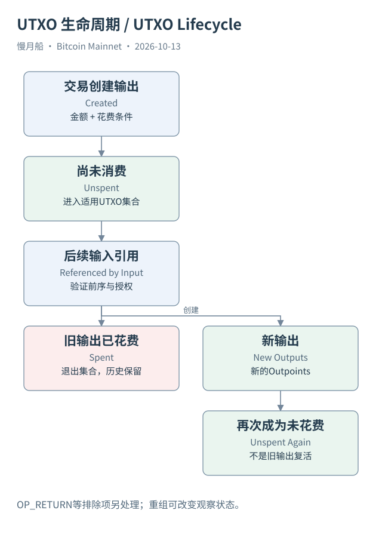

# 04｜旧输出被花掉以后，还留下什么？

把上一笔转账想成一次换票：旧票据整张交回，换成几张新票据。这个比喻有助于理解金额分拆，但票据不是带着永久身份的小硬币。链上能够追踪的是输出如何被创建和引用。旧输出在当前 UTXO 集合中退出，历史交易仍然保留，新输出则拥有新的 Outpoint。

一笔输出出生于创建它的交易。对于可以进入未花费集合的输出，在当前有效链上还没有被后续交易花费时，它处于未花费状态。另一笔普通交易用输入引用它并成功成为有效链历史的一部分，节点就把相应旧输出从集合中移除，同时加入符合条件的新输出。

UTXO 集合（UTXO Set）是节点验证花费的重要状态。节点不必为每一个新输入都从创世区块重新搜索全部交易，再问有没有别人花过它。它直接检查相应输出是否在当前状态里，并取得金额、脚本及有关元数据。这一维护过程常与链状态（Chainstate）联系在一起，但链状态不等于钱包自己的余额缓存。

有些输出不会作为正常可花费 UTXO 保存。例如以 `OP_RETURN` 开始、明显不可花费的输出，Bitcoin Core 可以直接识别并不纳入 UTXO 集合。交易历史仍然包含它。因而，统计所有创建输出的行数，不等于统计当前可花费输出数；统计每天输出数减输入数，也需要考虑这些排除和特殊规则。

Coinbase 输出还存在成熟期。即使它已经是链上未花费输出，也不能立刻按普通输出使用。另一类输出可能受时间锁约束。未花费是一个状态判断，可立即花费还需要检查条件。仅把数据库中“没有花费记录”的行全加起来，无法自动得到某钱包此刻能发送的金额。

未确认交易会让视图更加复杂。节点的 Mempool 可能已经有交易准备花掉某笔输出，确认链的 UTXO 集合却尚未按它更新。钱包可以选择扣除这笔待花费金额，避免再次选币。两个软件显示不同状态时，应先问它们采用已确认视图，还是加入了本地交易池视图。

链重组也能改变生命周期的观察结果。一笔曾被收录的花费交易如果离开当前有效链，对应输出可能重新成为未花费。分析近期数据时，应保存区块哈希和观察链头，允许回滚更新；“曾确认过”与“现在位于有效链”不能永久画等号。

本书使用的历史花费边，是公共 Mainnet 索引在取证时提供的记录。它足以解释真实的输出依赖，但没有假装已经在本地全节点上独立验证所有共识规则。对一笔长期确认的案例，我们仍保存高度和区块哈希，以便复查使用的是哪份历史。

读者可以据此区分四样东西：创建输出的历史表、节点当前维护的 UTXO 集合、钱包认识的相关输出，以及平台计算的历史地址余额。它们彼此有关，却有不同范围与维护方式。下一部分进入交易结构时，我们会继续沿着输入引用和新输出这两条线阅读。

[编辑此图](../../assets/diagrams/utxo.drawio)

依据：[core-coins](https://github.com/bitcoin/bitcoin/blob/v31.0/src/coins.h)；[core-consensus](https://github.com/bitcoin/bitcoin/blob/v31.0/src/consensus/consensus.h)；[blocks](https://developer.bitcoin.org/devguide/block_chain.html)。研究基准日：2026-10-13。来源获取状态见[来源目录](../../research/source_catalog.md)。

[上一章](../part-01/03-outpoint.md) · [目录](../../SUMMARY.md) · [下一章](../part-02/05-transaction-anatomy.md)
