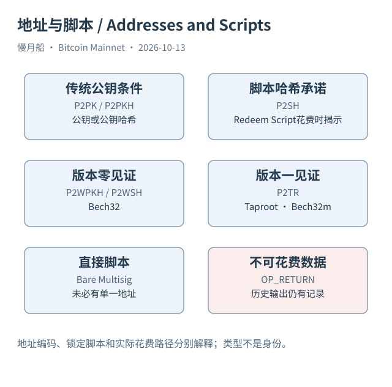

# 08｜为什么地址长得不同，花费方式也不同？

你可能见过以 1、3、bc1q 或 bc1p 开头的 Mainnet 地址。它们看起来像不同格式的账号，其实是在编码不同类别的收款信息。学习地址类型，是为了理解输出承诺了什么、花费时可能公开什么；不是靠几个开头字符就识别钱包主人和交易目的。

P2PK 直接把公钥放入输出脚本，是早期交易中常见的形式。P2PKH 把公钥哈希放入脚本，常用 Base58Check 地址表达。P2SH 则承诺赎回脚本（Redeem Script）的哈希，地址常以 3 开头。创建 P2SH 输出时，外部观察者通常看不到全部内部花费条件，要等实际花费揭示相应脚本。

原生 P2WPKH 是版本零、长度二十字节的见证程序；P2WSH 是版本零、长度三十二字节的程序，承诺见证脚本。两者常采用 Bech32 编码。在嵌套 SegWit 中，外层还可能是 P2SH，因此只看到 3 开头，不能认定它将来必然采用传统非见证方式花费。

P2TR 是版本一、长度三十二字节的 Taproot 见证程序，采用 Bech32m。bc1p 是 Mainnet 上常见的展示形式，但有效识别应解码网络、见证版本、程序长度和校验，不是仅字符串匹配。不同网络可以使用相似结构，查询之前还必须确认是 Bitcoin Mainnet。

裸多签（Bare Multisig）可以在输出脚本中直接表达若干公钥和签名要求。OP_RETURN 则常用于不可花费的数据输出。它们提醒我们：输出的本质是金额和脚本，并非每个输出都必须拥有一个普通用户意义上的收款地址。附录把这些类型并排列出，方便回查。

地址编码、锁定脚本、赎回脚本、见证脚本和实际见证栈不是同一个对象。P2SH 地址表达一份哈希承诺，花费时可能揭示一个多签脚本；P2TR 输出承诺一个输出公钥，实际花费可能走密钥路径，也可能揭示特定脚本路径。创建时看见的信息与花费后看见的信息会改变。

同一种脚本类型也可以用于很多业务。交易所、个人和合作协议都可能使用 Taproot；采用多签并不自动意味着交易所冷钱包。地址类型统计适合描述技术采用情况，不能直接转成用户画像或资产归属。后文的 SQL 08 按输出脚本分类，指标标题会明确统计的是输出行数。

本篇真实样本包含传统、见证与 Taproot 花费，脚本类型取自公共索引的解析结果，必要时再与原始脚本字节比较。类型标签是解析产物，原字节是回查依据。如果平台使用不同名称，应建立明确映射，而不是把名字不一致当成协议发生分叉。

把地址看成收款条件的可读编码后，许多误解自然消失：新地址不必代表新人，旧地址重复使用不会自动合并输出，地址为空也不必代表无价值。接下来讨论时间锁和多签时，我们会继续追问条件如何影响未来花费，而不是只看地址的外观。

[编辑此图](../../assets/diagrams/address-types.drawio)

依据：[bip16](https://github.com/bitcoin/bips/blob/master/bip-0016.mediawiki)；[bip173](https://github.com/bitcoin/bips/blob/master/bip-0173.mediawiki)；[bip350](https://github.com/bitcoin/bips/blob/master/bip-0350.mediawiki)；[bip341](https://github.com/bitcoin/bips/blob/master/bip-0341.mediawiki)。研究基准日：2026-10-13。来源获取状态见[来源目录](../../research/source_catalog.md)。

[上一章](../part-02/07-signatures-and-scripts.md) · [目录](../../SUMMARY.md) · [下一章](../part-03/09-multisig-and-timelocks.md)
