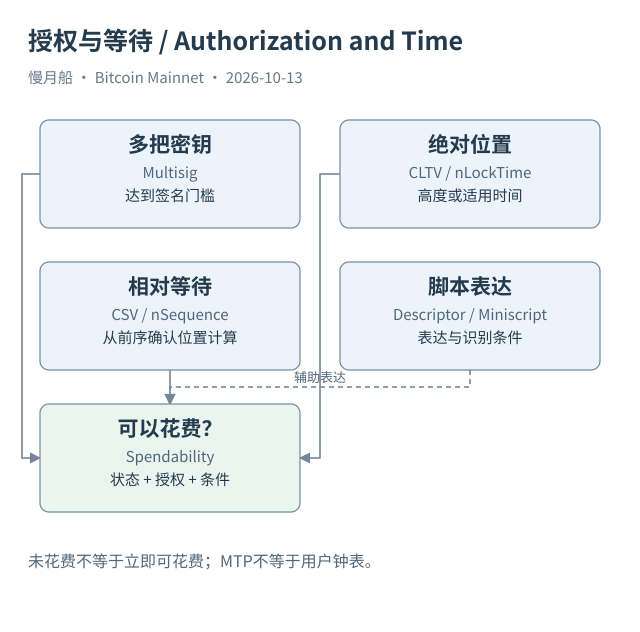

# 09｜有了私钥，为什么仍可能暂时花不了？

一家公司把储备金锁进需要三把钥匙中两把签名的条件里。财务人员拿着其中一把私钥，钱包可以看见输出，却不能独自转走。另一笔输出要求等待一段时间，即使签名完全正确，也可能还没到花费条件允许的位置。余额和权限，从这一刻开始不能只用一个数字表示。

多重签名（Multisig）把授权分散给多个密钥。传统脚本可以明确列出公钥及门槛，也可以把复杂脚本隐藏在哈希承诺后，花费时再揭示。多个密钥不必对应多名自然人；一家公司也可以管理多把钥匙。因此，脚本结构能说明授权条件，却不能单独证明内部审批制度怎样执行。

绝对锁定时间（Absolute Locktime）限制交易在指定高度或时间条件前不能被收录。交易级 nLockTime 是否生效还与输入 sequence 有关，不能只读一个非零字段就认定等待规则已经完整启用。脚本中的 CHECKLOCKTIMEVERIFY，简称 CLTV，允许输出条件要求花费交易满足相应锁定限制。

相对锁定时间（Relative Locktime）则以被花费输出的确认位置为起点。BIP68 对适用版本和 sequence 位定义相对限制，CHECKSEQUENCEVERIFY，简称 CSV，可以把相关要求加入脚本。按区块数等待和按时间单位等待并不是同一口径；时间模式还涉及中位时间和规定的单位粒度。

中位过去时间（Median Time Past，MTP）取有关历史区块时间的中位值，用于适用规则中的时间判断。它不是用户电脑的当前钟表，也不是钱包按下发送键的时间。分析“多久后能花费”时，要明确是高度条件、MTP 条件还是软件预计的现实时间，否则界面里的倒计时会被误写成共识事实。

这些条件解释了为什么某些未花费输出并非立即可用。钱包也许知道自己的密钥，却还需要其他签名、尚未揭示的脚本或等待位置。UTXO 查询通常先回答输出有没有被消费；要回答当前是否能构造有效花费，还必须进一步分析授权与时间条件。

输出描述符（Output Descriptor）提供一种表达和识别脚本的方法，可以把公钥来源、派生范围及脚本模板联系起来。它适合钱包导入和跟踪，却不是新增加到每笔原始交易里的共识字段。Core 返回的推断描述符与钱包自己保留的完整派生信息也可能不同，不应混为同一份身份证据。

Miniscript 帮助以较结构化的方式表达和分析某些脚本策略。它不是让 Bitcoin 自动获得 EVM 式的全局账户状态，也不把所有复杂脚本变成公开的业务合同。对链上研究者，重要的是知道哪些条件当前可见、哪些在花费前只以承诺存在，以及实际执行走了哪条路径。

如果浏览器写“多签钱包”，就继续查看这句话依据的是已揭示脚本还是外部标签。如果只是看见一个 P2SH 地址，完整条件可能仍未知。技术解释应在这里停在可观察范围；公司名字、审批人数和受益人归属，需要另外保存来源。

[编辑此图](../../assets/diagrams/timelocks.drawio)

依据：[bip65](https://github.com/bitcoin/bips/blob/master/bip-0065.mediawiki)；[bip68](https://github.com/bitcoin/bips/blob/master/bip-0068.mediawiki)；[bip112](https://github.com/bitcoin/bips/blob/master/bip-0112.mediawiki)；[bip113](https://github.com/bitcoin/bips/blob/master/bip-0113.mediawiki)；[bip380](https://github.com/bitcoin/bips/blob/master/bip-0380.mediawiki)。研究基准日：2026-10-13。来源获取状态见[来源目录](../../research/source_catalog.md)。

[上一章](../part-02/08-addresses-and-conditions.md) · [目录](../../SUMMARY.md) · [下一章](../part-03/10-block-anatomy.md)
