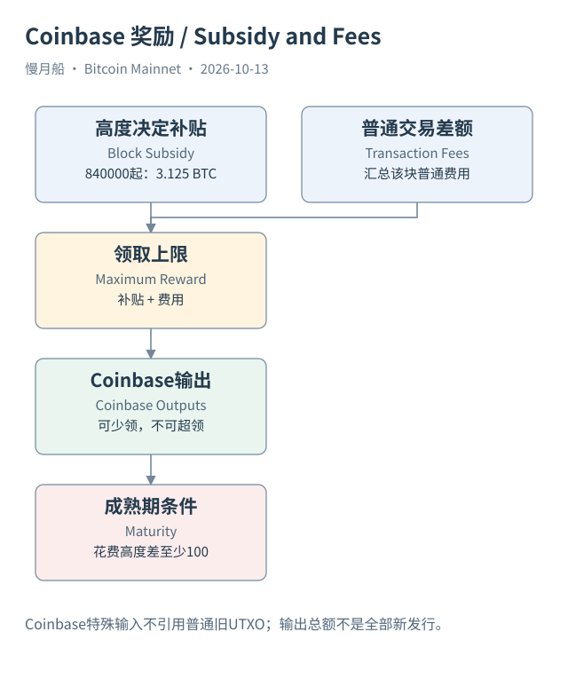

# 12｜矿工新得到的 BTC，为什么不是普通转账？

每笔普通交易都要引用旧输出，那么最初用于花费的价值又从哪里来？区块第一笔 Coinbase 交易给这个问题提供特殊入口。这里的 Coinbase 是协议术语，与同名交易所不是一回事。它允许矿工按规则领取补贴及费用，而不需要像普通交易一样引用已有 UTXO 提供全部金额。

区块补贴（Block Subsidy）是符合高度规则的新发行金额。交易费则来自普通交易输入总额与输出总额的差额。矿工能领取的上限，是适用补贴加该区块交易费；矿工并非必须把全部上限都领走。Coinbase 输出总额因此应与上限比较，不能一律把它叫“这块新发行的 BTC”。

Mainnet 补贴按每 210000 个区块减半。高度 840000 开始进入 2024 年减半后的 3.125 BTC 补贴阶段。日期是达到该高度的现实时间，规则触发依据则是区块高度。不要按某个日历周年直接推断未来减半已经发生，也不要将每块总奖励误写成固定 3.125 BTC。

Case 06 是高度 840000 的真实 Coinbase。它有特殊输入与多个输出，包括见证承诺相关的不可花费输出。API 给出的输出总额可用整数聪求和，再与该高度补贴比较；差额涉及费用领取。若没有取得完整区块全部普通交易，就不能声称已经独立重算了这块每一笔手续费。

Coinbase 输入中的数据可以包含区块高度及矿工选择的其他内容，但不是一条普通前序输出引用。数据平台可能给它填入特殊值或空值。SQL 连接输入与旧输出前，应先排除 Coinbase；不能把空前序字段解释为数据损坏，再用想象中的转出账户补上。

Coinbase 输出还有一百个区块的成熟期规则。它产生时可以是未花费输出，但不能立刻当作普通可用零钱。精确判断需比较花费所在高度与创建高度；界面显示确认数的习惯与协议高度差可能让口头说法相差一格，最可靠的是检查具体条件和节点验证结果。

常说的二千一百万供应上限，来自补贴序列按整数聪递减形成的约束。它不等于当前全部金额都能流通。未领取奖励、创世块奖励的特殊处理、明显不可花费输出，以及可能丢失的密钥，都会影响各种“可用供应”指标，其中密钥是否丢失往往不能仅凭长期未花费证明。

把多年不动的输出称为休眠，是对观察历史的描述。称它已经丢失，需要额外依据；称它未来永远不可能被花费，更需要检查脚本和规则。发行上限、当前 UTXO 总金额、钱包可花费余额和市场流通估计，不能只用一个总数相互替代。

后文 SQL 10 将把 `mint_reward`、`total_fees` 和 `total_reward` 的平台口径分开，并将 Coinbase 输出作为独立对象观察。学会区分补贴和费用后，你就不会因为区块奖励突然增加，误以为协议违背了减半发行规则。

[编辑此图](../../assets/diagrams/coinbase.drawio)

依据：[bip34](https://github.com/bitcoin/bips/blob/master/bip-0034.mediawiki)；[core-consensus](https://github.com/bitcoin/bitcoin/blob/v31.0/src/consensus/consensus.h)；[rpc-getblockstats](https://bitcoincore.org/en/doc/31.0.0/rpc/blockchain/getblockstats/)。研究基准日：2026-10-13。来源获取状态见[来源目录](../../research/source_catalog.md)。

[上一章](../part-03/11-proof-of-work.md) · [目录](../../SUMMARY.md) · [下一章](../part-04/13-fees-and-units.md)
