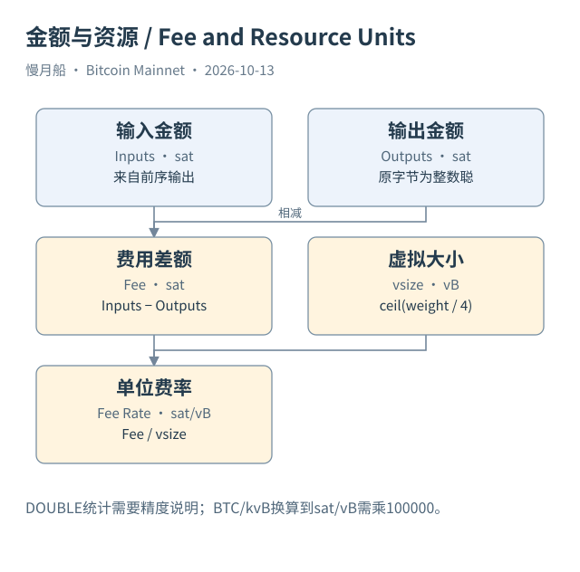

# 13｜为什么转账金额小，手续费却可能更高？

你付给朋友 0.01 BTC，手续费却比上次转 1 BTC 更高。原因常常不在金额本身，而在这次交易需要占用多少区块资源，以及当时的竞争状况。用很多小输出拼成一次付款，可能比花费一个大输出产生更多输入，交易也可能更大。

普通交易的费用，是输入金额总和减输出金额总和。费用并非一个另行设置的共识 Gas 字段，也不是交易金额固定百分比。钱包通过选币、输出安排与费率估计构造这一差额；验证者根据被引用的旧输出与新输出金额计算它。

SegWit 使用交易重量（Transaction Weight）计量资源：基础大小乘三，再加完整大小，单位是 Weight Unit。等价地，非见证部分获得四倍计量，见证部分按相应规则计量。虚拟大小（Virtual Size，vsize）是重量除以四后向上取整，单位为 vByte，不应直接拿原始完整字节数替代。

费率（Fee Rate）常写为 sat/vB：手续费整数聪除以虚拟大小。假设一笔交易费用 1400 sat、虚拟大小 140 vB，费率是 10 sat/vB。若误把 0.000014 BTC 直接除以 140 再标为 sat/vB，结果将错一亿倍。单位必须跟在数字和计算式旁边。

钱包估计费用时，需要对可能进入新区块的交易竞争作判断。同样大小的交易，在交易池拥挤程度不同的时刻可能采用不同费率。估计也不保证具体收录时间：矿工选择、交易依赖、节点视图和未来新增交易都可能改变结果。

Core 的 `estimatesmartfee` 返回费率时采用 BTC/kvB，并可能返回错误信息或实际估计目标。把它用于钱包展示，需要明确转换到 sat/vB 的规则；一 BTC/kvB 相当于十万 sat/vB。教学请求显式指定估计模式，避免读者把某个历史版本的默认值当作长期不变行为。

本篇 Case 01 的费用为零，说明早期真实交易与今天常见钱包体验不同。Case 04 可以用前序输出整数金额减新输出金额，并用解码得到的虚拟大小计算费率。案例不是当下网络费率推荐，也不能拿历史零费交易证明今天所有节点愿意转发零费交易。

Dune 的金额字段使用 DOUBLE 时，适合在明确近似口径下做统计。若要核对某一笔精确费用，本书优先用 API 的整数聪及原始输出字节。先对每行转换并舍入，通常比先聚合巨大浮点总额再舍入更容易控制误差，但转换仍需与整数来源检查，不能因此宣称天然审计级精确。

当你看见“平均手续费下降”，还应问是 BTC/交易、sat/vB 中位数，还是按 vsize 加权的费率。它们回答不同问题。一个时期交易结构更简单，可以降低每笔费用；即使网络资源单价没有同步下降，钱包体验也可能改变。

还有一个常见混淆：手续费总额更高不代表费率更高。一个很大的整合交易可能总费更多，却每虚拟字节付得较少。比较两笔交易前，先把费用总额与资源单价分别列出来。

[编辑此图](../../assets/diagrams/fees.drawio)

依据：[bip141](https://github.com/bitcoin/bips/blob/master/bip-0141.mediawiki)；[rpc-estimatesmartfee](https://bitcoincore.org/en/doc/31.0.0/rpc/util/estimatesmartfee/)；[tx-reference](https://developer.bitcoin.org/reference/transactions.html)。研究基准日：2026-10-13。来源获取状态见[来源目录](../../research/source_catalog.md)。

[上一章](../part-03/12-coinbase-and-halving.md) · [目录](../../SUMMARY.md) · [下一章](../part-04/14-mempool-and-policy.md)
