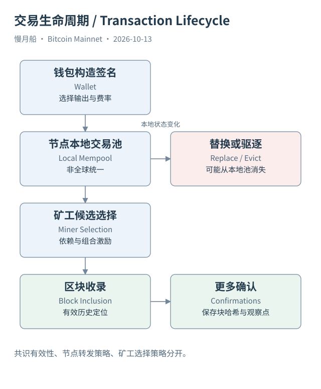

# 14｜未确认交易究竟存在哪个地方？

你广播交易后，浏览器说正在等待确认。另一个浏览器却暂时搜不到它。这不一定说明交易不存在，也不一定意味着网络出现了一张被篡改的统一待处理表。内存交易池（Mempool）是各节点自己的未确认交易集合，节点看到的内容可以不同。

交易通过点对点网络（Peer-to-peer Network）传播。一个节点收到交易，会检查它是否符合适用的共识约束以及本地接收和转发策略。能进入某节点的 Mempool，不表示已经写入区块；暂时没有被某节点接收，也不能直接证明其他节点或矿工都没有见过它。

共识规则（Consensus Rule）决定区块内容是否有效。标准性和转发策略（Standardness / Relay Policy）控制节点默认愿意接受和传播什么。矿工的选择策略决定候选区块中优先安排哪些交易。这三层有关联，却不是同一套永久不变的限制。

Dust 是一个典型例子。某些很小的可花费输出，在常见费率条件下使用成本不划算，节点策略会按脚本类型和政策费率计算相关阈值。它不是统一写在协议中、适用于所有输出和所有版本的固定最低付款金额。Core 29 又引入特定包条件下的临时 Dust 策略，旧教程不能覆盖全部新行为。

交易也会依赖尚未确认的父交易。子交易引用父交易创建的输出，父交易先需要成为有效历史，子交易才可能按顺序被纳入。同一节点会跟踪这些依赖，用于接受、替换、驱逐及候选区块构造。看单笔费率时，若忽略依赖，会漏掉组合的激励关系。

本轮核对到的 Core 31.0 发布说明介绍了 cluster mempool。默认策略以连通交易簇的数量和虚拟大小约束代替旧的祖先、后代数量与大小限制，并用 chunk 排序等方式处理选择。这里说的是明确软件版本的默认策略，不是所有矿工和全部节点必须同步采用的共识规则。

Mempool 里的交易可能被替换、驱逐、确认或因冲突而消失。节点重启与本地容量也会影响观察。记录一笔未确认交易的案例时，应保存节点来源、取得时间、首次看见口径和替换关系。仅保存 TxID 而没有时间与状态，很难解释日后为何搜不到同样的页面。

本书不伪造实时交易池样本，也不为取得样本自动启动全节点。RPC 教学文件提供 `getrawmempool` 和 `getmempoolentry` 的只读请求及版本化说明，并明确没有实际返回。公共历史区块案例属于已确认数据，不能借用它们冒充曾经完整看到的 Mempool 过程。

对 SQL 分析师，最实用的界线是把确认表与交易池快照分开。Dune 的四张基础表描述索引的确认历史，不应该默认拥有用户广播时间、每个节点的排队过程或每次替换事件。要研究这些问题，需要另外取得有明确节点与时间口径的数据。

[编辑此图](../../assets/diagrams/lifecycle.drawio)

依据：[p2p](https://developer.bitcoin.org/devguide/p2p_network.html)；[core28](https://bitcoincore.org/en/releases/28.0/)；[core29](https://bitcoincore.org/en/releases/29.0/)；[core31](https://bitcoincore.org/en/releases/31.0/)。研究基准日：2026-10-13。来源获取状态见[来源目录](../../research/source_catalog.md)。

[上一章](../part-04/13-fees-and-units.md) · [目录](../../SUMMARY.md) · [下一章](../part-04/15-rbf-and-cpfp.md)
