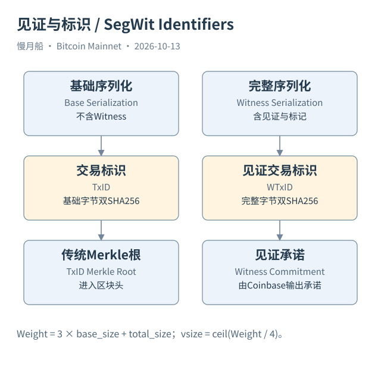

# 16｜见证移到哪里去了，为什么还有两种交易标识？

你查看一笔 SegWit 交易，scriptSig 可能很短甚至为空，见证栈却有签名和公钥。它不是省掉了授权验证，而是把适用花费结构中的证明数据放进另一部分。隔离见证（Segregated Witness，SegWit）让交易字节、标识和区块资源计量之间的关系发生了重要变化。

见证（Witness）按输入组织成数据栈。P2WPKH 通常需要签名和公钥，P2WSH 则涉及见证脚本及其所需数据。输入指向的输出类型决定怎样解释这些数据；不能看见 Witness 非空，就认定它一定是 Taproot 或某个附加资产协议。

基础序列化保留旧格式所需的交易结构，用它计算 TxID。完整见证序列化还包含见证数据，用它计算 WTxID。这样，适用见证数据的变化不会直接进入 TxID 哈希范围。这对依赖前序 TxID 的交易构造尤其重要，但分析时仍应检查全部输入类型和具体签名条件。

交易 Weight 和 vsize 用来表达新的计量。完整交易的 `size` 与 `virtual_size` 常不相同，不能把两个数字都标成“字节”而不解释。Dune 交易表提供 size 与 virtual_size，本轮 Catalog 没有交易级原生 weight 列；要计算 Weight，应从原始字节或另一个可靠来源取得必要结构。

区块头继续承诺 TxID Merkle 根。SegWit 通过 Coinbase 中的见证承诺连接见证树与区块内容。两个承诺解决不同的结构问题，不应该把 Witness 原文直接画在传统 TxID 树叶子中，更不能因为普通头部没有增加一个 witness_root 字段，就误以为见证没有受到区块承诺。

Mainnet 的 SegWit 激活应结合部署与历史高度判断。BIP141 描述规则，不是因为 GitHub 文档存在就自动让所有网络同时应用。本篇使用高度 481824 附近资料解释激活历史，并另取长期确认的见证花费作为字节案例，避免将“处于激活块”与“每笔交易都使用见证”混淆。

Case 04 的解码结果保存基础大小、完整大小、Weight、vsize、TxID 和 WTxID。原始字节与 API 记录互相核对，构成一个读者可以离线复算的小例子。复算哈希是结构校验；它没有证明本地已完整验证脚本、区块 PoW 和整个历史链。

对网络采用率统计，分母也需说明。按花费交易中是否有 Witness 统计，与按新输出是否采用见证脚本统计，是两种指标。一笔交易可以混合不同输入或输出类型。把二者都命名为“SegWit 用户比例”，不仅遗漏混合结构，也把地址或交易误变成了用户。

SegWit 帮助我们看懂一个重要原则：升级会改变观察数据的组织方式，但输入引用旧输出、交易创建新输出的主线仍在。下一部分进入 Taproot 时，我们继续沿这条主线问：输出先承诺了什么，花费后又揭示了什么。

同一区块里的两笔见证交易也可能具有不同的大小折扣，因为输入类型和证明材料不同。采用见证不是给所有交易统一减半，而是让适用字节按重量规则进入计量。

[编辑此图](../../assets/diagrams/segwit.drawio)

依据：[bip141](https://github.com/bitcoin/bips/blob/master/bip-0141.mediawiki)；[bip143](https://github.com/bitcoin/bips/blob/master/bip-0143.mediawiki)；[bip144](https://github.com/bitcoin/bips/blob/master/bip-0144.mediawiki)。研究基准日：2026-10-13。来源获取状态见[来源目录](../../research/source_catalog.md)。

[上一章](../part-04/15-rbf-and-cpfp.md) · [目录](../../SUMMARY.md) · [下一章](../part-05/17-taproot-paths.md)
