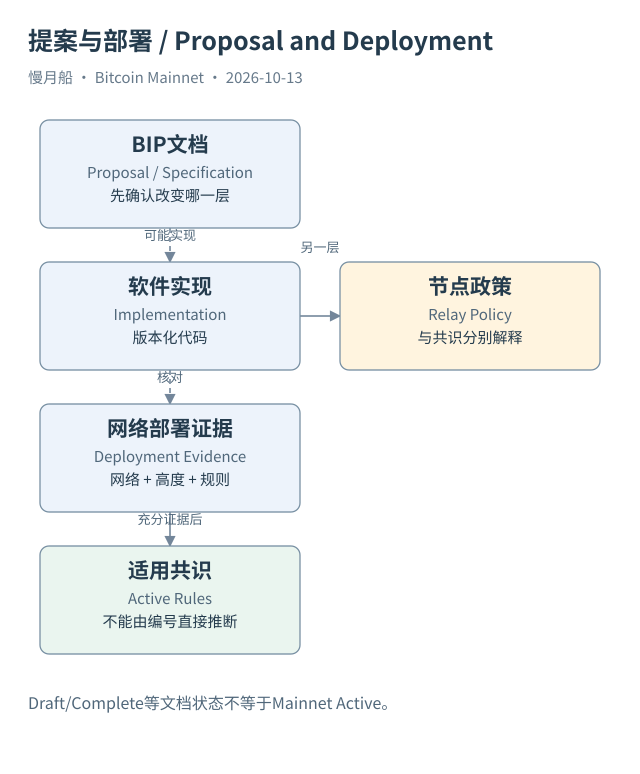

# 18｜有了 BIP 编号，就已经能在主网使用吗？

你读到一篇新闻，说某个新操作码可以让 Bitcoin 实现更复杂的合约。打开 GitHub，发现它已经有 BIP 编号和详细规范，于是准备把它写成当前主网规则。这一步需要停下来：提案、文档状态、软件实现和网络激活，是四件不同的事情。

Bitcoin 改进提案（Bitcoin Improvement Proposal，BIP）提供公开讨论和规范表达。文档可能是 Draft、Proposed、Complete 或其他状态，但这些词的含义要按对应分类理解。完成规范不等于全网已经接受，更不等于所有旧节点都立刻改变花费验证。

有些 BIP 描述共识变化，有些描述钱包编码、应用接口或节点策略。Bech32 编码和某种主网软分叉不是同一类动作。研究时先问这份提案改变哪一层，再查实现与部署依据，才能知道它是否影响本书正在解读的历史交易。

限制未来花费结构的设想常被放在契约（Covenants）讨论中。CTV、APO、OP_CAT 等名称出现在不同技术讨论里，涉及的操作、签名承诺和部署条件不相同。它们不能因为都被称作“提高脚本表达力”，就被合并成一份已经启用的 Bitcoin 智能合约标准。

本篇核对提案原文，并以 Core v31.0 Mainnet 参数与脚本实现作为当前解释的一个明确基准。对于没有取得充分激活证据的新提案，不把它用于解释案例已经发生的共识执行，也不凭猜测指定未来激活日期。研究目录保留待验证项目，书稿可以准确介绍讨论对象而不冒充运行事实。

软分叉（Soft Fork）部署还涉及节点与矿工如何识别并执行新增约束。具体历史必须依照对应提案的机制、网络和实际位置核对，不能把某次升级经验套用到全部 BIP。测试网出现功能，也不足以证明 Bitcoin Mainnet 已经相同激活。

一个很实用的编辑检查，是把句子里的动词分开：“提出”“实现”“默认转发”“已经激活”分别需要不同证据。新闻说开发者完成实现，只支持实现层判断；节点愿意转发某种交易，涉及策略；有效区块必须满足某条限制，才是在谈适用共识规则。

历史案例也要按发生时的规则解释。不能拿今天某版本的地址标签和策略，反过来宣称十年前的节点已经采用同样规则。版本化资料、区块高度、网络名称和规则来源一起保存，能让读者看见技术演进，而不是把全部年份压成一个模糊的“现在”。

本书的核心不是预测下一次升级，而是读懂已经取得的数据。新提案可帮助你理解设计空间，却不应该压过 UTXO、输入引用和输出花费条件这条主线。遇到没有证据支持的激活判断，明确留下空白，就是技术写作的一部分。

把一个新功能写进教学实验时，最好同时注明实验网络与节点版本。某个本地测试链能够接受，并不会改写已经确认的主网历史；读者因此也能区分实验结果与协议运行事实。

[编辑此图](../../assets/diagrams/proposal.drawio)

依据：[bip119](https://github.com/bitcoin/bips/blob/master/bip-0119.mediawiki)；[bip118](https://github.com/bitcoin/bips/blob/master/bip-0118.mediawiki)；[bip347](https://github.com/bitcoin/bips/blob/master/bip-0347.mediawiki)；[core-chainparams](https://github.com/bitcoin/bitcoin/blob/v31.0/src/kernel/chainparams.cpp)。研究基准日：2026-10-13。来源获取状态见[来源目录](../../research/source_catalog.md)。

[上一章](../part-05/17-taproot-paths.md) · [目录](../../SUMMARY.md) · [下一章](../part-05/19-dune-data-map.md)
